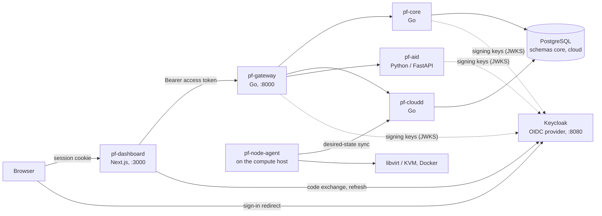

# ParallelF

Integrated cloud infrastructure and network security platform.

ParallelF is a self-hosted platform that will combine a miniature cloud, a WireGuard VPN with a custom control plane, network monitoring and defensive security, an isolated game-security research lab, and a read-only AI investigation assistant, all managed from one dashboard. It is designed to run on a single 16 GB workstation.

[](https://github.com/commonvtake/ParallelF/actions/workflows/ci.yml)

## Status: Phase 2, ParallelF Cloud

The platform foundation and the first subsystem, ParallelF Cloud, are in place. The remaining subsystems are not built yet, and the dashboard says so on each of their pages.

| Area | State |
|---|---|
| Sign-in through an OpenID Connect provider (Keycloak), roles and permissions | Working |
| API gateway: token verification, routing, aggregated platform status | Working |
| `pf-core` (Go): caller profile, projects, transactional event outbox on PostgreSQL | Working |
| `pf-aid` (Python/FastAPI): service foundation with an authenticated capability listing | Working (no AI features) |
| ParallelF Cloud: KVM VMs and Docker containers on a registered host, scheduling, quotas, NAT/isolated/lab networks, metrics, audit log ([guide](docs/cloud.md)) | Working on one host |
| Dashboard: Overview (live status), Cloud, and Settings (profile, roles, projects, session) | Working |
| Dashboard: VPN, Network Monitoring, Security Lab, AI Investigator | Not implemented; labelled as such |
| Event bus (NATS JetStream), MFA policy, platform-wide audit log, observability stack | Not implemented; see the [roadmap](docs/architecture/10-roadmap-and-acceptance-criteria.md) |

## What runs locally



Every service verifies the access token itself; the gateway is not a trusted hop. The browser never receives a token: the dashboard server keeps tokens in a server-side session and gives the browser an HttpOnly cookie.

## Quick start

You need Docker Engine with the Compose plugin, GNU Make, curl and about 3 GB of free memory. On Windows, work inside WSL2 and clone the repository into the Linux filesystem.

```sh
git clone https://github.com/commonvtake/ParallelF.git
cd ParallelF
make up        # creates .env with generated secrets, builds, starts, waits until ready
make verify    # smoke test: identity provider -> gateway -> services -> database
```

To run workloads, turn this machine into a compute host (Linux with KVM; see the [Cloud guide](docs/cloud.md)):

```sh
make cloud-host-setup   # KVM, libvirt, QEMU (sudo, once)
make agent-install      # the node agent under systemd (sudo)
make verify-cloud       # one VM: create, run, ping, stop, start, delete
```

Then open <http://localhost:3000> and sign in as `owner` (full access) or `viewer` (read-only). Their generated passwords are `PF_DEV_OWNER_PASSWORD` and `PF_DEV_VIEWER_PASSWORD` in `.env`.

| URL | What |
|---|---|
| <http://localhost:3000> | Dashboard |
| <http://localhost:8000> | API gateway ([OpenAPI contract](api/openapi/parallelf.v1.yaml)) |
| <http://localhost:8080> | Keycloak admin console (user `admin`, password `KC_BOOTSTRAP_ADMIN_PASSWORD` in `.env`) |

`make down` stops the stack and keeps its data; `make clean` also deletes the data. `make help` lists every task.

The first `make up` downloads base images and builds five images, which takes several minutes. All ports are published on `127.0.0.1` only.

## Repository layout

| Path | Contents |
|---|---|
| `api/openapi/` | HTTP API contract (OpenAPI 3.1), the source of the dashboard's types |
| `api/proto/`, `api/events/` | Versioned event schemas (Protobuf) and the event envelope |
| `pkg/` | Shared Go packages: configuration, logging, HTTP building blocks, authentication, authorization, IDs |
| `services/core/` | `pf-core` (Go) and its SQL migrations |
| `services/cloud/` | `pf-cloudd` (Go): cloud API, scheduler, store and migrations |
| `services/node-agent/` | `pf-node-agent` (Go, standard library only): runs on compute hosts, drives libvirt and Docker |
| `services/gateway/` | `pf-gateway` (Go) |
| `services/ai/` | `pf-aid` (Python, FastAPI) |
| `python/pf_common/` | Shared Python package: settings, logging, authentication, FastAPI application factory |
| `web/dashboard/` | Dashboard (Next.js, React, TypeScript) and its Playwright tests |
| `deploy/` | Compose stack, Dockerfile for Go services, PostgreSQL roles, Keycloak realm, the agent's systemd unit |
| `tests/integration/` | API tests that run against the live stack |
| `scripts/dev/` | Environment generation, readiness wait, token and smoke-test scripts |
| `docs/` | [Developer guide](docs/dev-setup.md), [architecture](docs/architecture/README.md), [decision records](docs/adr/README.md) |

## Development

The [developer guide](docs/dev-setup.md) covers the toolchain, configuration reference, how sign-in works, adding an endpoint or migration, logging, and troubleshooting.

```sh
make setup             # install Python and dashboard dependencies
make lint              # Go, Python, TypeScript and contract linters
make test              # unit tests: Go, Python, dashboard
make test-integration  # API tests against the running stack
make test-e2e          # browser tests against the running stack
```

Continuous integration runs the same commands on every pull request, including a job that builds the images, starts the Compose stack and runs the smoke, integration and browser tests against it.

## Security notes for the local stack

- The Keycloak realm in `deploy/keycloak/realm/` is for local development. It contains two test users and a public client (`parallelf-dev-cli`) with the password grant enabled so scripts can obtain tokens. Neither belongs in a real deployment.
- Keycloak runs in development mode over plain HTTP with an embedded database, and the realm is re-imported whenever its container is recreated.
- Secrets are generated into `.env`, which git ignores. Nothing in the repository is a usable credential.

## Scope and ethics

All security work is limited to networks and software owned by the project author, under the [rules of engagement](docs/security/rules-of-engagement.md). The project builds defences. It does not build anti-cheat bypasses, stealth tooling, or capabilities aimed at third-party systems.
