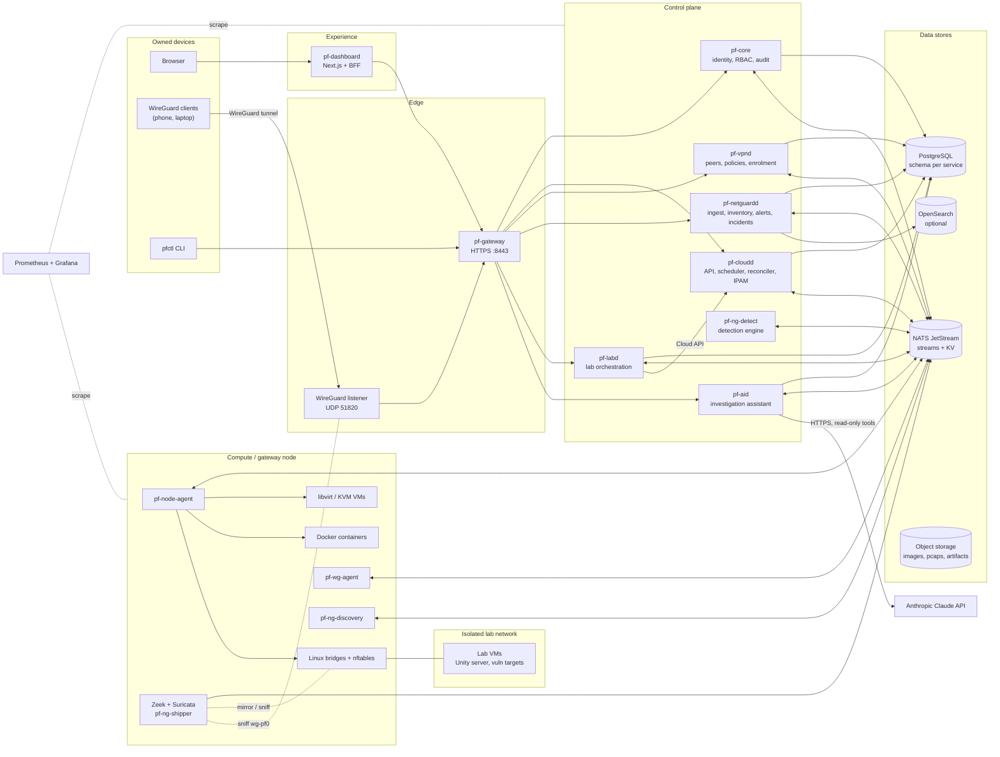

# 01 — High-Level System Architecture

## 1. One-paragraph summary

ParallelF is a self-hosted platform made of six product subsystems: **Cloud**, **VPN**, **NetGuard**, **Security Lab**, **AI**, and **Dashboard**. They sit on a shared **Platform Core** that provides identity, RBAC, the API gateway, audit, the event backbone and observability. Control-plane services written in Go and Python keep desired state in **PostgreSQL** and announce changes over **NATS JetStream**. Privileged **agents** on each node (the compute agent, the WireGuard agent and the sensors) pull desired state and reconcile the host to match it. The Cloud's virtual networks and the VPN interface are monitored by NetGuard. The Security Lab runs inside isolated Cloud networks. The AI assistant reads NetGuard's verified evidence through a strictly read-only tool layer. Users reach everything through the Dashboard or `pfctl`, and in production-like mode they reach it **only through the VPN**.

## 2. Planes

| Plane | Responsibility | Components |
|---|---|---|
| **Edge** | The only externally reachable surfaces | WireGuard UDP listener (`pf-wg-agent` host), `pf-gateway` (HTTPS, VPN-only in prod) |
| **Experience** | Human and automation interfaces | `pf-dashboard` (Next.js + BFF), `pfctl` CLI |
| **Control** | APIs, desired state, scheduling, policy, detection, investigations | `pf-core`, `pf-cloudd`, `pf-vpnd`, `pf-netguardd`, `pf-ng-detect`, `pf-labd`, `pf-aid` |
| **Data** | Durable state, events, search, blobs | PostgreSQL, NATS JetStream (streams + KV), OpenSearch (optional), object storage (local dir / MinIO / S3) |
| **Node (data plane)** | Executes on hosts with privileges | `pf-node-agent` (libvirt/KVM, Docker, bridges, nftables), `pf-wg-agent` (WireGuard, nftables), sensors (Zeek, Suricata, `pf-ng-shipper`, `pf-ng-discovery`, optional `pf-ng-probe`) |
| **Observability** | Metrics, logs, traces, dashboards | Prometheus, Grafana, OpenTelemetry SDKs (optional OTel Collector + Tempo/Jaeger) |
| **Isolated lab** | Untrusted research workloads | Lab VMs on `lab`-type networks with no routes out |

## 3. System context diagram

## 4. Component catalogue

| Component | Lang | Kind | Owns | Runs as |
|---|---|---|---|---|
| `pf-gateway` | Go | Stateless edge | Routing, JWT verification, rate limiting, request IDs, SSE fan-out | Container / k8s Deployment |
| `pf-core` | Go | Control | `core` and `audit` schemas: users, MFA, sessions, projects, role bindings, service accounts, API tokens, JWKS, audit chain | Container |
| `pf-cloudd` | Go | Control | `cloud` schema: nodes, images, flavors, workloads, networks, IPAM, volumes, operations | Container (leader-elected) |
| `pf-node-agent` | Go | Agent | Host libvirt domains, Docker containers, bridges, CNI wiring, nftables (cloud tables) | **systemd on host** (root, needs `/dev/kvm`) |
| `pf-vpnd` | Go | Control | `vpn` schema: gateways, devices/peers, groups, policies, enrolment, peer stats | Container |
| `pf-wg-agent` | Go | Agent | WireGuard interface `wg-pf0`, nftables (vpn tables), peer stats sampling | **systemd on gateway host** (`CAP_NET_ADMIN`) |
| `pf-netguardd` | Go | Control | `netguard` schema: scopes, sensors, assets, topology, flows, alerts, incidents, evidence | Container |
| `pf-ng-shipper` | Go | Agent | Tails Zeek/Suricata JSON, normalizes, publishes telemetry | Sidecar next to sensors |
| `pf-ng-discovery` | Go | Agent | ARP/ICMP/TCP-connect discovery inside **signed** authorized scopes only | systemd (`CAP_NET_RAW`) |
| `pf-ng-detect` | Python | Worker | Detection rules + anomaly models, emits alerts | Container |
| `pf-ng-probe` | C++ | Agent (optional) | Lightweight AF_PACKET flow exporter for hosts too small for Zeek | systemd |
| `pf-labd` | Python / FastAPI | Control | `lab` schema: targets, environments, experiments, findings, integrity reports | Container |
| `pf-aid` | Python / FastAPI | Control | `ai` schema: investigations, tool-call log, reports, citations | Container |
| `pf-dashboard` | TypeScript / Next.js | Experience | No database. Session cookie ↔ token exchange (BFF) | Container |
| `pfctl` | Go | CLI | — | Your terminal |
| Zeek, Suricata | upstream | Sensors | Protocol logs, IDS alerts | Containers with `network_mode: host` / host packages |
| PostgreSQL 17 | upstream | Store | All relational state | Container / StatefulSet |
| NATS 2.11+ with JetStream | upstream | Bus | Streams, KV, request/reply | Container / StatefulSet |
| OpenSearch 2.x | upstream | Search (optional) | Full-text log search, long-range flow analytics | Container, **off by default** |
| Prometheus, Grafana | upstream | Observability | Metrics, dashboards, alerts | Containers |

**Process count matters.** A naive design gives every function its own microservice, which means 25+ processes on 16 GB of RAM. Here each bounded context is **one binary**, with internal packages (`api`, `scheduler`, `reconciler`, `store`, …) that could be split out later. See [ADR-0003](../adr/0003-modular-monolith-per-domain.md).

## 5. Interaction styles

| Path | Style | Why |
|---|---|---|
| Browser → Dashboard | HTTPS, httpOnly session cookie | Tokens never reach browser JS (BFF pattern) |
| Dashboard / pfctl → Gateway | REST/JSON (OpenAPI 3.1), bearer JWT | Standard, debuggable, codegen for TS and Go |
| Gateway → services | HTTP/1.1 or HTTP/2 over **mTLS**, original JWT forwarded and re-verified | Zero trust, no "trusted header" shortcuts |
| Service → service (sync) | REST over mTLS with **service-account** JWT | Example: `pf-labd` → `pf-cloudd` to create lab VMs |
| Control plane → agents | **Level-triggered**: NATS "poke" + request/reply desired-state snapshot | Lost messages only delay convergence |
| Agents → control plane | JetStream status streams + KV heartbeats | Durable, replayable, bounded |
| Domain events | JetStream via **transactional outbox**, CloudEvents headers | Exactly-once *effect* (dedupe + idempotent consumers) |
| Telemetry | JetStream high-volume stream with size/age limits | Backpressure and bounded disk use |
| Dashboard live updates | Server-Sent Events from gateway, filtered by RBAC | Simpler than WebSockets for one-way updates |
| VM console | WebSocket (gateway-proxied, short-lived ticket) → VNC/serial | Interactive, bidirectional |
| AI → Claude | HTTPS via official Anthropic Python SDK | Only outbound third-party call in the system |

## 6. Cross-cutting concerns (summary)

| Concern | Approach | Detail |
|---|---|---|
| AuthN | argon2id passwords + TOTP/WebAuthn MFA; EdDSA (Ed25519) access JWTs, 10 min TTL; rotating refresh tokens with reuse detection | [subsystems/platform-core.md](subsystems/platform-core.md) |
| AuthZ | Project-scoped RBAC (`owner`, `admin`, `operator`, `analyst`, `viewer`, `lab-researcher`) checked at gateway (coarse) and service (fine) | same |
| Service identity | Internal CA (smallstep `step-ca`) issuing short-lived mTLS certs; NATS NKey users with per-identity subject permissions | [08](08-infrastructure.md) |
| Audit | Every mutating request → audit event → append-only, hash-chained `audit.audit_log` | [05](05-database-design.md) |
| Config | 12-factor env vars + optional YAML; secrets from files (`*_FILE`), SOPS+age in repo | [08](08-infrastructure.md) |
| Observability | Prometheus metrics on an internal admin port, `slog`/`structlog` JSON logs, OTel traces propagated over HTTP *and* NATS headers | [08](08-infrastructure.md) |
| Errors | RFC 9457 `application/problem+json` everywhere | [06](06-api-and-event-contracts.md) |
| IDs | UUIDv7 (time-ordered) generated in application code | [05](05-database-design.md) |
| Time | UTC everywhere, `timestamptz`, RFC 3339 on the wire | — |

## 7. Environments

| | **dev** (WSL2 + Compose) | **lab-prod** (Hyper-V VM + k3s) | **cloud-demo** (AWS, ephemeral) |
|---|---|---|---|
| Purpose | Daily development, one subsystem at a time | Production-like: Helm, NetworkPolicies, VPN-only access, backups | Show the platform running on real cloud infrastructure, then destroy it |
| Orchestration | Docker Compose with profiles; agents as host processes | k3s + Helm umbrella chart; agents as systemd units | k3s on one EC2 instance via Terraform + cloud-init |
| Exposure | `localhost` only | WireGuard UDP only (router port-forward); dashboard only via VPN | Security group allows **only UDP 51820**; admin via SSM Session Manager |
| TLS | Internal CA, dev certs | Internal CA, short-lived certs | Internal CA for internal traffic; dashboard served only via VPN |
| MFA | Optional (flag) | Required | Required |
| VM workloads | Nested KVM in WSL2 | Nested KVM in Hyper-V VM | Container driver only (see [08](08-infrastructure.md) §6) |
| Data retention | Short (24 h telemetry) | 7–14 days telemetry | Hours |
| Backups | None | Nightly `pg_dump` + restore drill | Snapshot to S3 before destroy (optional) |

## 8. Quality attribute targets (initial SLOs, local hardware)

| Attribute | Target |
|---|---|
| API latency | p95 < 300 ms for reads, < 500 ms for synchronous writes (gateway → service → DB) |
| Container create → `RUNNING` | p95 < 15 s (image cached) |
| VM create → `RUNNING` (guest reachable) | p95 < 90 s (base image cached) |
| VPN revocation effective | < 10 s from API call to dropped traffic |
| VPN JIT expiry | Exact to nftables timeout, **independent of control-plane availability** |
| Telemetry → visible flow | p95 < 30 s |
| Telemetry ingest capacity | ≥ 2,000 events/s sustained on dev hardware without loss |
| Alert → incident visible | < 60 s |
| Reconciliation convergence after agent restart | < 60 s |
| Audit completeness | 100% of mutating API calls produce an audit record (tested) |
| AI report citation validity | ≥ 90% pass on the golden incident set; 100% of failing reports are flagged, never shown as validated |
