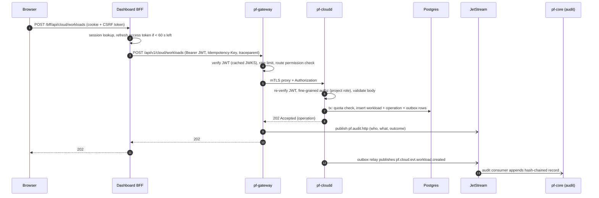
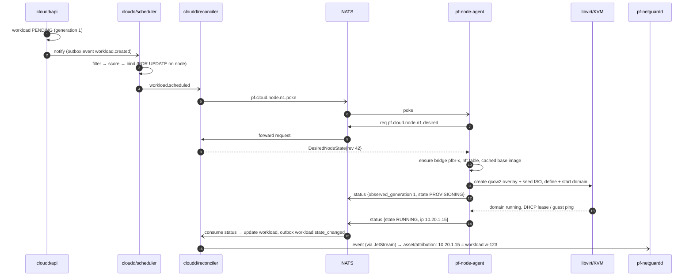
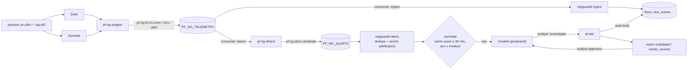
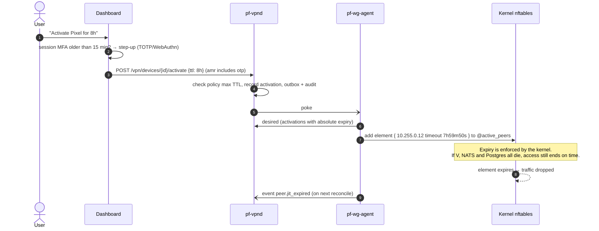
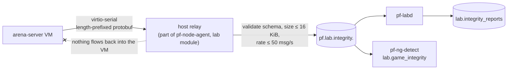

# 03 — Service Communication and Data Flows

Flows specific to one subsystem live in its own doc: [VPN enrolment](subsystems/vpn.md#3-device-enrolment--the-private-key-never-leaves-the-device), [AI investigation](subsystems/ai.md#4-orchestration-loop), [lab experiment](subsystems/security-lab.md#6-experiment-workflow). This document covers the cross-cutting and cross-subsystem flows.

## 1. Communication matrix

| From \ To | pf-core | pf-cloudd | pf-vpnd | pf-netguardd | pf-labd | pf-aid | NATS | Postgres |
|---|---|---|---|---|---|---|---|---|
| **pf-gateway** | REST (auth, JWKS) | REST | REST | REST | REST | REST | sub (SSE fan-out) | — |
| **pf-core** | — | — | — | — | — | — | pub outbox, sub `pf.audit.>` | `core`, `audit` |
| **pf-cloudd** | JWKS | — | — | — | — | — | pub events, req/reply agents, KV | `cloud` |
| **pf-vpnd** | JWKS | REST (resolve network CIDRs) | — | — | — | — | pub events, req/reply agents | `vpn` |
| **pf-netguardd** | JWKS | — | — | — | — | — | sub telemetry/alerts/cloud/vpn events | `netguard` |
| **pf-ng-detect** | — | — | — | — | — | — | sub telemetry, pub alerts | `netguard` read-only views (documented exception, [05](05-database-design.md) §1) |
| **pf-labd** | client-credentials | **REST (create lab nets/VMs)** | — | REST (sensor health) | — | — | pub events, sub integrity | `lab` |
| **pf-aid** | client-credentials | REST read | REST read | **REST read** | REST read | — | pub events | `ai` |
| **pf-node-agent** | — | — | — | — | — | — | req desired, pub status, KV heartbeat | — |
| **pf-wg-agent** | — | — | — | — | — | — | req desired, pub stats/events | — |
| **pf-ng-shipper / discovery** | — | — | — | — | — | — | pub telemetry, req scope | — |

Rules:

- Services never read another service's schema. Cross-domain data comes through REST APIs or events. The single exception is `pf-ng-detect`, which reads three NetGuard views (it is a satellite worker of the NetGuard domain, not a separate domain).
- Agents talk **only** to NATS. They have no DB credentials and no inbound ports.
- Every REST hop is mTLS. Every NATS identity is an NKey user with explicit subject permissions ([07](07-trust-boundaries-and-threat-model.md) §5).

## 2. Request path: browser → service

## 3. VM creation end to end

## 4. Telemetry → alert → incident → AI

Latency budget (p95): Zeek log flush ≤ 10 s (Zeek's rotation/flush interval tuned down for dev), shipper ≤ 1 s, ingest batch ≤ 1 s, detection ≤ 5 s, alert upsert ≤ 1 s. The total stays under the 30 s target for flows, and under 60 s for alerts.

## 5. VPN JIT activation (fail-closed path)

The agent computes the remaining timeout from the **absolute** expiry, so restarts never extend access. On restart it rebuilds the set from desired state, and expired activations are simply absent.

## 6. Lab telemetry relay (one-way)

## 7. Event flow map (producers → consumers)

| Stream | Subjects | Producers | Consumers |
|---|---|---|---|
| `PF_AUDIT` | `pf.audit.>` | gateway, all services, agents | `pf-core` audit writer |
| `PF_CLOUD_EVENTS` | `pf.cloud.evt.>` | `pf-cloudd` (outbox) | netguardd (attribution), vpnd (network CIDRs), labd (env status), gateway SSE |
| `PF_AGENT_STATUS` | `pf.cloud.node.*.status`, `pf.vpn.gw.*.status` | node agents, wg agents | cloudd, vpnd |
| `PF_VPN_EVENTS` | `pf.vpn.evt.>` | `pf-vpnd` (outbox), `pf-wg-agent` (connect/disconnect) | netguardd (attribution), gateway SSE |
| `PF_VPN_STATS` | `pf.vpn.gw.*.stats` | `pf-wg-agent` | vpnd (peer_stats) |
| `PF_NG_TELEMETRY` | `pf.ng.tel.>` | shipper, discovery, probe | netguardd ingest + inventory, ng-detect |
| `PF_NG_ALERTS` | `pf.ng.alert.>` | ng-detect | netguardd alerts |
| `PF_NG_EVENTS` | `pf.ng.evt.>` | netguardd (outbox: alert/incident changes) | gateway SSE, aid (optional auto-triage, off by default) |
| `PF_LAB` | `pf.lab.evt.>`, `pf.lab.integrity.>` | labd, lab relay | labd, ng-detect, gateway SSE |
| `PF_AI_EVENTS` | `pf.ai.evt.>` | aid | gateway SSE, netguardd (report ready) |
| `PF_DLQ` | `pf.dlq.>` | consumer libs | humans (alert) |

Core NATS (non-persistent) subjects are used for request/reply and pokes: `pf.cloud.node.<id>.desired`, `pf.cloud.node.<id>.poke`, `pf.vpn.gw.<id>.desired`, `pf.vpn.gw.<id>.poke`, `pf.ng.sensor.<id>.scope`.
