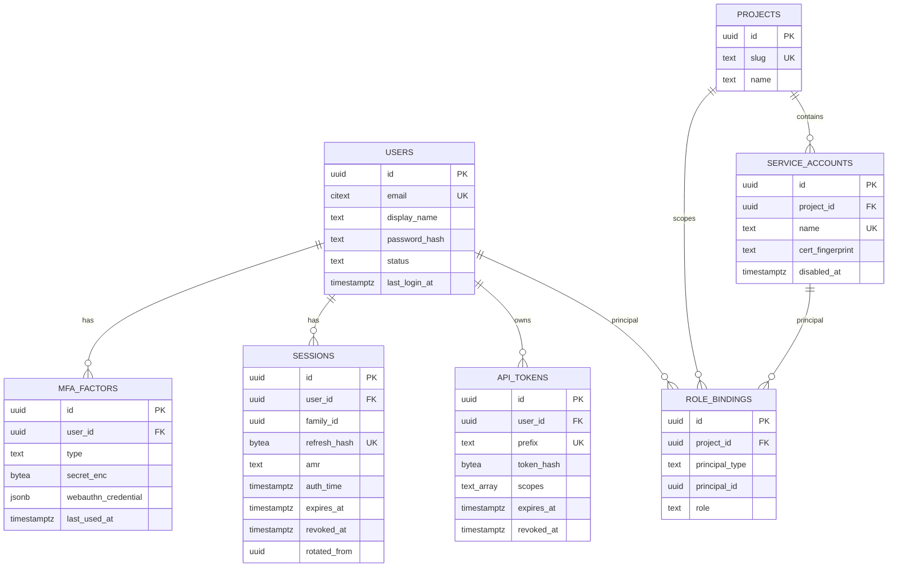
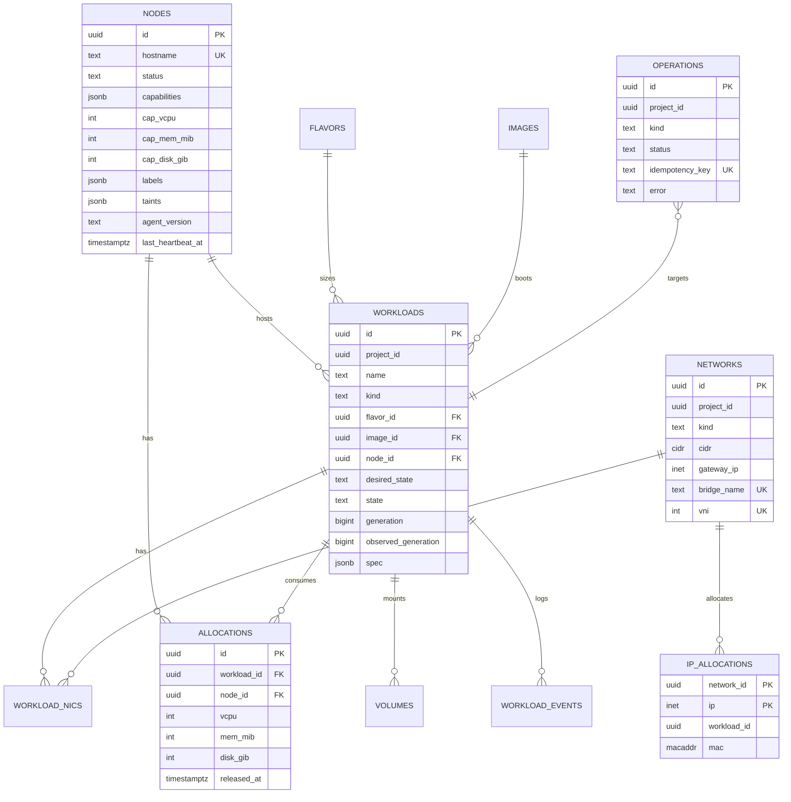
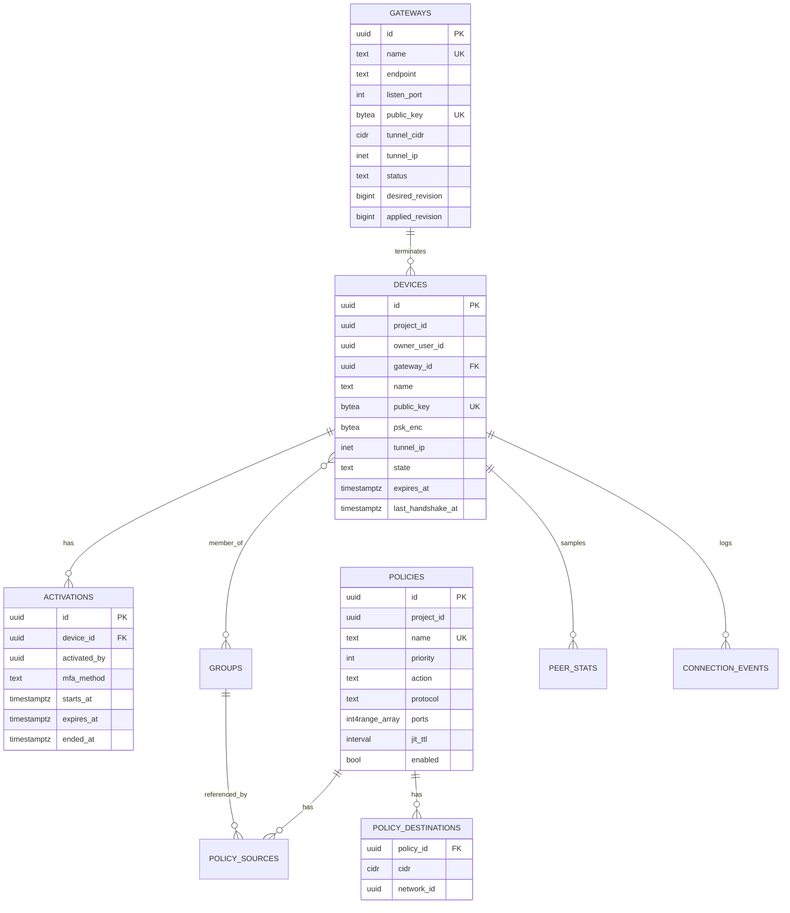
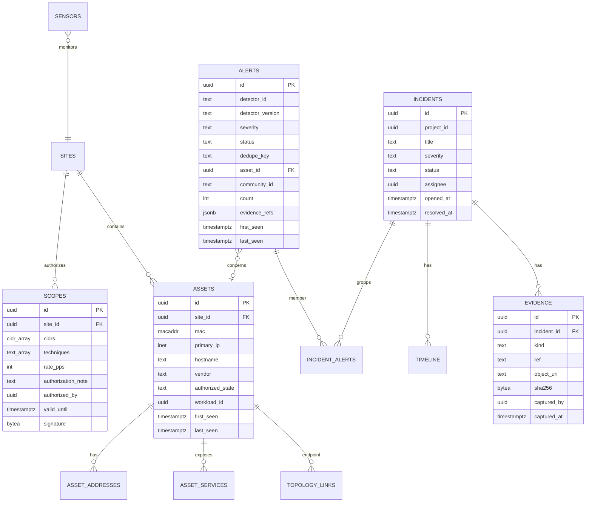

# 05 — Database Design

## 1. Topology and ownership

- **One PostgreSQL 17 instance** (dev, lab-prod) with **one schema per service**: `core`, `audit`, `cloud`, `vpn`, `netguard`, `lab`, `ai`. See [ADR-0004](../adr/0004-postgres-schema-per-service.md).
- **No cross-schema foreign keys or joins.** IDs from other domains (`project_id`, `user_id`, `workload_id`) are stored as plain `uuid`s and validated through APIs or JWT claims. Each schema could move to its own database tomorrow without code changes.
- **Roles per service:**
  - `pf_<svc>_owner` (NOLOGIN) owns the schema and is used only by migrations (via `SET ROLE` from `pf_migrator`).
  - `pf_<svc>` (LOGIN) is the runtime role, with `SELECT/INSERT/UPDATE/DELETE` on its own schema and **no DDL**.
  - `pf_ng_detect_ro` (LOGIN) is a **documented exception**: `SELECT` on three read-only views in `netguard` (baselines, asset summary, scope list), so the detector avoids high-frequency REST calls.
  - `pf_core` has `INSERT, SELECT` (only) on `audit.audit_log`.
- **IDs:** UUIDv7, generated in the app (`google/uuid` `NewV7`, Python `uuid6`/`uuid_utils`). They are time-ordered, which keeps btree inserts index-friendly, and are safe to expose.
- **Conventions:** `snake_case`; `created_at`/`updated_at timestamptz NOT NULL DEFAULT now()`; soft delete (`deleted_at`) only where history matters (workloads, networks, devices); enum-like columns as `text` + `CHECK` (easier to migrate than PG enums); JSONB only for genuinely open-ended data (`spec`, `details`, `evidence`).
- **Migrations:** `golang-migrate` SQL files under `services/<svc>/migrations/`, numbered `NNNN_description.up.sql/.down.sql`. Every migration must be online-safe: concurrent index builds, no long table rewrites, and expand → migrate → contract for breaking changes.

## 2. Common tables (present in every service schema)

```sql
-- Transactional outbox: written in the same tx as the domain change.
CREATE TABLE <schema>.outbox (
    id            uuid PRIMARY KEY,            -- CloudEvents id == Nats-Msg-Id (dedupe)
    subject       text        NOT NULL,        -- e.g. pf.cloud.evt.workload.state_changed
    event_type    text        NOT NULL,        -- e.g. parallelf.cloud.v1.WorkloadStateChanged
    payload       bytea       NOT NULL,        -- protojson-encoded message
    headers       jsonb       NOT NULL DEFAULT '{}',   -- traceparent, ce-subject, …
    created_at    timestamptz NOT NULL DEFAULT now(),
    published_at  timestamptz
);
CREATE INDEX outbox_unpublished ON <schema>.outbox (created_at) WHERE published_at IS NULL;

-- Idempotent consumers.
CREATE TABLE <schema>.processed_events (
    consumer      text        NOT NULL,
    event_id      uuid        NOT NULL,
    processed_at  timestamptz NOT NULL DEFAULT now(),
    PRIMARY KEY (consumer, event_id)
);
```

## 3. `core` schema (identity, RBAC)



Key points:

- `users.password_hash` holds a PHC string (`$argon2id$v=19$m=…,t=…,p=…$salt$hash`), so parameters can be upgraded on next login.
- `mfa_factors.secret_enc` holds TOTP secrets encrypted with AES-256-GCM. The KEK is a file secret, and the key ID is stored in the ciphertext header so the KEK can be rotated.
- `sessions` implements refresh rotation: presenting a refresh token whose row has `revoked_at` set (already rotated) **revokes every session with the same `family_id`**.
- `role_bindings` has `UNIQUE (project_id, principal_type, principal_id, role)`. `project_id` is NULL for platform-wide bindings (owner).
- Signing keys are **files**, not rows. `core.jwks_history (kid, public_jwk, not_before, not_after)` supports verification during rotation.

## 4. `audit` schema

```sql
CREATE TABLE audit.audit_log (
    seq            bigint GENERATED ALWAYS AS IDENTITY PRIMARY KEY,
    id             uuid        NOT NULL UNIQUE,      -- event id (dedupe from JetStream)
    ts             timestamptz NOT NULL,
    actor_type     text        NOT NULL CHECK (actor_type IN ('user','service','agent','system')),
    actor_id       text        NOT NULL,
    project_id     uuid,
    action         text        NOT NULL,             -- e.g. vpn.devices.revoke
    resource_type  text,
    resource_id    text,
    outcome        text        NOT NULL CHECK (outcome IN ('success','denied','error')),
    request_id     text,
    source_ip      inet,
    details        jsonb       NOT NULL DEFAULT '{}',
    prev_hash      bytea       NOT NULL,             -- hash of seq-1 (genesis: 32 zero bytes)
    hash           bytea       NOT NULL              -- sha256(prev_hash || canonical_json(row sans hashes))
);
CREATE INDEX audit_ts ON audit.audit_log USING brin (ts);
CREATE INDEX audit_actor ON audit.audit_log (actor_id, ts);
CREATE INDEX audit_resource ON audit.audit_log (resource_type, resource_id, ts);

CREATE FUNCTION audit.deny_mutation() RETURNS trigger LANGUAGE plpgsql AS $$
BEGIN
    RAISE EXCEPTION 'audit.audit_log is append-only';
END $$;
CREATE TRIGGER audit_no_update_delete BEFORE UPDATE OR DELETE ON audit.audit_log
    FOR EACH ROW EXECUTE FUNCTION audit.deny_mutation();
CREATE TRIGGER audit_no_truncate BEFORE TRUNCATE ON audit.audit_log
    FOR EACH STATEMENT EXECUTE FUNCTION audit.deny_mutation();
```

A single writer (an ordered JetStream consumer in `pf-core`) keeps the chain linear. A superuser could still disable the triggers, which is why the chain head is **anchored** externally every night (see [platform-core.md](subsystems/platform-core.md#4-audit)).

## 5. `cloud` schema



```sql
CREATE TABLE cloud.workloads (
    id                   uuid PRIMARY KEY,
    project_id           uuid        NOT NULL,
    name                 text        NOT NULL CHECK (name ~ '^[a-z][a-z0-9-]{0,62}$'),
    kind                 text        NOT NULL CHECK (kind IN ('vm','container')),
    flavor_id            uuid        NOT NULL REFERENCES cloud.flavors(id),
    image_id             uuid        NOT NULL REFERENCES cloud.images(id),
    node_id              uuid        REFERENCES cloud.nodes(id),
    desired_state        text        NOT NULL CHECK (desired_state IN ('running','stopped','deleted')),
    state                text        NOT NULL DEFAULT 'PENDING'
                         CHECK (state IN ('PENDING','SCHEDULED','PROVISIONING','RUNNING','STOPPING',
                                          'STOPPED','UNKNOWN','DELETING','DELETED','ERROR')),
    generation           bigint      NOT NULL DEFAULT 1,
    observed_generation  bigint      NOT NULL DEFAULT 0,
    spec                 jsonb       NOT NULL,       -- ssh keys, cloud-init ref, env refs, restart policy
    status_message       text,
    created_by           text        NOT NULL,
    created_at           timestamptz NOT NULL DEFAULT now(),
    updated_at           timestamptz NOT NULL DEFAULT now(),
    deleted_at           timestamptz
);
CREATE UNIQUE INDEX workloads_live_name ON cloud.workloads (project_id, name) WHERE deleted_at IS NULL;
CREATE INDEX workloads_node ON cloud.workloads (node_id) WHERE deleted_at IS NULL;
CREATE INDEX workloads_pending ON cloud.workloads (created_at) WHERE state = 'PENDING';

CREATE TABLE cloud.networks (
    id           uuid PRIMARY KEY,
    project_id   uuid        NOT NULL,
    name         text        NOT NULL,
    kind         text        NOT NULL CHECK (kind IN ('nat','isolated','lab')),
    cidr         cidr        NOT NULL CHECK (masklen(cidr) BETWEEN 16 AND 29),
    gateway_ip   inet,
    bridge_name  text        NOT NULL UNIQUE CHECK (length(bridge_name) <= 15),  -- Linux IFNAMSIZ
    vni          integer     UNIQUE CHECK (vni BETWEEN 1 AND 16777215),
    created_at   timestamptz NOT NULL DEFAULT now(),
    deleted_at   timestamptz,
    CHECK ((kind = 'lab') = (gateway_ip IS NULL)),          -- lab bridges never get a host IP
    CHECK (gateway_ip IS NULL OR gateway_ip << cidr),
    -- v1: global non-overlap (all networks share the host routing table).
    EXCLUDE USING gist (cidr inet_ops WITH &&) WHERE (deleted_at IS NULL)
);

CREATE TABLE cloud.ip_allocations (
    network_id   uuid    NOT NULL REFERENCES cloud.networks(id),
    ip           inet    NOT NULL,
    workload_id  uuid    REFERENCES cloud.workloads(id),
    mac          macaddr NOT NULL UNIQUE,
    allocated_at timestamptz NOT NULL DEFAULT now(),
    PRIMARY KEY (network_id, ip)
);
```

Capacity is computed as `SUM(allocations WHERE released_at IS NULL)` per node. It is checked inside the bind transaction while holding `FOR UPDATE` on the node row. `cloud.quotas (project_id PK, max_vcpu, max_mem_mib, max_instances, max_disk_gib)` is checked at admission under `FOR UPDATE` on the quota row.

Other tables: `flavors`, `images (digest bytea UNIQUE, kind, format, source_uri, size_bytes)`, `workload_nics (workload_id, network_id, ip, mac, ordinal)`, `volumes`, `workload_events (workload_id, ts, type, message)`, `operations`, `node_bootstrap_tokens (token_hash, expires_at, used_at)`.

## 6. `vpn` schema



```sql
CREATE TABLE vpn.devices (
    id                 uuid PRIMARY KEY,
    project_id         uuid        NOT NULL,
    owner_user_id      uuid        NOT NULL,
    gateway_id         uuid        NOT NULL REFERENCES vpn.gateways(id),
    name               text        NOT NULL,
    public_key         bytea       NOT NULL UNIQUE CHECK (octet_length(public_key) = 32),
    psk_enc            bytea,                       -- AES-256-GCM, KEK from file secret
    tunnel_ip          inet        NOT NULL CHECK (masklen(tunnel_ip) = 32),
    state              text        NOT NULL CHECK (state IN ('PENDING','ENROLLED','ACTIVE','REVOKED','EXPIRED')),
    expires_at         timestamptz NOT NULL,
    revoked_at         timestamptz,
    revoked_reason     text,
    last_handshake_at  timestamptz,
    last_endpoint      inet,
    created_at         timestamptz NOT NULL DEFAULT now()
);
-- Tunnel IPs may be reused only after a device is gone.
CREATE UNIQUE INDEX devices_live_ip ON vpn.devices (gateway_id, tunnel_ip)
    WHERE state NOT IN ('REVOKED','EXPIRED');

CREATE TABLE vpn.activations (
    id            uuid PRIMARY KEY,
    device_id     uuid        NOT NULL REFERENCES vpn.devices(id),
    activated_by  uuid        NOT NULL,
    mfa_method    text        NOT NULL CHECK (mfa_method IN ('otp','webauthn')),
    starts_at     timestamptz NOT NULL,
    expires_at    timestamptz NOT NULL,
    ended_at      timestamptz,
    end_reason    text CHECK (end_reason IN ('expired','manual','revoked')),
    CHECK (expires_at > starts_at AND expires_at - starts_at <= interval '24 hours')
);
CREATE INDEX activations_live ON vpn.activations (device_id) WHERE ended_at IS NULL;

CREATE TABLE vpn.peer_stats (
    device_id  uuid        NOT NULL,
    ts         timestamptz NOT NULL,
    rx_bytes   bigint      NOT NULL,
    tx_bytes   bigint      NOT NULL,
    handshake_age_s integer,
    PRIMARY KEY (device_id, ts)
) PARTITION BY RANGE (ts);
```

Other tables: `groups`, `group_members`, `policy_sources`, `enrolment_tokens (token_hash, expires_at, max_uses, uses)`, `connection_events` (partitioned by day).

## 7. `netguard` schema



```sql
CREATE TABLE netguard.flows (
    id               uuid        NOT NULL,
    ts_start         timestamptz NOT NULL,
    ts_end           timestamptz,
    sensor_id        uuid        NOT NULL,
    community_id     text,
    src_ip           inet        NOT NULL,
    src_port         integer,
    dst_ip           inet        NOT NULL,
    dst_port         integer,
    proto            smallint    NOT NULL,      -- IANA protocol number
    app_proto        text,
    conn_state       text,
    bytes_orig       bigint,
    bytes_resp       bigint,
    pkts_orig        bigint,
    pkts_resp        bigint,
    zeek_uid         text,
    src_asset_id     uuid,
    dst_asset_id     uuid,
    attr_user_id     uuid,                      -- VPN attribution at ingest time
    attr_device_id   uuid,
    attr_workload_id uuid,                      -- Cloud attribution at ingest time
    raw_sha256       bytea       NOT NULL,      -- provenance of the source log line
    PRIMARY KEY (ts_start, id)
) PARTITION BY RANGE (ts_start);
CREATE INDEX flows_ts_brin   ON netguard.flows USING brin (ts_start);
CREATE INDEX flows_src       ON netguard.flows (src_ip, ts_start);
CREATE INDEX flows_dst       ON netguard.flows (dst_ip, dst_port, ts_start);
CREATE INDEX flows_cid       ON netguard.flows (community_id);
-- Partitions: netguard.flows_YYYYMMDD created 3 days ahead, dropped after retention.

CREATE TABLE netguard.alerts (
    id                uuid PRIMARY KEY,
    detector_id       text        NOT NULL,
    detector_version  text        NOT NULL,
    severity          text        NOT NULL CHECK (severity IN ('info','low','medium','high','critical')),
    status            text        NOT NULL DEFAULT 'NEW'
                      CHECK (status IN ('NEW','TRIAGED','SUPPRESSED','ESCALATED','CLOSED')),
    title             text        NOT NULL,
    dedupe_key        text        NOT NULL,   -- detector + normalized key, e.g. ng.port_scan|10.20.1.9
    asset_id          uuid,
    community_id      text,
    count             integer     NOT NULL DEFAULT 1,
    evidence_refs     jsonb       NOT NULL,   -- [{"type":"flow","id":"flow:20261110:0193…"}]
    first_seen        timestamptz NOT NULL,
    last_seen         timestamptz NOT NULL,
    created_at        timestamptz NOT NULL DEFAULT now()
);
CREATE UNIQUE INDEX alerts_open_dedupe ON netguard.alerts (dedupe_key)
    WHERE status IN ('NEW','TRIAGED','ESCALATED');
```

Other tables: `sites`, `sensors (kind, host, version, cert_fingerprint, last_seen)`, `asset_addresses`, `asset_services`, `topology_links (src_asset, dst_asset, kind, bucket_hour, bytes, conns)`, `dns_events`/`http_events`/`tls_events` (partitioned like `flows`), `attribution_intervals (ip, valid_from, valid_to, user_id, device_id, workload_id)` with a GiST index on `tstzrange(valid_from, valid_to)`, `suppressions`, `incident_alerts`, `incident_timeline`, `detector_state`, `scan_jobs`.

## 8. `lab` schema

| Table | Key columns |
|---|---|
| `targets` | `id`, `name`, `kind ('unity_build','vuln_program')`, `version`, `artifact_uri`, `sha256 bytea UNIQUE`, `provenance` (git commit), `ownership_attestation text NOT NULL` |
| `templates` | `id`, `name`, `workloads jsonb` (roles, flavors, images), `default_ttl interval` |
| `environments` | `id`, `template_id`, `network_id`, `workload_ids uuid[]`, `status`, `created_by`, `ttl_expires_at`, `destroyed_at` |
| `experiments` | `id`, `environment_id`, `target_id`, `hypothesis`, `technique_category`, `status`, `notes_md` |
| `findings` | `id`, `experiment_id`, `title`, `cwe`, `cvss_vector`, `severity`, `status ('open','mitigated','verified','wont_fix')`, `mitigation_md`, `fix_commit`, `regression_test` |
| `integrity_reports` | `id`, `environment_id`, `session_id`, `player_id`, `check_type`, `score`, `details jsonb`, `ts` (partitioned by month) |

## 9. `ai` schema

| Table | Key columns |
|---|---|
| `investigations` | `id`, `incident_id`, `requested_by`, `status ('running','completed','budget_exceeded','failed')`, `model`, `prompt_version`, `input_tokens`, `output_tokens`, `est_cost_usd numeric(10,4)`, `started_at`, `finished_at` |
| `steps` | `id`, `investigation_id`, `seq`, `tool_name`, `tool_input jsonb`, `output_sha256`, `output_evidence_ids text[]`, `output_bytes`, `latency_ms`, `error` (outputs themselves are stored compressed in object storage for replay) |
| `reports` | `id`, `investigation_id`, `incident_id`, `body jsonb` (schema in [ai.md](subsystems/ai.md#5-report-schema-enforced-through-the-submit_report-tools-json-schema)), `validation_status ('validated','needs_review')`, `validation_errors jsonb`, `approved_by`, `approved_at` |
| `daily_budget` | `day date PK`, `spent_usd`, `limit_usd` |
| `eval_runs` | `id`, `git_sha`, `model`, `scenario_count`, `citation_pass_rate`, `key_fact_recall`, `injection_failures`, `cost_usd` |

## 10. Retention and sizing

| Data | Partitioning | dev | lab-prod |
|---|---|---|---|
| `netguard.flows`, `*_events` | daily | 3–7 d | 14 d |
| `vpn.peer_stats`, `connection_events` | daily | 7 d | 30 d |
| `lab.integrity_reports` | monthly | 90 d | 180 d |
| `audit.audit_log` | none (low volume; monthly partitions if > 10 M rows) | forever | forever |
| `<schema>.outbox` (published) | none | purge after 7 d | purge after 7 d |
| `<schema>.processed_events` | none | purge after 14 d (> JetStream max age) | same |

A `retention` job in each owning service (leader-elected) creates partitions ahead of time and runs `DROP TABLE` on expired ones. Dropping a partition is instant, unlike `DELETE`.

## 11. Operations

- **Dev tuning** (container with a 1 GiB limit): `shared_buffers=256MB`, `work_mem=8MB`, `maintenance_work_mem=64MB`, `max_connections=100`, `wal_compression=on`. Pools: Go `pgxpool` max 8 per service, Python `asyncpg`/SQLAlchemy pool 5.
- **Backups (lab-prod):** nightly `pg_dump -Fc` per schema, encrypted with `age`, written to object storage. Restore drill monthly via `task db:restore-drill` into a scratch database, verified with row counts and `pfctl audit verify`. Stretch: `pgBackRest` with WAL archiving for point-in-time recovery.
- **Observability:** `postgres_exporter`, `pg_stat_statements` enabled, slow-query log > 250 ms.
