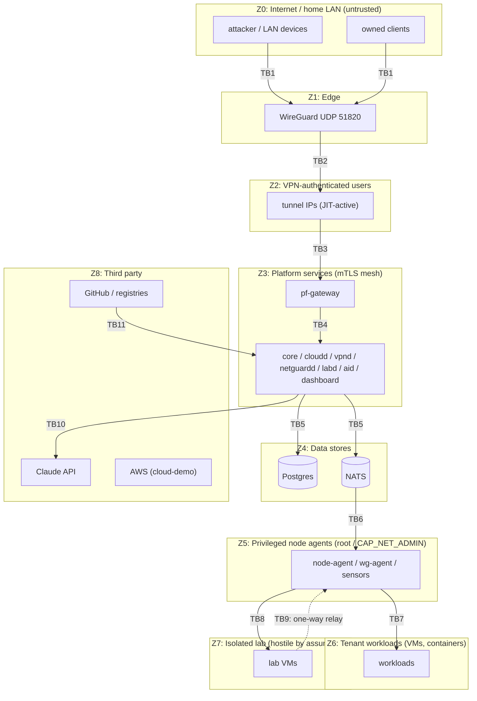

# 07 — Trust Boundaries and Threat Model

Method: data-flow-diagram-based **STRIDE**, reviewed at every milestone that adds a boundary. Each mitigation is paired with a **verification**, a test or check that proves the control exists. Unverified mitigations don't count.

## 1. Assets

| Asset | Why it matters | Where it lives |
|---|---|---|
| A1 User credentials (password hashes, TOTP secrets, WebAuthn creds) | Account takeover | `core` schema (hashed / encrypted) |
| A2 JWT signing keys (Ed25519) | Forge any identity | File secret on `pf-core` host, 0400 |
| A3 Refresh tokens, PATs, service-account creds | Session hijack | Hashes in `core`; client-side in BFF memory / user's machine |
| A4 Internal CA keys | Impersonate any service | Root offline (encrypted file, not on the dev box's normal path); intermediate in `step-ca` |
| A5 WireGuard gateway private key, PSKs | Impersonate gateway / decrypt future handshakes w/ PSK | Gateway host file 0600; PSKs encrypted in `vpn` |
| A6 Telemetry (DNS queries, flows) | Privacy of household; attacker reconnaissance value | `netguard` schema, OpenSearch, object storage |
| A7 Audit log | Accountability; forensic integrity | `audit` schema + external anchors |
| A8 Lab targets (vulnerable programs, game builds) | Could harm the host or network if they escape the lab | Lab VMs, read-only ISOs, repo |
| A9 Anthropic API key / budget | Financial loss, data egress | File secret for `pf-aid` |
| A10 Host integrity (Windows + WSL/Hyper-V) | Everything runs here | Physical machine |
| A11 Source repo + CI | Supply chain | GitHub |

## 2. Threat actors

| Actor | Capability | Notes |
|---|---|---|
| T1 Internet attacker | Can send packets to your public IP | Sees only UDP 51820 (WireGuard stays silent to unauthenticated packets) |
| T2 LAN-adjacent device | On the home LAN (compromised IoT, guest) | Can reach WSL/Hyper-V LAN-facing ports if exposed |
| T3 Malicious telemetry author | Controls strings that appear in monitored traffic (DNS names, UA, SNI, player names) | Targets parsers, UI (XSS) and the AI (prompt injection) |
| T4 Lab payload | Code running inside lab VMs (deliberately vulnerable or modified programs) | Tries to escape network or VM isolation |
| T5 Stolen device | Has an enrolled WireGuard key | Mitigated by JIT + MFA |
| T6 Compromised dependency / CI | Malicious package or action | Supply chain |
| T7 Operator mistake | You, tired, at 2 a.m. | Misconfigured scope, exposed port, committed secret |
| T8 Curious reviewer | Given a viewer account for a demo | Must not escalate |

## 3. Trust boundaries

| ID | Boundary | Crossing | Primary controls |
|---|---|---|---|
| TB1 | Internet/LAN → edge | UDP packets | WireGuard (Noise IK; silent drop of unauthenticated packets); only one port forwarded |
| TB2 | Tunnel → authorized user | decrypted IP packets | Per-peer AllowedIPs (anti-spoof), **JIT active set**, policy chains, default deny |
| TB3 | User → platform API | HTTPS | Gateway binds to tunnel IP only (lab-prod), JWT, MFA, rate limits |
| TB4 | Gateway → services | HTTP | mTLS, JWT re-verification, per-service authz |
| TB5 | Services → stores | SQL / NATS | Per-service DB roles, NATS NKey users with subject ACLs, TLS |
| TB6 | Control plane → agents | desired-state snapshots | NATS ACLs (agent sees only its own subjects), schema validation, no "exec" capability in any contract |
| TB7 | Host → workloads | hypervisor / container runtime | KVM + sVirt/AppArmor + seccomp; container hardening defaults; untrusted code VM-only |
| TB8 | Host → lab | lab bridges | No host IP, nftables drop, no shared folders, read-only ISO ingress |
| TB9 | Lab → platform | virtio-serial relay | Length-prefixed, schema-validated, size- and rate-limited, one direction |
| TB10 | Platform → third parties | HTTPS egress | Only `pf-aid` (Anthropic) and image import (allowlisted) have egress; minimization |
| TB11 | Supply chain → build | code, images, actions | Pinned versions/digests, lockfiles, Dependabot, Trivy, SBOM, branch protection, gitleaks |

## 4. STRIDE analysis (key threats)

| # | Threat | STRIDE | TB | Mitigation | Verification |
|---|---|---|---|---|---|
| 1 | Credential stuffing / brute force on login | S | TB3 | Dashboard reachable only via VPN (lab-prod); argon2id; per-account + per-IP rate limits with exponential backoff; MFA required for all roles in lab-prod | Integration test: 20 bad logins → 429 + lockout window; MFA-required flag test |
| 2 | JWT forgery / algorithm confusion | S, E | TB3–4 | `alg` pinned to EdDSA; `kid` required and must be in JWKS; `aud`/`iss`/`exp`/`nbf` enforced; 10 min TTL | Table-driven tests: `alg=none`, HS256 with public key as secret, wrong `aud`, expired → 401 |
| 3 | Refresh-token theft & replay | S | TB3 | BFF keeps tokens server-side; rotation with reuse detection revokes the family | Test: replay old refresh token → all family sessions revoked + audit |
| 4 | CSRF via dashboard | T | TB3 | SameSite=Strict, double-submit token, Origin check | Playwright: cross-origin form POST rejected |
| 5 | Stored XSS from telemetry (hostnames, UA, player names) or AI output | T, E | TB3 | React text rendering only; sanitized Markdown (no raw HTML, no images); strict nonce CSP | Playwright fixture with `<script>`/`javascript:` payloads in hostnames; CSP report count = 0 |
| 6 | Viewer escalates privileges | E | TB4 | Authz at gateway (coarse) **and** service (fine); deny by default; permission matrix generated from one YAML | Generated test: every route × every role vs expected matrix |
| 7 | SSRF via image import | I, E | TB10 | Scheme allowlist (`https`), DNS resolution then IP check (no RFC1918/link-local/loopback), redirect re-check, size cap, sha256 required | Unit tests with `169.254.169.254`, `localhost`, DNS-rebinding fixture |
| 8 | Command/XML injection in node-agent | T, E | TB6 | No shell interpolation (argv only); libvirt XML via typed structs; names regex-validated at API and agent | Fuzz test on DesiredWorkload → XML; static check bans `exec.Command("sh", "-c", …)` |
| 9 | Compromised agent impersonates another node or reads others' state | S, I | TB6 | Per-agent NKey; ACL: pub/sub only `pf.cloud.node.<own-id>.>`; JetStream API perms limited to own consumer | Test with node-A creds attempting node-B subjects → permission violation |
| 10 | Malicious desired state (compromised NATS) | T, E | TB6 | NATS TLS + auth; desired-state messages **signed** by control plane (Ed25519) in lab-prod (hardening milestone); agent validates bounds | Agent rejects unsigned/invalid-signature snapshot test |
| 11 | VM escape from lab | E | TB7–8 | KVM, sVirt/AppArmor, seccomp sandbox, no passthrough devices, patched host, lab VMs ephemeral | Config test asserts domain XML has seclabel + no hostdev; periodic `virt-host-validate` |
| 12 | Lab network egress | I, E | TB8 | Bridge without host IP, nft drop, admission rule, mandatory monitoring, `ng.lab_egress_attempt` critical alert | `/lab/environments/{id}/isolation-check` suite: ICMP/TCP/UDP/DNS to host, gateway, LAN, internet all fail; runs at every env start |
| 13 | Discovery used against non-owned networks | (abuse) | TB1/LAN | Signed scope, public-IP hard block, CIDR size cap, technique allowlist, rate cap, audit, owner/admin only, `authorization_note` | Agent unit tests: public IP, oversize CIDR, expired/unsigned scope → refused + metric |
| 14 | Telemetry flood → disk/memory exhaustion | D | TB5 | JetStream max-bytes + discard-new for telemetry, shipper disk buffer cap, per-sensor rate limit, partition retention | Load test at 5× expected rate: no OOM, drops are counted, platform stays responsive |
| 15 | Parser exploitation via crafted logs | T, D | TB5 | Typed parsing, line/field size limits, Go fuzzing on normalizer, no `eval` | `go test -fuzz` corpus in CI (time-boxed) |
| 16 | Prompt injection makes AI take actions | E | TB10 | **No write tools exist**; tool args validated; output sanitized; human approval | Static test enumerates tool registry (all read-only); injection corpus eval |
| 17 | AI hallucinated findings misguide responder | T (integrity) | TB10 | Deterministic citation validator; `needs_review` status; UI highlights unverified claims | Eval metric: citation pass rate; invalid citations never show as `validated` |
| 18 | Sensitive data leaks to third-party API | I | TB10 | Field allowlists, pseudonymization option, no secrets reachable, per-investigation data log | Unit test: tool outputs never contain fields outside allowlist |
| 19 | Audit tampering | R, T | TB5 | Append-only grants + triggers, hash chain, nightly external anchor | `pfctl audit verify` test detects modified/deleted row (done as superuser in test DB) |
| 20 | Stolen phone with enrolled key | S | TB2 | JIT activation requires MFA; device expiry; immediate revocation + conntrack flush | E2E: revoked device traffic blocked < 10 s; inactive device can't pass traffic |
| 21 | Tunnel IP spoofing | S | TB2 | WireGuard cryptokey routing: AllowedIPs = /32 per peer, so the kernel drops packets with other source IPs | Test with peer forging another tunnel IP → dropped |
| 22 | Secrets committed to git | I | TB11 | gitleaks pre-commit + CI, SOPS for config secrets, `.env` in `.gitignore` | CI job fails on seeded fake secret in a test branch |
| 23 | Malicious dependency / action | T, E | TB11 | Lockfiles; Actions pinned by SHA; Dependabot; `govulncheck`, `pip-audit`, `pnpm audit`; Trivy; minimal base images (distroless) | CI gates; SBOM attached to releases |
| 24 | Exposed admin ports on LAN (Postgres, NATS, Grafana) | I, E | TB1 | Compose binds `127.0.0.1` only; lab-prod NetworkPolicies; Grafana behind gateway/VPN | `ss -ltn` check script in CI e2e: no 0.0.0.0 listeners except WireGuard |
| 25 | Denial of wallet (AI) | D | TB10 | Per-investigation and daily budgets; console spend limit; rate limit on `POST /ai/investigations` | Test: budget exceeded → status `budget_exceeded`, no API calls |

## 5. NATS permission matrix (least privilege)

| Identity | Publish | Subscribe |
|---|---|---|
| `svc-core` | `pf.audit.core`, `pf.core.evt.>` | `pf.audit.>` (via its consumer) |
| `svc-gateway` | `pf.audit.gateway` | `pf.*.evt.>` (SSE fan-out; filtered by RBAC before forwarding) |
| `svc-cloudd` | `pf.cloud.evt.>`, `pf.cloud.node.*.poke`, `_INBOX.>` replies | `pf.cloud.node.*.desired`, consumers on `PF_AGENT_STATUS` (cloud subjects), KV `pf_heartbeats` |
| `agent-node-<id>` | `pf.cloud.node.<id>.status`, `pf.cloud.node.<id>.desired` (request), `pf.lab.integrity.*` (lab relay), KV put `cloud.node.<id>` | `pf.cloud.node.<id>.poke`, `_INBOX.<id>.>` |
| `svc-vpnd` | `pf.vpn.evt.>`, `pf.vpn.gw.*.poke` | `pf.vpn.gw.*.desired`, consumers on stats/status |
| `agent-wg-<id>` | `pf.vpn.gw.<id>.{status,stats,desired}`, `pf.vpn.evt.peer.>`, `pf.vpn.evt.activation.ended` | `pf.vpn.gw.<id>.poke`, `_INBOX.<id>.>` |
| `sensor-<id>` | `pf.ng.tel.<id>.>`, `pf.ng.sensor.<id>.scope` (request) | `_INBOX.<id>.>` |
| `svc-netguardd` | `pf.ng.evt.>`, `pf.audit.netguard` | consumers on `PF_NG_TELEMETRY`, `PF_NG_ALERTS`, `PF_CLOUD_EVENTS`, `PF_VPN_EVENTS`; replies on `pf.ng.sensor.*.scope` |
| `svc-ng-detect` | `pf.ng.alert.candidate` | consumer on `PF_NG_TELEMETRY`, `pf.lab.integrity.>` |
| `svc-labd` | `pf.lab.evt.>`, `pf.audit.lab` | `pf.lab.integrity.>`, `pf.cloud.evt.>` |
| `svc-aid` | `pf.ai.evt.>`, `pf.audit.ai` | — |

JetStream API access (`$JS.API.>`) is granted per identity only for the specific stream/consumer names it uses. Stream creation is restricted to the `pfctl nats apply` admin identity.

## 6. Security controls by layer (summary)

| Layer | Controls |
|---|---|
| Host | Windows patched, BitLocker on; WSL/Hyper-V VMs with unattended-upgrades; libvirt AppArmor + seccomp; `/dev/kvm` group restricted |
| Network | Only UDP 51820 exposed; all other listeners on loopback or tunnel IP; nftables tables per owner (cloud / vpn); k8s NetworkPolicies default-deny in lab-prod |
| Identity | MFA, short-lived tokens, rotation, service accounts, mTLS, NKeys |
| Data | Per-service DB roles; AES-GCM field encryption for secrets at rest (envelope KEK); disk encryption on host; encrypted backups |
| Application | Input validation from OpenAPI schemas (generated), problem+json without stack traces, CSP, idempotency, rate limits |
| Detection | NetGuard monitors the platform's own networks, including the VPN and lab; Prometheus alerts on auth failures, DLQ, lab egress counters |
| Response | Runbooks: revoke device, rotate signing key, rotate CA, restore DB, lab isolation failure |

## 7. Residual risks (accepted, documented)

1. **Single host = single failure and trust domain.** Compromise of the Windows host compromises everything. Accepted for a personal lab and mitigated by OS hygiene and disk encryption.
2. **Nested virtualization** adds attack surface (L1 hypervisor bugs). The lab threat model assumes deliberately vulnerable *educational* code, not real-world malware. **Live malware analysis is out of scope.**
3. **Own identity implementation** has less battle-testing than Keycloak/Zitadel. Mitigated by standard libraries, tests and review. Swappable later because services only rely on JWKS + standard claims ([ADR-0008](../adr/0008-identity-service.md)).
4. **Client-side game integrity checks are bypassable by design.** They are used only as weak signals.
5. **Telemetry privacy.** Monitoring a household LAN captures other people's metadata. Default to monitoring **ParallelF-owned virtual networks only**. LAN monitoring is opt-in with household consent and short retention.
