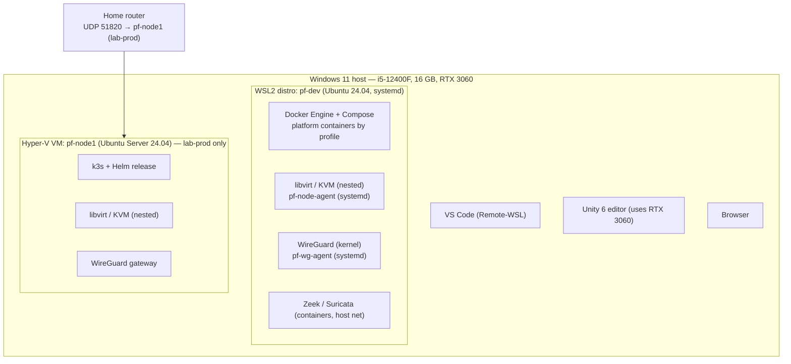
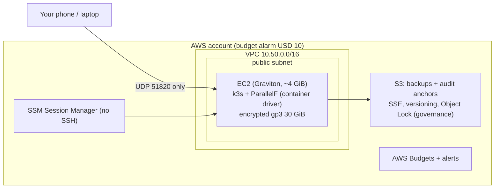
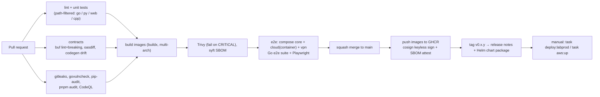

# 08 — Infrastructure Requirements

## 1. Host layout (dev hardware)



**Two operating modes**, never both at full size:

| Mode | WSL2 memory cap | Hyper-V VM | Used for |
|---|---|---|---|
| **A: dev** (default) | 10 GB | off | Day-to-day development of any subsystem |
| **B: lab-prod** | 4 GB (editor, builds, `pfctl`) | `pf-node1` with 7 GB (dynamic memory min 4 GB) | Production-like deployment, VPN from real devices, demos |

### 1.1 WSL2 configuration

`%UserProfile%\.wslconfig`:

```ini
[wsl2]
memory=10GB              # mode A; 4GB in mode B
processors=8
swap=4GB
nestedVirtualization=true
networkingMode=mirrored  # simplifies localhost + inbound; verify Hyper-V firewall rules
[experimental]
autoMemoryReclaim=gradual
sparseVhd=true
```

`/etc/wsl.conf` in the distro:

```ini
[boot]
systemd=true
[interop]
appendWindowsPath=false  # keeps PATH clean; avoids Windows binaries in scripts
```

Verification script `scripts/dev/check-nested-virt.sh`: `/dev/kvm` exists and is accessible, `kvm-ok`, `virt-host-validate qemu`, the WireGuard module loads, nftables is available, and cgroup v2 is active. Setting names change between WSL releases, so check them against current Microsoft docs during M0.

### 1.2 Hyper-V VM `pf-node1` (mode B)

- Gen 2 VM, 4 vCPU, dynamic memory 4–7 GB, 80 GB dynamically expanding VHDX, **external virtual switch** (bridged to the LAN so the router can forward UDP 51820).
- Nested virtualization enabled from PowerShell: `Set-VMProcessor -VMName pf-node1 -ExposeVirtualizationExtensions $true`.
- Requires Windows 11 Pro/Education/Enterprise. On Home edition, use a second WSL distro for k3s, with no LAN-exposed VPN. VPN testing from a phone then goes through the WSL mirrored-network path plus a Windows Firewall rule.

## 2. Memory budget and Compose profiles

Estimates, to be **measured in M0** with `scripts/dev/mem-report.sh` (`docker stats` + `ps` RSS + `virsh dommemstat`) and the table updated with real numbers.

| Component | Est. RSS | Profile(s) |
|---|---|---|
| PostgreSQL 17 (tuned) | 250–400 MB | core |
| NATS + JetStream | 50–150 MB | core |
| pf-core, pf-gateway (Go) | 30–60 MB each | core |
| pf-dashboard (Next.js **dev** server) | 500–900 MB | core (use `next start` build when not editing UI: ~150 MB) |
| pf-cloudd (Go) | 30–60 MB | cloud |
| pf-node-agent (Go, host) | 20–40 MB | cloud |
| libvirtd + per-VM QEMU overhead | ~100 MB + VM RAM | cloud |
| Lab/test VMs | 512 MB–2 GB each | cloud, lab |
| pf-vpnd + pf-wg-agent | 50–80 MB | vpn |
| pf-netguardd (Go) | 50–150 MB | ng |
| Zeek (single worker) | 200–500 MB | ng |
| pf-ng-detect (Python) | 120–250 MB | ng |
| Suricata (trimmed ruleset) | 300–700 MB | ng-full |
| OpenSearch (heap 1 GB) | 1.5–2 GB | ng-full |
| pf-labd (Python) | 100–150 MB | lab |
| pf-aid (Python) | 100–200 MB | ai |
| Prometheus + Grafana | 300–500 MB | obs |
| k3s server (mode B) | 500–900 MB | lab-prod |

| `task up:<profile>` | Includes | Est. total (excluding VMs) |
|---|---|---|
| `core` | Postgres, NATS, core, gateway, dashboard | ~1.2–1.8 GB |
| `cloud` | core + cloudd + host agent | ~1.4–2.0 GB + VMs |
| `vpn` | core + vpnd + host wg-agent | ~1.3–1.9 GB |
| `ng` | core + netguardd + shipper + Zeek + ng-detect | ~1.8–2.8 GB |
| `ng-full` | ng + Suricata + OpenSearch | ~3.8–5.5 GB |
| `lab` | core + cloud + labd + ng (lab sensor is mandatory) | ~2.3–3.5 GB + 2–3 VMs (~2–4 GB) |
| `ai` | core + ng + aid | ~2.0–3.0 GB |
| `obs` (add-on) | Prometheus + Grafana | +0.3–0.5 GB |
| `all` | Everything | **Not supported on 16 GB.** CI and AWS only |

Rule of thumb: keep the WSL working set ≤ 8 GB, leaving ≥ 6 GB for Windows, VS Code, the browser and Unity. When Unity is open, avoid `ng-full` and `lab` simultaneously.

## 3. Ports (dev; all bound to `127.0.0.1` unless noted)

| Port | Service | Notes |
|---|---|---|
| 8443 | pf-gateway | the only API entrypoint |
| 3000 | pf-dashboard | |
| 9001–9006 | core, cloudd, vpnd, netguardd, labd, aid (mTLS, internal) | reached only by the gateway |
| 19001–19006 | admin ports (`/metrics`, `/healthz`, `/readyz`) | Prometheus only |
| 5432 | PostgreSQL | |
| 4222 / 8222 | NATS client / monitoring | TLS on 4222 |
| 9090 / 3001 | Prometheus / Grafana | |
| 9200 | OpenSearch | ng-full only |
| **51820/udp** | WireGuard | **0.0.0.0** — the only non-loopback listener |
| 9100 | node_exporter | |

## 4. Storage layout (inside Linux, never on `/mnt/c`)

```text
/var/lib/parallelf/
├── images/          # VM base images (qcow2), verified by sha256
├── instances/<id>/  # overlays, seed ISOs, console sockets
├── lab/iso/         # read-only artifact ISOs
├── objects/         # local object store (dev): evidence, AI step outputs, backups
├── shipper/         # offsets + disk buffer
└── secrets/         # 0700 root; service keys, KEKs (mode B: k8s secrets instead)
```

Disk estimate: 40–80 GB free inside the WSL VHDX (base images ~600 MB each, overlays grow with use, telemetry partitions a few GB).

## 5. PKI and secrets

| Item | Tool | Lifetime |
|---|---|---|
| Root CA | `step` CLI, created once, **encrypted and kept offline** (removable media / password manager) | 10 y |
| Intermediate CA | `step-ca` container (dev) / k8s Deployment (lab-prod) | 1 y |
| Service certs (mTLS) | ACME or `step ca certificate`, auto-renewed by a sidecar/`step ca renew --daemon` | 24 h |
| Agent certs | Issued at node registration with a one-time bootstrap token | 7 d, auto-renew |
| NATS NKeys | `nsc` / `nk` generated by `scripts/nats/gen-nkeys.sh`; seeds stored as secrets | rotate on demand |
| JWT signing keys | Ed25519, generated by `pf-core`, stored as file secrets | rotate every 30 d (overlapping) |
| KEKs (field encryption) | 256-bit random, file secret, key ID in ciphertext | rotate yearly; re-wrap job |
| Repo secrets | **SOPS + age** (`deploy/secrets/*.enc.yaml`), age key outside the repo | — |
| Anthropic key | File secret mounted only into `pf-aid` | per console policy |

## 6. Environments in detail

### 6.1 dev (mode A)
- Docker Compose (`deploy/compose/compose.yaml`) with profiles. Platform services run as containers, agents as **host systemd units** inside WSL (they need `/dev/kvm`, netlink, nftables).
- `task dev:certs` bootstraps the CA and issues certs. `task up:core` reaches all-healthy in < 60 s.

### 6.2 lab-prod (mode B)
- k3s single node on `pf-node1`. Helm umbrella chart `deploy/helm/parallelf` with per-service subcharts: resource requests/limits, liveness/readiness probes, PodDisruptionBudgets (documentation value), **default-deny NetworkPolicies** with explicit allows, and Pod Security Admission `restricted` for all platform pods.
- Postgres and NATS run as StatefulSets with local-path PVCs.
- Agents remain systemd services on the node (they manage the host). k3s's own CNI (flannel) and nftables rules coexist with ParallelF's tables because each owner manages only its own nftables table.
- `pf-gateway` is exposed only on the WireGuard tunnel IP (hostNetwork listener restricted to `10.255.0.1`, or a NodePort plus nftables input rule).
- Backups: CronJob `pg_dump` → age-encrypt → object storage (MinIO in-cluster, or the Windows host share **for encrypted backups only**).

### 6.3 cloud-demo (AWS, ephemeral)



- **Terraform** (`deploy/terraform/envs/aws-demo`). Modules: `network` (VPC, one public subnet, IGW, **no NAT gateway** because NAT gateways bill hourly), `node` (EC2 + IAM instance profile with `AmazonSSMManagedInstanceCore` + least-privilege S3 access, cloud-init that installs k3s and deploys the Helm chart), `backup-bucket`, `budget`.
- **Security group:** inbound **only UDP 51820**. No SSH; admin access goes through SSM.
- **State:** S3 backend with native lockfile (`use_lockfile = true`, Terraform ≥ 1.10), so no DynamoDB table is needed. Alternatively, local state for a solo demo.
- **Cost controls:** run only during demos (`task aws:up` / `task aws:down`), budget alarm at USD 5 and 10, tag everything `project=parallelf`, and a post-destroy check script that lists any remaining tagged resources. Public IPv4 addresses are billed hourly, so release them on destroy. Check current pricing before the first apply. A few demo hours should cost very little, but verify for your region.
- **VMs on AWS:** KVM on EC2 has historically required bare-metal (`*.metal`) instances, which are expensive. Check whether nested virtualization is offered for your chosen instance family. The demo defaults to the **container driver** and shows the VM driver with a recorded local demo instead.

## 7. Observability stack

| Signal | Implementation |
|---|---|
| Metrics | Prometheus (scrape 15 s, retention 7 d dev). Exporters: `node_exporter`, `postgres_exporter`, NATS (`/varz`, `/jsz` via `prometheus-nats-exporter`), libvirt (optional exporter), Zeek/Suricata stats through the shipper |
| Dashboards (provisioned as code) | Platform overview · API RED (rate/errors/duration) per route · Cloud capacity & scheduling · Reconcile & drift · VPN peers & revocation latency · NetGuard pipeline lag & drops · Alerts by detector · AI cost & citation pass rate · NATS streams/consumers · Postgres |
| Alerts (Grafana alerting) | Service down; consumer pending > threshold for 5 m; DLQ non-empty; telemetry drops > 0; `ng.lab_egress_attempt`; audit writer lag; cert expiry < 3 d; disk > 85%; AI daily budget > 80% |
| Logs | JSON to stdout (`slog`, `structlog`) with `trace_id`, `request_id`, `project_id`; dev uses `docker compose logs`; lab-prod optionally ships platform logs to OpenSearch (`ng-full`) or Loki (add-on) |
| Traces | OpenTelemetry SDKs; context propagated over HTTP **and NATS headers**; OTel Collector + Tempo/Jaeger is an **optional add-on profile** because of RAM |
| Health | `/healthz` (process alive), `/readyz` (DB + NATS + required deps), shown on the dashboard overview |

## 8. CI/CD



- GitHub-hosted runners for everything except tests needing KVM. Check whether hosted Linux runners currently expose `/dev/kvm`. If so, a tiny VM smoke test (CirrOS-sized image) runs in CI. Otherwise VM tests run locally via `task test:vm` and results are attached to the PR.
- Lab target exploit-checks run in a `--network none` container, only on sanitizer builds.
- Deployment is manual and explicit (`task deploy:labprod`). GitOps (Argo CD / Flux) is a stretch goal because of RAM.

## 9. Backup and disaster recovery (lab-prod)

| Item | Method | RPO | RTO |
|---|---|---|---|
| Postgres | Nightly `pg_dump -Fc` per schema, age-encrypted, 14 dailies + 8 weeklies | 24 h | 1 h (documented drill) |
| NATS | Streams are rebuildable/replayable; config as code. Snapshot `PF_AUDIT` weekly (`nats stream backup`) | n/a | 15 min |
| Secrets/PKI | Root CA offline copy; SOPS-encrypted repo secrets; age key in password manager | — | — |
| VM base images | Re-downloadable (sha256 pinned) | — | — |
| Audit anchors | Nightly to object storage (+ S3 Object Lock in cloud-demo) | 24 h | — |

Runbook `docs/runbooks/restore.md` is exercised in milestone M14.

## 10. Software baseline (pin exact versions in M0)

| Component | Target line |
|---|---|
| Ubuntu (WSL, VM) | 24.04 LTS |
| Go / Python / Node | 1.23+ / 3.12 / 22 LTS |
| PostgreSQL / NATS | 17 / 2.11+ |
| libvirt / QEMU | distro packages for 24.04 (libvirt 10.x, QEMU 8.x) |
| Docker Engine / Compose v2 | current stable |
| Zeek / Suricata | 7.x LTS / 7.x or 8.x |
| OpenSearch | 2.x |
| Prometheus / Grafana | 3.x / current stable |
| k3s | current stable channel |
| Terraform | ≥ 1.10 (S3 native locking) |
| Unity | 6 LTS + Netcode for GameObjects |
