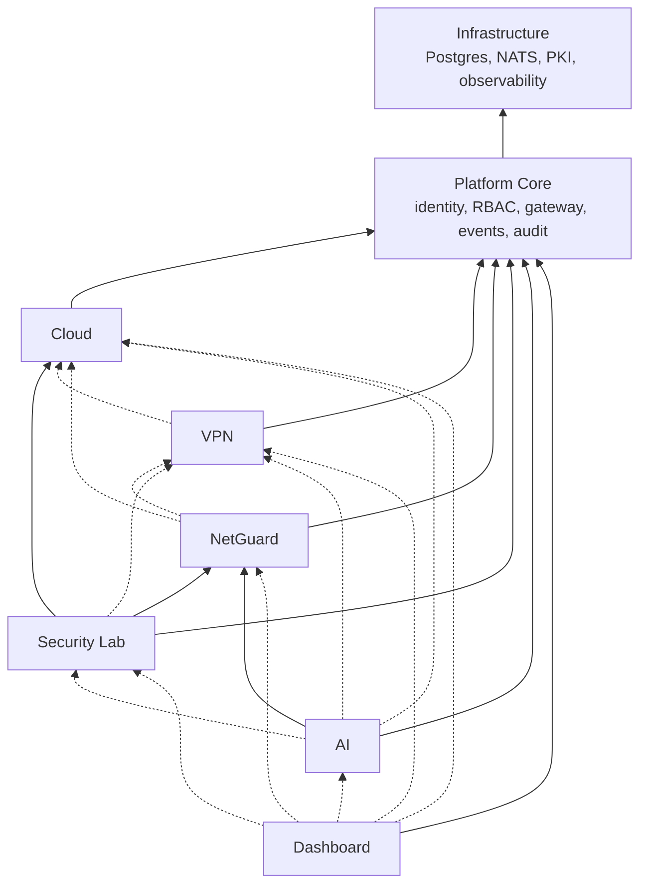

# 09 — Dependencies Between Subsystems

## 1. Dependency graph

A solid arrow means a **hard** dependency (it cannot function without the target). A dashed arrow means **soft** (enrichment or an optional feature that degrades gracefully).

## 2. Dependency matrix

| Consumer ↓ / Provider → | Core | Cloud | VPN | NetGuard | Lab | Third party |
|---|---|---|---|---|---|---|
| **Cloud** | **hard**: authn/authz, audit, events | — | soft: VPN routes make workloads reachable | soft: monitored by sensors (no runtime dependency) | — | image sources (import only) |
| **VPN** | **hard** | soft: resolve `network_id` → CIDR for policies | — | — | — | — |
| **NetGuard** | **hard** | soft: workload attribution; sensors on cloud bridges | soft: user/device attribution; sensor on `wg-pf0` | — | soft: integrity telemetry | offline OUI / GeoLite files |
| **Security Lab** | **hard** | **hard**: environments are Cloud VMs on `lab` networks | soft: analyst access path | **hard (policy)**: lab won't start if the lab sensor is unhealthy | — | — |
| **AI** | **hard** | soft: workload lookups | soft: identity lookups | **hard**: incidents, alerts, telemetry | soft: integrity reports | **hard**: Claude API |
| **Dashboard** | **hard** | soft | soft | soft | soft | — |

## 3. Failure-mode behaviour (degradation)

| Failed component | Impact | Unaffected |
|---|---|---|
| **Postgres** | All APIs return 503 on writes; reads fail | Running VMs/containers keep running; WireGuard keeps forwarding; **JIT expiry still enforced by the kernel**; sensors buffer to JetStream |
| **NATS** | Agents can't fetch new desired state (no new changes applied); events and telemetry queue in outboxes and shipper disk buffers | Existing workloads, VPN peers and nftables state persist; APIs still accept writes (outbox accumulates) |
| **pf-core** | No new logins or token refreshes; existing access tokens work until expiry (≤ 10 min); audit writes queue in `PF_AUDIT` | Agents, data plane |
| **pf-gateway** | No API or dashboard access | Everything else, including VPN data plane |
| **pf-cloudd** | No create/update/delete; no rescheduling | Running workloads (agents keep the last desired state they had and do **not** delete anything when the control plane is unreachable) |
| **pf-node-agent** | No convergence on that node; node → `NOT_READY`, workloads → `UNKNOWN` | VMs keep running (QEMU processes are independent of the agent) |
| **pf-vpnd** | No enrolment, activation or revocation through the API | Active tunnels until their JIT timeouts expire (fail-closed) |
| **pf-wg-agent** | Peer changes not applied; stats stop | Kernel WireGuard + nftables keep enforcing the last applied state |
| **pf-netguardd** | No ingest (JetStream retains up to 24 h / 2 GiB), no alerts UI | Detection keeps producing candidates into `PF_NG_ALERTS` (retained 7 d) |
| **pf-ng-detect** | No new alerts | Ingest/inventory continue; on restart it replays from its durable consumer position |
| **pf-labd** | No new lab environments or experiment updates. TTL destruction normally runs in labd, so as a backstop `pf-cloudd` enforces a hard `max_lifetime` (24 h) on every workload attached to a `lab` network | Running lab VMs remain isolated (isolation is enforced by Cloud and the host, not by labd) |
| **pf-aid / Claude API** | No investigations | All other functions |

Design rule: **agents never take destructive action because the control plane is unreachable.** Absence of desired state is "unknown", not "delete everything".

## 4. Startup order (Compose `depends_on` with health conditions; Helm hooks)

1. Postgres, NATS, step-ca
2. `pfctl nats apply` (streams/KV) and migrations (Job / init container per service)
3. `pf-core` (JWKS must be available)
4. `pf-gateway`
5. Domain services: `pf-cloudd`, `pf-vpnd`, `pf-netguardd`, `pf-ng-detect`, `pf-labd`, `pf-aid` (independent of each other; soft dependencies retry with backoff)
6. Agents (systemd units with `Restart=always`; they wait for NATS)
7. `pf-dashboard`

## 5. Build-order implications

The dependency graph dictates the roadmap order: **Core → Cloud → VPN → NetGuard → Lab → AI**, with the Dashboard growing alongside each subsystem rather than at the end. NetGuard comes after Cloud and VPN because its best data sources are the networks those subsystems create. AI comes last because it needs real, validated incidents to investigate.
