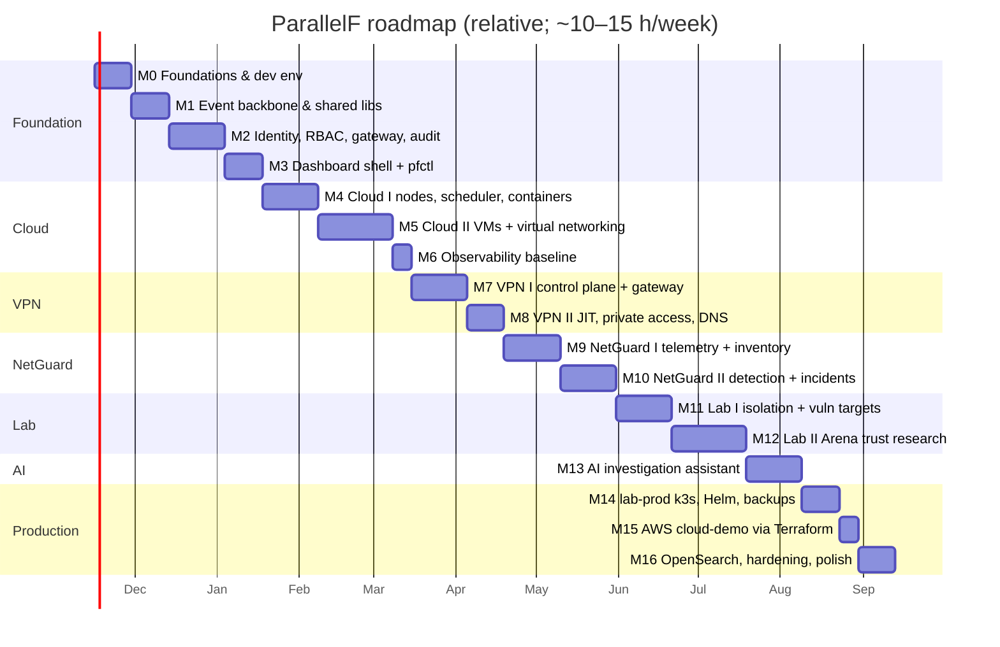

# 10 — Milestone Roadmap and Acceptance Criteria

## 1. Planning assumptions

- Pace: ~10–15 hrs/week. Estimates are in **working weeks at that pace**. Expect ±30%.
- Each milestone is a **vertical slice**: API + persistence + events + dashboard screen + tests + metrics + docs. Nothing is "backend now, UI later".
- Each milestone ends with a tagged release (`v0.<n>.0`), a 2–3 minute demo recording, and an updated architecture doc and ADR set.

## 2. Global Definition of Done (applies to every milestone)

1. CI green: lint, unit tests, contract checks, image scan with no CRITICAL findings, e2e for touched profiles.
2. Unit coverage ≥ 70% on new Go/Python packages (domain logic ≥ 85%). Coverage is not chased in generated code.
3. New endpoints exist in OpenAPI and new events in Protobuf **before** implementation; generated clients are used.
4. Metrics, structured logs and health endpoints for every new component. A Grafana panel for any new SLO.
5. Threat model updated for any new boundary, with each mitigation's verification test written.
6. Runbook added for any new operational action (rotate, revoke, restore, destroy).
7. Peak RAM measured for the profile and recorded in [08](08-infrastructure.md) §2.
8. `README` / `docs/dev-setup.md` still reproduces from a clean WSL distro.

## 3. Timeline

**Minimum resume-worthy slice:** M0–M5 + M7 + M9 + M10 (~6 months). That alone demonstrates a custom IaaS control plane, a WireGuard control plane and a network-monitoring pipeline. Cloud (M0–M5) is already resume-worthy on its own at ~4 months.

**Cut lines if time runs short (cut in this order):** M16 OpenSearch → M15 AWS → M8 internal DNS → M5 VXLAN stretch → M12 attack classes A6–A7.

---

## M0 — Foundations & developer environment (≈2 wk)

**Goal:** a reproducible, measurable dev environment and a CI skeleton.

Deliverables: monorepo skeleton per [04](04-monorepo-structure.md); `Taskfile.yml`; `go.work`; `uv` workspace; pnpm workspace; Compose with `core` infra (Postgres, NATS, step-ca); `scripts/dev/wsl-bootstrap.sh`, `check-nested-virt.sh`, `mem-report.sh`; pre-commit (gitleaks, formatters); CI workflows (lint/test per language with path filters); ADR template; `docs/dev-setup.md`; LICENSE, SECURITY.md.

Acceptance criteria:
1. From a fresh WSL2 Ubuntu 24.04, `scripts/dev/wsl-bootstrap.sh && task up:infra` brings Postgres, NATS and step-ca to healthy in **< 60 s** (after first image pull).
2. `check-nested-virt.sh` reports `/dev/kvm` usable, the WireGuard module loadable, nftables present and cgroup v2. Any failure prints the remediation.
3. A PR with a seeded fake AWS key fails CI (gitleaks), and so does a PR with a lint error in each language.
4. `mem-report.sh` outputs a per-process RSS table, and the infra profile's idle RSS is recorded in [08](08-infrastructure.md).
5. Exact versions for all toolchains and images are pinned (no `latest` tags).

## M1 — Event backbone & shared libraries (≈2 wk)

**Goal:** reliable eventing primitives every service reuses.

Deliverables: `pkg/events` + `pf_common.events` (CloudEvents headers, outbox writer, relay with advisory-lock leadership, idempotent consumer helper, DLQ handling); `pkg/natsx` provisioning from `deploy/nats/jetstream.yaml` (`pfctl nats apply`); `pkg/obs` (slog, Prometheus, OTel with NATS header propagation); `pkg/httpx` (problem+json, idempotency middleware, admin server); `buf` setup with `common/v1`; NATS NKey generation and permissions config.

Acceptance criteria:
1. **Crash test:** with 10,000 domain writes in a loop, killing the relay (`SIGKILL`) at random 20 times yields **exactly 10,000** unique events consumed. The consumer-side `processed_events` count matches and there are no duplicate side effects.
2. A message that fails processing 5 times lands in `pf.dlq.<stream>` with error headers, and a metric increments.
3. `pfctl nats apply` is idempotent: running it twice gives no diff, and a changed limit is applied.
4. A trace started in an HTTP handler continues in a NATS consumer (same `trace_id`, visible in logs).
5. A NATS identity publishing outside its permitted subjects gets a permissions violation (integration test).
6. `buf lint` and `buf breaking` run in CI.

## M2 — Identity, RBAC, gateway, audit (≈3 wk)

**Goal:** secure authentication and authorization, and a verifiable audit trail.

Deliverables: `pf-core` (bootstrap owner via one-time CLI token, login, argon2id, TOTP, WebAuthn, sessions with rotation, JWKS, projects, role bindings, service accounts, PATs, audit writer with hash chain); `pf-gateway` (JWT verification, routing, rate limits, audit emission); `api/permissions.yaml` + codegen; `core.yaml` OpenAPI.

Acceptance criteria:
1. There is no open registration. The owner is created only with the bootstrap token, which is single-use and expires in 1 h.
2. Login requires MFA when the flag is on (default on in lab-prod); TOTP and WebAuthn both work.
3. JWT test table passes: `alg=none`, HS256-with-public-key, unknown `kid`, wrong `aud`/`iss`, expired, not-yet-valid → **401** in every case.
4. Refresh-token reuse revokes the whole session family and writes an audit event.
5. A generated authorization test covers **every route × every role** against `permissions.yaml`, with 0 mismatches.
6. 100% of mutating requests in the e2e suite produce an audit row. `pfctl audit verify` passes, and fails after a row is altered in a test DB (modified as superuser with triggers disabled).
7. Login p95 < 300 ms at 5 rps locally with tuned argon2id parameters (documented).
8. Signing-key rotation: tokens signed by the previous key validate until they expire, and new tokens use the new `kid`.

## M3 — Dashboard shell + pfctl basics (≈2 wk)

**Goal:** a secure web shell and CLI that every later milestone extends.

Deliverables: Next.js app with BFF session, login + MFA screens, layout/navigation, project switcher, audit log viewer, SSE event hook, members/roles admin; generated TS client; `pfctl login|whoami|audit`.

Acceptance criteria:
1. Playwright: `document.cookie` contains no token, and the session cookie is `HttpOnly; Secure; SameSite=Strict` with the `__Host-` prefix.
2. Every page response carries the CSP from [dashboard.md](subsystems/dashboard.md) with a per-request nonce, and the CSP violation count during the e2e run is 0.
3. Cross-origin POST to `/bff/*` is rejected (CSRF test).
4. A new audit event appears in the open audit view in < 2 s via SSE, without reload.
5. axe accessibility checks pass on the login and audit pages (no serious/critical issues).
6. `pfctl login` stores a PAT in the OS keyring (or a 0600 file fallback) and never prints it after creation.

## M4 — Cloud I: nodes, scheduler, container workloads (≈3 wk)

**Goal:** a real control plane that schedules and reconciles container workloads.

Deliverables: `pf-cloudd` (nodes, flavors, images [container], workloads, operations, quotas, scheduler, reconciler, node controller); `pf-node-agent` (registration, heartbeat, desired-state reconcile, Docker driver); dashboard Cloud pages (workloads, nodes, operations); `pfctl cloud …`.

Acceptance criteria:
1. A node registers with a single-use bootstrap token. Reusing the token fails. The node appears `READY` with correct capacity.
2. `POST /cloud/workloads` (container) → `RUNNING` in **p95 < 15 s** with the image cached. State transitions are visible live in the dashboard.
3. **Self-healing:** `docker rm -f` of a managed container → recreated and back to `RUNNING` in **< 60 s**. A manually created container *with* a ParallelF label but not in desired state is removed after the grace period. Unlabelled containers are never touched.
4. **No over-allocation:** 50 concurrent create requests against a node with room for 10 produce exactly 10 scheduled workloads, the remaining 40 `PENDING` with an unschedulable reason, and allocations ≤ capacity (property/integration test).
5. Same `Idempotency-Key` twice → same operation ID, one workload.
6. Agent killed → node `NOT_READY` within 30 s, workloads `UNKNOWN`. Agent restarted → back to `READY`/`RUNNING` within 60 s **with no workload restarts**.
7. Quota exceeded → `422` problem with `quota.*` code.
8. NATS ACL test: node A's credentials cannot request node B's desired state.

## M5 — Cloud II: KVM VMs + virtual networking (≈4 wk)

**Goal:** VMs and containers on shared, isolated virtual networks.

Deliverables: libvirt driver (overlays, cloud-init seed ISO, domain XML via structs, console), image import with sha256 + SSRF guard, networks (`nat`, `isolated`, `lab`), IPAM, bridge + CNI attach for containers, nftables table management, VM console via gateway WebSocket (noVNC), volumes (local), dashboard network and console views. Stretch: VXLAN between two nodes.

Acceptance criteria:
1. An Ubuntu 24.04 cloud-image VM reaches `RUNNING` (guest reachable by ping from the host namespace) in **p95 < 90 s** with the base image cached. SSH works with the injected key.
2. A VM and a container on the same `nat` network can ping each other. Both reach the internet via masquerade.
3. On an `isolated` network: no internet (curl fails), and VM↔VM on the same network works.
4. On a `lab` network: the bridge has no host IP, and the workload cannot reach the host, other networks or the internet (automated test).
5. Overlapping CIDR creation is rejected by the **DB constraint** (returned as `409`).
6. **Leak check:** after creating and deleting 25 mixed workloads, there are zero orphan domains, overlays, taps/veths, IP allocations or nft rules (`task test:leaks`).
7. Domain XML for every VM contains `seclabel` and no `hostdev` (config test).
8. Image import refuses `http://169.254.169.254/...`, `https://localhost/...` and a digest mismatch.
9. The console WebSocket requires a valid single-use ticket. A reused ticket returns 401.
10. Agent nftables apply is atomic: an injected failure mid-render leaves the previous ruleset intact.

## M6 — Observability baseline (≈1 wk)

**Goal:** see the system working before adding more of it.

Deliverables: `obs` profile (Prometheus, Grafana provisioned as code), dashboards (platform overview, API RED, cloud capacity, reconcile/drift, NATS, Postgres), alert rules (service down, consumer lag, DLQ, cert expiry, disk).

Acceptance criteria:
1. Every running service shows `up == 1`, and the API RED dashboard shows per-route latency histograms.
2. Stopping `pf-cloudd` fires the "service down" alert within 2 min. Filling the DLQ fires its alert.
3. One click from a slow request in a Grafana panel to its trace/log lines by `trace_id` (via logs if the tracing add-on is off).
4. Dashboards and alert rules are fully provisioned from the repo (a fresh Grafana volume reproduces them).

## M7 — VPN I: control plane + gateway agent (≈3 wk)

**Goal:** real devices connect securely, and policy and revocation work.

Deliverables: `pf-vpnd` (gateways, devices, groups, policies, tunnel IPAM, enrolment tokens, stats ingest), `pf-wg-agent` (wgctrl, nftables policy compile, conntrack flush, stats/events), add-device wizard with in-browser X25519 key generation and QR, policy editor + simulator, device/connection views, `pfctl vpn enroll`.

Acceptance criteria:
1. A phone you own on **cellular data** connects using the official WireGuard app and reaches only what its policies allow (gateway API on the tunnel IP). Other destinations time out.
2. **Private key never transmitted:** the Playwright test inspects all requests during enrolment, and none contains the private key (base64 or raw).
3. **Revocation < 10 s** from API call to traffic drop for a continuously pinging device (measured over 20 runs, p95). Existing TCP connections are terminated (conntrack flush).
4. Policy deny is effective: `nc -vz` to a denied port fails, an allowed port succeeds, and the simulator predicts both correctly.
5. Restarting the agent re-converges to an identical WireGuard + nftables state (diff of `wg show dump` and `nft list table` before and after is empty).
6. Online/idle/offline status updates in the dashboard within 30 s of the client connecting or disconnecting.
7. Tunnel IP spoofing test: a peer sending with another peer's source IP gets its packets dropped.
8. Duplicate public key → `409`. Malformed key → `422`.

## M8 — VPN II: JIT access, private connectivity, DNS (≈2 wk)

**Goal:** MFA-gated, fail-closed access to cloud networks.

Deliverables: JIT activations with the nftables timeout set, step-up MFA flow, policy targets referencing Cloud networks, routing to cloud networks, CoreDNS `*.pf.internal`, device expiry job.

Acceptance criteria:
1. A device that is enrolled but not activated cannot pass any traffic.
2. Activation requires MFA within 15 min. A stale session gets a `step-up-required` problem, and the dashboard prompts.
3. **Fail-closed test:** activate with a 2-minute TTL, then **stop `pf-vpnd`, NATS and Postgres**. Traffic stops within 2 min ± 5 s.
4. Agent restart does not extend an activation (absolute-expiry test).
5. A VPN client reaches a VM's private IP on a `nat` network when a policy allows it, and fails when it doesn't. A `lab` network is unreachable unless it is the designated analyst VM and the user holds `lab-researcher`.
6. `<workload>.pf.internal` resolves over the tunnel to the current IP, and the record updates within 30 s of the IP changing.
7. Devices past `expires_at` are removed from the gateway automatically, and an audit event is written.

## M9 — NetGuard I: sensors, telemetry pipeline, inventory, discovery (≈3 wk)

**Goal:** trustworthy, backpressured telemetry from owned networks.

Deliverables: Zeek on cloud bridges and `wg-pf0`, `pf-ng-shipper`, `pf-netguardd` ingest (partitioned flows/DNS/HTTP/TLS), inventory, attribution (VPN + Cloud), retention job, authorized scopes with signing, `pf-ng-discovery`, dashboard assets/flows/scopes views.

Acceptance criteria:
1. A `curl` from a VM shows up as a flow in the dashboard in **p95 < 30 s**, attributed to its workload. Traffic from a VPN device is attributed to user + device.
2. A new VM appears as an asset (MAC, IP, vendor/OUI) without manual entry.
3. **Scope enforcement:** discovery refuses (and counts and audits) public IPs, CIDRs larger than /22, expired scopes, unsigned scopes, and scopes signed by an unknown key. Unit and integration tests pass.
4. **Throughput:** a replay of 2,000 events/s for 10 min loses no events (consumer pending stays bounded and returns to ~0 within 60 s after the load stops) on dev hardware.
5. **Backpressure:** at 5× load the shipper buffers to disk up to its cap, then drops with a counter. Zeek is never blocked and the platform stays responsive (API p95 < 500 ms).
6. Restarting the shipper neither duplicates nor loses lines (offset test with rotation in between).
7. Retention drops partitions older than the configured window, and future partitions exist 3 days ahead.
8. The normalizer fuzz test runs in CI (time-boxed) with no crashes.

## M10 — NetGuard II: detection, alerts, incidents, topology (≈3 wk)

**Goal:** turn telemetry into actionable, evidence-backed incidents.

Deliverables: Suricata (trimmed ET Open), `pf-ng-detect` with detectors from [netguard.md](subsystems/netguard.md) §3.4, alert dedupe and suppression, correlation → proposed incidents, incident workflow + timeline + evidence hashing, topology graph view, `lab/scenarios/` simulation suite.

Acceptance criteria:
1. **Detection suite** (`task ng:scenarios`, run in an isolated or lab network against your own VMs): port scan, beaconing loop, DNS high-entropy queries, new device, egress spike, revoked-device reconnect attempt, and a Suricata test signature. **≥ 95%** of scenarios raise the expected alert within 60 s.
2. **Benign baseline:** 1 h of scripted normal activity produces **0 alerts ≥ medium**.
3. Repeated detections update one open alert (count/last_seen) rather than creating duplicates (dedupe index test).
4. Correlated alerts propose an incident. Analyst confirmation creates it with a timeline.
5. Evidence attached to an incident is stored with SHA-256, and `GET /evidence/{id}` re-verifies the hash. Tampering with the stored object makes verification fail.
6. Topology view renders the cloud, VPN and lab segments correctly for the scenario environment.
7. An XSS fixture (script tags in hostname, UA, DNS name) renders as text, and CSP reports are 0.

## M11 — Security Lab I: isolation + vulnerable targets (≈3 wk)

**Goal:** a provably isolated lab and the educational target catalogue.

Deliverables: `pf-labd` (targets, templates, environments with TTL, experiments, findings), the lab-network admission rules in Cloud, read-only ISO ingress, isolation-check suite, `vt-01`…`vt-05` targets with vuln/fixed/exploit-check and the mitigation matrix, `ci-lab-targets.yml`, rules of engagement, the first two write-ups.

Acceptance criteria:
1. **Isolation suite** at every environment start: from a lab VM, ICMP/TCP/UDP/DNS to the host, the gateway tunnel IP, LAN, other cloud networks and the internet **all fail**. Results are stored on the environment. Failure blocks `READY`.
2. Starting an environment while the lab sensor is unhealthy is refused with a clear error.
3. Environments are destroyed at TTL (tested with a 2 min TTL), and Cloud's `max_lifetime` backstop destroys lab workloads even when `pf-labd` is stopped.
4. Admission rejects a workload attached to a lab network plus any other network, and a container on a lab network.
5. For each target, the exploit-check **detects the bug in the vulnerable build** (sanitizer report or controlled crash) and **passes cleanly on the fixed build**, in CI with `--network none`.
6. A deliberate egress attempt from a lab VM (e.g. `curl 1.1.1.1`) fails, increments the lab nftables drop counter, **and** raises `ng.lab_egress_attempt` as a critical alert within 60 s.
7. Every experiment and finding change is audited.

## M12 — Security Lab II: ParallelF Arena client/server trust (≈4 wk)

**Goal:** demonstrate server authority and detection on your own game.

Deliverables: Unity project `lab/unity/ParallelFArena` (dedicated Linux server, Linux client with bot mode, Mono and IL2CPP builds), server-side validation (movement, fire rate, hit rewind, economy), integrity/gameplay telemetry over the lab relay, `lab.game_integrity` detector, research catalogue A1–A7 write-ups.

Acceptance criteria:
1. Server and bot clients run headless in lab VMs (2 vCPU / 2 GB server VM). An 8-bot match is stable for 15 min.
2. **A3 speed modification** (a client build you modified in the lab) is corrected server-side, and an alert appears in NetGuard **within 5 s**.
3. **A2 memory edits** of client health or ammo have no effect on server-side state (bot test asserts server values).
4. **A4 replay** of captured packets is rejected (sequence/session checks). The rejection counter increments.
5. **A5 impossible hit claims** apply 0 damage, and the alert includes player/session evidence.
6. Benign bots over 30 min produce a **false-positive rate < 1%** of sessions flagged, documented in the A7 write-up.
7. The lab relay drops malformed, oversized or over-rate messages (fuzz test), and nothing flows back into the VM.
8. Each attack class has a write-up with reproduction notes (lab-only), mitigation, and the test or detection that verifies it.

## M13 — AI investigation assistant (≈3 wk)

**Goal:** an evidence-cited, read-only, cost-bounded investigation assistant.

Deliverables: `pf-aid` (orchestrator, tool registry, validator, redaction, budgets), the `svc:aid` service account with read-only permissions, report UI with claim highlighting and approval, eval harness with golden scenarios (from M10/M12) and an injection corpus.

Acceptance criteria:
1. **Read-only by construction:** a static test enumerates the tool registry and asserts every tool maps to a GET endpoint. The `svc:aid` role has only `*.read` permissions, and the `pf_aid` DB role has privileges only on the `ai` schema.
2. On the golden set (≥ 10 scenarios), **≥ 90% of reports pass citation validation**, and key-fact recall is ≥ 80%.
3. A report with an invented evidence ID or an entity absent from its cited evidence is **never** marked `validated` (unit tests with crafted reports).
4. **Injection corpus:** tool-call patterns stay within each scenario's normal set. Injected text never appears as a followed instruction and is treated as observed data.
5. Budgets: per-investigation caps stop the loop with `budget_exceeded`. Once the daily cap is hit, new investigations are refused without calling the API.
6. The AI output renderer strips images and raw HTML, and links are inert until confirmed (Playwright).
7. Each investigation shows its tool steps, tokens, estimated cost and the fields sent to the API.
8. Approving a report attaches it to the incident timeline with an audit record. Unapproved reports never appear on the incident.

## M14 — lab-prod deployment: k3s, Helm, backups (≈2 wk)

**Goal:** a production-like deployment and operational discipline.

Deliverables: Helm umbrella chart, NetworkPolicies, Pod Security `restricted`, SOPS-managed secrets, `pf-node1` Hyper-V VM setup, router port-forward runbook, backup CronJob, restore drill, runbooks.

Acceptance criteria:
1. `task deploy:labprod` installs or upgrades from scratch to all-ready in < 10 min. `helm upgrade` with no changes is a no-op.
2. A port scan of `pf-node1` from the LAN (your own scan of your own host) shows only **UDP 51820**. The dashboard is reachable only through the VPN.
3. NetworkPolicy test: a debug pod in the namespace cannot reach Postgres unless it carries an allowed label.
4. **Restore drill:** delete the database volume, restore from the latest backup within **RTO 1 h**, `pfctl audit verify` passes, and the data loss window is within RPO 24 h.
5. All platform pods run as non-root with read-only root filesystems where possible, and the `restricted` PSA admits them.

## M15 — AWS cloud-demo via Terraform (≈1 wk)

**Goal:** show infrastructure-as-code on real cloud, safely and cheaply.

Deliverables: Terraform modules and env, cloud-init bootstrap, budget alarms, SSM access, `task aws:up|down|verify-clean`.

Acceptance criteria:
1. `task aws:up` → platform (container driver) reachable via VPN in **< 15 min**. `task aws:down` → `verify-clean` finds **zero** tagged resources and no unattached EIPs, volumes or snapshots.
2. The security group has exactly one ingress rule (UDP 51820). Admin access works via SSM with no SSH key pair.
3. `terraform plan` after `apply` shows no changes. `tflint` and `checkov` (or `trivy config`) pass with documented exceptions only.
4. Budget alarms are confirmed in the console, and the actual demo cost is recorded in the README.

## M16 — OpenSearch, hardening, portfolio polish (≈2 wk)

**Goal:** finish strong.

Deliverables: `ng-full` profile with OpenSearch dual-write and search UI, signed desired-state snapshots for agents (threat #10), chaos scripts, k6 load tests, final threat model review, demo video, README polish, architecture diagram export, resume bullets.

Acceptance criteria:
1. Full-text search across 7 days of Zeek logs returns in < 2 s. Disabling OpenSearch degrades gracefully (Postgres search path still works and the UI hides full-text).
2. Agents reject unsigned or tampered desired-state snapshots (test).
3. **Chaos:** killing NATS, Postgres or an agent mid-operation (scripted, 10 runs each) causes no lost committed events, no duplicated side effects, and full convergence within 2 min of recovery.
4. k6: API sustains 50 rps mixed reads at p95 < 300 ms on dev hardware with the `core+cloud` profile.
5. README quickstart takes a reviewer from clone to a running `core` profile in < 15 min.
6. Every threat-model verification listed in [07](07-trust-boundaries-and-threat-model.md) links to an existing passing test.
