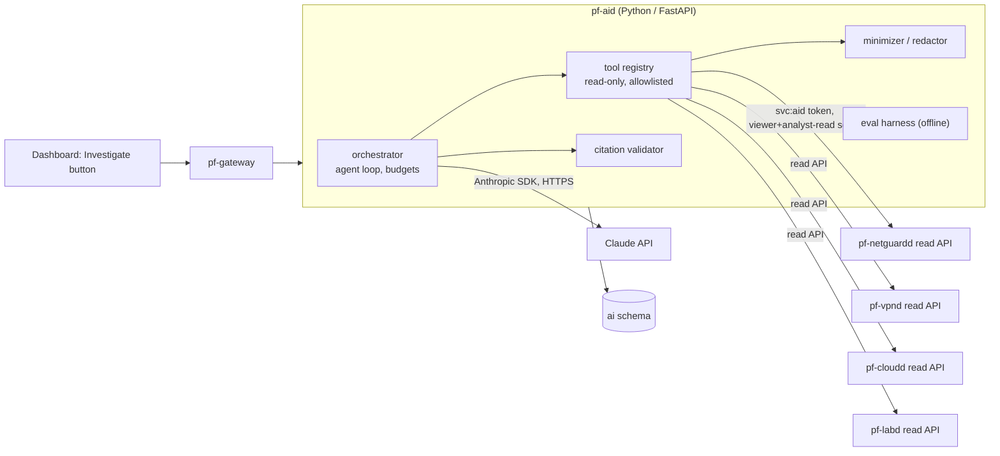
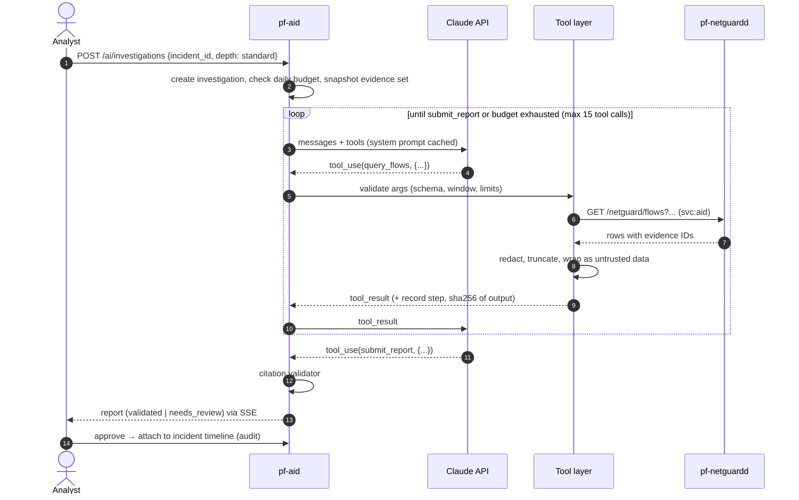

# ParallelF AI — Read-Only Security Investigation Assistant

## 1. Goals and hard constraints

- Given an incident (or alert), investigate using **verified telemetry only** and produce an **evidence-backed report**: summary, timeline, affected assets and identities, hypotheses with confidence, and recommended next steps for a human.
- **Read-only by construction.** No tool can change anything. That holds even if the model is fully manipulated by prompt injection hidden in telemetry.
- **Every factual claim cites evidence IDs.** A deterministic validator checks the citations before a report can be shown as "validated".
- Humans stay in the loop. Reports attach to an incident only after an analyst approves them, and recommended actions are links to the owning UI, never automatic calls.
- Cost-bounded, auditable and evaluable.

## 2. Components



`pf-aid` has **no direct database access to other schemas**. It calls other services' read endpoints with the `svc:aid` service account, whose role grants only `*.read` permissions. Its own DB role can write only to the `ai` schema.

## 3. Tools exposed to the model

All tools are **parameterized queries with bounded outputs**. The model never writes SQL, OpenSearch DSL or URLs.

| Tool | Input (validated by Pydantic) | Output cap |
|---|---|---|
| `get_incident` | `incident_id` | incident, linked alert IDs, timeline summary |
| `get_alert` | `alert_id` | alert with evidence refs |
| `query_flows` | `src_ip?`, `dst_ip?`, `dst_port?`, `community_id?`, `time_from`, `time_to` (window ≤ 24 h), `limit ≤ 200` | rows with `evidence_id` (`flow:<partition>:<id>`) |
| `query_dns` | `src_ip?`, `qname_suffix?`, window, limit | rows with evidence IDs |
| `get_asset` | `asset_id` or `ip` + `at_time` | asset record + attribution |
| `get_vpn_attribution` | `tunnel_ip`, `at_time` | user/device (display name only, no keys) |
| `get_workload_by_ip` | `ip`, `at_time` | workload metadata (no cloud-init user-data, no env vars) |
| `list_related_alerts` | `asset_id` or `community_id`, window | alert summaries |
| `get_lab_integrity_reports` | `session_id` or `player_id`, window | reports |
| `submit_report` | the report schema (§5) | terminates the loop |

Field allowlists are enforced in the tool layer. Secrets, keys, PSKs, password hashes, tokens, cloud-init data and environment variables are **not reachable by any tool**.

## 4. Orchestration loop



- **Model:** configurable (`PF_AI_MODEL`). Default to a Sonnet-class model for cost, with an opt-in "deep" mode using an Opus-class model. Model IDs live in config, not code.
- **Prompt caching** on the long, static system prompt and tool definitions reduces cost for repeated investigations.
- **Budgets:** per investigation (max tool calls, max input/output tokens, wall-clock 120 s) and per day (estimated USD, configurable). Exceeding a budget ends the investigation with status `budget_exceeded` and a partial, clearly labelled report.
- **Retries:** exponential backoff on rate-limit and overload errors. Tool errors are returned to the model as structured errors, not exceptions.

## 5. Report schema (enforced through the `submit_report` tool's JSON Schema)

```json
{
  "summary": "string (≤ 1200 chars)",
  "severity_assessment": "info|low|medium|high|critical",
  "confidence": "low|medium|high",
  "timeline": [{"time": "RFC3339", "event": "string", "evidence": ["flow:2026-11-10:01937..."]}],
  "claims": [{"id": "c1", "text": "string", "evidence": ["alert:...", "flow:..."],
              "entities": {"ips": ["10.20.1.15"], "assets": ["asset:..."], "ports": [443]}}],
  "hypotheses": [{"text": "string", "supporting_claims": ["c1"], "confidence": "low|medium|high"}],
  "gaps": ["string — what evidence is missing"],
  "recommended_actions": [{"text": "string", "subsystem": "vpn|cloud|netguard|lab", "requires_human": true}]
}
```

## 6. Citation validator (deterministic, no LLM)

A report is `validated` only if **all** of the following hold:

1. Every `claims[].evidence` ID and `timeline[].evidence` ID appears in the outputs of tool calls **made during this investigation** (the step log stores output hashes and the IDs returned).
2. Every entity in `claims[].entities` (IPs, ports, asset IDs) appears in at least one cited evidence record.
3. Every timestamp in the timeline is within ±60 s of a timestamp in its cited evidence.
4. No claim lacks evidence. Hypotheses may be uncited but must reference claims.

Failures are listed per claim. The UI shows unverified claims highlighted, and the report status becomes `needs_review`. Validation results are stored, so the **citation pass rate** is a tracked quality metric.

## 7. Prompt-injection and data-handling posture

Telemetry is attacker-influenced (hostnames, DNS queries, HTTP user agents, TLS SNI, filenames, in-game player names). Mitigations:

| Risk | Mitigation |
|---|---|
| Injected instructions in telemetry | Tool results are wrapped as data with explicit delimiters, and the system prompt states that tool content is untrusted. **The decisive control is structural:** no write tools, no egress tools, bounded queries. The worst outcome is a wrong report, which the validator and human review catch |
| Model asks for out-of-scope data | Tool-layer validation rejects it (time windows, limits, allowlisted fields) |
| Exfiltration through the model's own output | Output is rendered as sanitized Markdown (no images, no auto-loaded links, no raw HTML) so injected Markdown images can't leak data to a URL |
| Sensitive data sent to a third party | Data minimization at the tool layer. Optional pseudonymization of user emails and display names (`user_7f3a`) with a reversible mapping kept locally. Never sends credentials or keys. Each investigation shows "data sent to Anthropic" in its step log |
| API key exposure | Stored as a file secret, loaded only by `pf-aid`, with a workspace spend limit set in the Anthropic console. Never logged |
| Over-trust in AI output | Label "AI-generated — analyst review required". Approval is an explicit, audited action |

## 8. Evaluation harness

- **Golden incidents:** replayable scenarios produced by the NetGuard lab simulation suite (port scan of a lab VM, beaconing container, DNS-tunnel-like traffic, revoked-device reconnect attempts, Arena speed-hack session), each with expected key facts.
- **Metrics:** citation pass rate, key-fact recall, false-claim count (claims that fail validation), tool calls per investigation, tokens, cost, latency.
- **Injection corpus:** the same scenarios with injected strings in hostnames, user agents and player names. Pass condition: no tool-call pattern outside the scenario's normal set, and the injection shows up in `gaps` or claims as observed data, not followed as an instruction.
- Runs offline (`task ai:eval`) against recorded tool outputs. A full live run happens only on demand, to control cost.
