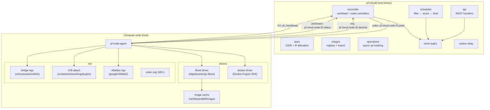
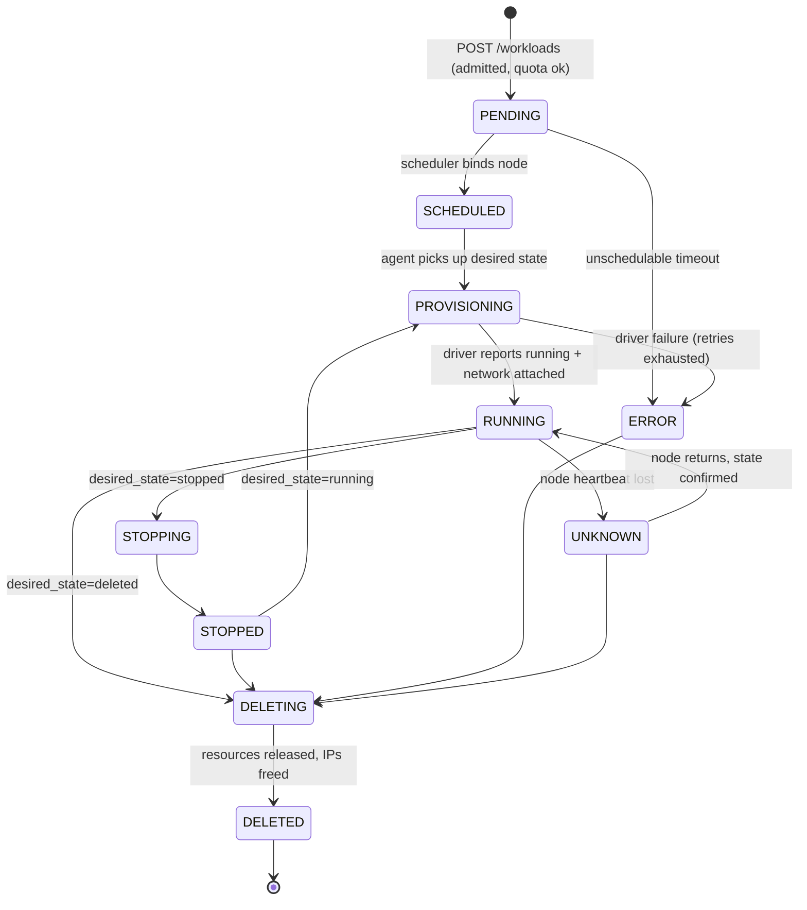
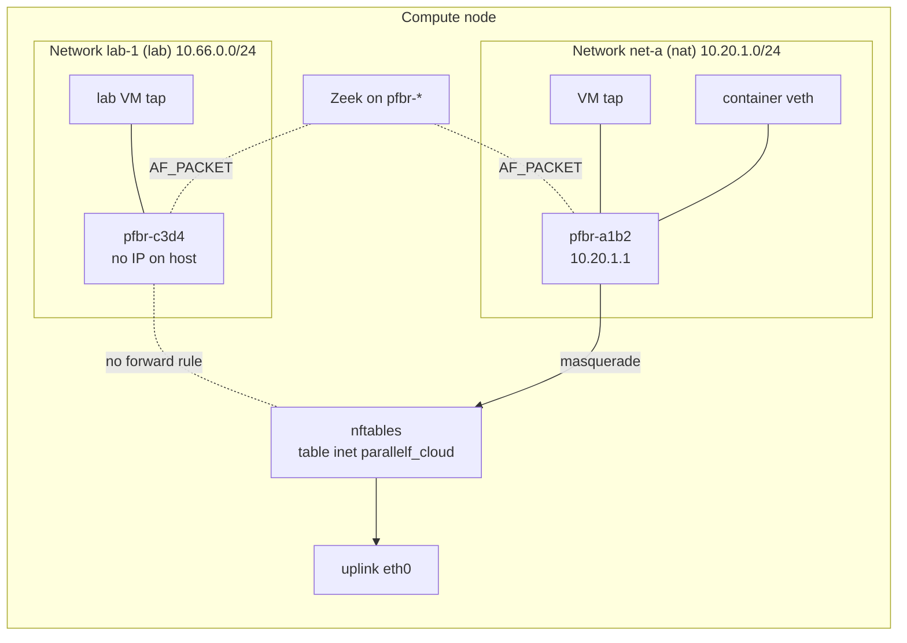

# ParallelF Cloud — Mini IaaS + Container Platform

> **Implementation status (Phase 2).** The resource model, lifecycle, scheduler, IPAM, quotas, level-triggered reconciliation, audit log and outbox events below are implemented for one host; the operator guide is [docs/cloud.md](../../cloud.md). Phase 2 departs from this design in four places, recorded in [ADR-0013](../../adr/0013-cloud-phase-2-agent-protocol-and-runtimes.md): agents sync over HTTP instead of NATS, runtimes are driven through `virsh`/`qemu-img` and the Docker Engine API instead of client libraries, each network belongs to one runtime (libvirt or Docker) instead of a shared CNI bridge with an agent-owned nftables table, and images are fetched by the agent from pinned URLs instead of an import API. Operations, volumes, labels/taints, image-locality scoring and VXLAN are not built yet.

## 1. Goals

- Run **VMs** (KVM via libvirt) and **containers** (Docker Engine) through a single workload API.
- Schedule onto one or more nodes using a real filter/score scheduler with quotas and overcommit.
- Manage the full lifecycle declaratively: desired state goes into the API, and the system converges to it.
- Provide virtual networks that VMs and containers share, with IPAM, NAT egress, isolation, and a special `lab` network type.
- Be observable and self-healing within the limits of a local-disk design.

Non-goals for v1: live migration, shared storage, GPU passthrough, autoscaling groups, load balancers. See §9 for the extension points.

## 2. Components

## 3. Resource model

| Resource | Key fields | Notes |
|---|---|---|
| `Node` | hostname, capabilities (`kvm`, `docker`, `nested`), capacity and allocatable (vCPU, MiB, GiB), labels, taints, status | Registers itself with a one-time bootstrap token and gets an mTLS cert plus a NATS NKey |
| `Flavor` | name, vCPU, mem MiB, disk GiB | e.g. `pf.nano` (1 vCPU / 512 MiB / 5 GiB), `pf.small` (1 / 1024 / 10), `pf.medium` (2 / 2048 / 20) |
| `Image` | kind `vm` (qcow2) or `container` (OCI ref), source, **sha256 digest (required)**, os type, min memory | VM images are imported once into the node cache and verified by digest |
| `Network` | kind `nat` / `isolated` / `lab`, CIDR, gateway IP, bridge name, VNI (multi-node) | CIDRs may not overlap within a project (DB exclusion constraint) |
| `Workload` | kind `vm` / `container`, flavor, image, network(s), ssh keys, env (containers), cloud-init user-data (VMs), restart policy, **desired_state**, **generation** | Single API for both kinds |
| `Volume` | size, node, attachment | Local qcow2 or Docker volume. Pinned to its node |
| `Operation` | kind, status, resource ref, idempotency key, error | Every mutating call returns `202 Accepted` + an Operation |
| `Quota` | per project: max vCPU, mem, instances, disk | Checked transactionally at admission |

### 3.1 Workload lifecycle

`generation` increases on every spec or desired-state change. The agent reports `observed_generation` back. The UI shows "converging" whenever the two differ, the same pattern Kubernetes uses.

## 4. Scheduler

Single active scheduler (leader election via Postgres advisory lock). It is event-driven, triggered by a workload-created notification, and also runs a 10 s sweep for anything still `PENDING`.

1. **Filter.** Node is `READY` and not tainted `NoSchedule`; it has the required capability (`kvm` for VMs); fits `requested ≤ allocatable × overcommit − allocated` (defaults: CPU 4.0, memory **1.0**, disk 1.0); label selector matches; anti-affinity group not already on the node; the image is compatible.
2. **Score.** A weighted sum of plugins: `binpack` (default in dev, packs workloads to leave RAM free elsewhere) or `spread` (default in multi-node); `image-locality` (base image already cached); `network-locality` (the network's bridge already exists on the node).
3. **Bind.** One transaction: `SELECT … FROM cloud.nodes WHERE id=$1 FOR UPDATE`, recheck capacity, insert into `allocations`, set `workloads.node_id`, `state=SCHEDULED`, `generation+1`, write an outbox event, commit. This prevents double-booking even if two schedulers ever run concurrently.

Failure handling: the scheduler records unschedulable reasons on the workload (e.g. `0/1 nodes: insufficient memory`) and an event. After 10 minutes `PENDING` → `ERROR`.

## 5. Reconciliation protocol (control plane ↔ agent)

This is **level-triggered**: the agent always converges to a full desired-state snapshot and never applies one-off commands. See [ADR-0006](../../adr/0006-level-triggered-reconciliation.md).

1. On startup, on every `poke`, and every 30 s, the agent sends a request on `pf.cloud.node.<id>.desired`. `pf-cloudd` replies with `DesiredNodeState{revision, workloads[], networks[]}`.
2. The agent diffs desired against actual (libvirt domains labelled `parallelf.workload_id` in metadata, Docker containers labelled `io.parallelf.workload_id`, bridges named `pfbr-<shortid>`).
3. It applies the minimal changes. Each action is idempotent: "ensure network", "ensure domain defined", "ensure running".
4. It publishes `WorkloadStatusReport{workload_id, observed_generation, state, ip, error}` to JetStream `pf.cloud.node.<id>.status`.
5. A heartbeat goes into KV bucket `pf_heartbeats` (key `cloud.node.<id>`, bucket max-age 30 s) every 10 s. The node controller marks the node `NOT_READY` after a missed TTL and its workloads `UNKNOWN`.
6. **Orphans** (resources labelled ParallelF that are not in desired state) are deleted after a 2-minute grace period. Unlabelled resources are never touched.

Why not a command queue? Commands can be lost, reordered or replayed. Snapshots plus idempotent convergence give correctness for free after crashes, restarts and partitions.

## 6. Drivers

### 6.1 libvirt / KVM

- Connects to `qemu:///system` through the pure-Go `digitalocean/go-libvirt`, which avoids cgo and keeps cross-compilation simple.
- Disk: a qcow2 **overlay** backed by the cached base image (`qemu-img create -f qcow2 -F qcow2 -b base.qcow2 overlay.qcow2 <size>`), so creation is instant.
- Boot config: cloud-init **NoCloud** seed ISO (hostname, SSH keys, network config, user-data), generated in Go (`kdomanski/iso9660`).
- Domain XML built with `libvirt.org/go/libvirtxml` structs, **never with string templates**. Features: virtio disk/net, `host-passthrough` CPU in dev, serial console + VNC bound to `127.0.0.1` on the host, `<seclabel>` (AppArmor/sVirt) enabled, QEMU `seccomp_sandbox=1` in `qemu.conf`.
- Metadata `<parallelf:workload id=… generation=…/>` in the domain XML makes reconciliation possible.
- Readiness: the domain is running, the guest has a DHCP lease (or static IP from IPAM via cloud-init), and an optional qemu-guest-agent ping succeeds.

### 6.2 Docker (containers)

- Docker Engine API via the official Go SDK. Images are pulled by **digest** only.
- Containers start with `--network none`. The agent then calls the **CNI bridge plugin** with a static IP from ParallelF IPAM to attach a veth into the network's Linux bridge. VMs and containers on the same ParallelF network therefore share one L2 segment.
- Hardening defaults: non-root user where the image allows it, `no-new-privileges`, all capabilities dropped and only explicitly requested ones re-added, read-only root fs optional, pids/memory/CPU limits from the flavor.
- **Policy:** untrusted or lab code never runs in containers. It runs only in VMs, because kernel sharing is too weak a boundary.

## 7. Virtual networking

| Network kind | Host IP on bridge | DHCP / DNS | Egress | Inbound | Monitored |
|---|---|---|---|---|---|
| `nat` | yes (gateway) | dnsmasq per bridge or cloud-init static | masquerade to uplink | via VPN policy only | yes |
| `isolated` | yes | yes | none (forward drop) | via VPN policy only | yes |
| `lab` | **no** | static via cloud-init only | **none** | **none** except analyst VM on the same network | yes (mandatory) |

- **IPAM** lives in Postgres (`cloud.ip_allocations` with primary key `(network_id, ip)`). Allocation scans for the lowest free address, with a unique constraint as the final arbiter.
- **nftables.** The agent owns `table inet parallelf_cloud` and replaces it **atomically** on every reconcile (nftables transactions), so partial rule states never exist. It never touches other tables (Docker's iptables-nft rules and the VPN tables are separate).
- **Multi-node (M5 stretch).** One VXLAN device per network (`vx-<vni>`) is attached to the bridge, with static FDB entries for peer nodes pushed through desired state. Underlay traffic travels over WireGuard between nodes, so it is encrypted.
- **VPN reachability.** `pf-wg-agent` routes the tunnel CIDR to cloud networks according to VPN policies (see [vpn.md](vpn.md)).

## 8. Images

- `pfctl image import --url https://cloud-images.ubuntu.com/... --sha256 …` → `pf-cloudd` downloads into object storage with a size cap and **digest verification**. It refuses URLs that resolve to private or link-local ranges (SSRF guard).
- Nodes fetch from object storage on first use (`image-locality` scoring rewards nodes that already have the image).
- Curated defaults: Ubuntu 24.04 cloud image (VMs), Alpine and Debian slim (containers), and lab images built from the same base plus cloud-init.

## 9. Extension points

| Extension | Hook |
|---|---|
| New runtime (e.g. Firecracker, containerd, k3s namespace) | `Driver` interface: `Ensure(ctx, desired) (Observed, error)`, `Delete`, `List` |
| Scheduler plugins | `FilterPlugin`, `ScorePlugin` interfaces registered by name in config |
| Network types | `NetworkProvider` (bridge+nft today; VXLAN, macvlan later) |
| Security groups | per-workload nftables sets, already modelled by the `parallelf_cloud` table structure |
| Metadata service | `169.254.169.254` link-local responder in the agent (stretch) |

## 10. Key metrics

`pf_cloud_workloads{state,kind}`, `pf_cloud_schedule_duration_seconds`, `pf_cloud_unschedulable_total{reason}`, `pf_cloud_reconcile_duration_seconds{node}`, `pf_cloud_node_allocatable{resource}`, `pf_cloud_node_allocated{resource}`, `pf_cloud_agent_drift_corrections_total{kind}`, `pf_cloud_vm_boot_seconds`.
