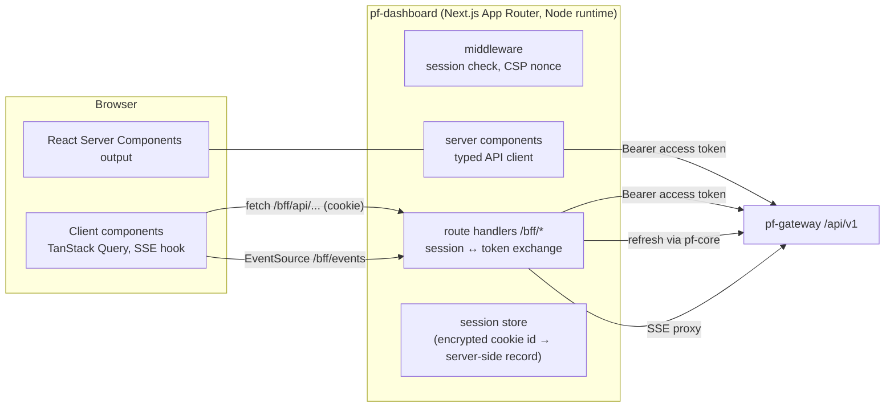

# ParallelF Dashboard — Unified Web Interface

## 1. Goals

- One interface for every subsystem, consistent and fast, with live updates.
- **Secure by default:** tokens never reach browser JavaScript, a strict CSP, every attacker-influenced string rendered as text, and no `dangerouslySetInnerHTML`.
- Thin. All business logic stays in the services. The dashboard is UI plus a small BFF.

## 2. Architecture

- **BFF session.** On login the BFF receives access and refresh tokens from `pf-core` and stores them server-side, in memory in dev or in a small Postgres table `core.web_sessions` in lab-prod (through the `pf-core` API, so the dashboard still owns no database). The browser holds only an opaque session ID in a `__Host-pf_sid` cookie (`HttpOnly; Secure; SameSite=Strict; Path=/`).
- **CSRF.** SameSite=Strict, plus a double-submit token on all `/bff` mutations, plus an `Origin` header check.
- **CSP.** `default-src 'self'; script-src 'self' 'nonce-<per-request>' 'strict-dynamic'; object-src 'none'; base-uri 'none'; frame-ancestors 'none'; connect-src 'self'; img-src 'self' data:`. Also `Referrer-Policy: no-referrer`, `X-Content-Type-Options: nosniff`, `Permissions-Policy` locked down.
- **API client.** Generated from the bundled OpenAPI spec (`openapi-typescript` + `openapi-fetch`), so types match the backend exactly.
- **Live updates.** One SSE connection per tab to `/bff/events`, multiplexed by event type. TanStack Query caches are invalidated or patched by event type.

## 3. Information architecture

| Section | Key screens |
|---|---|
| **Overview** | Platform health (services, nodes, gateways, sensors), open incidents, recent audit, resource usage vs RAM budget |
| **Cloud** | Workloads (list/detail, console tab, events, metrics), Networks (CIDR, attached workloads, topology mini-map), Images, Nodes (capacity bars, allocations), Operations |
| **VPN** | Devices (status chips: online/idle/offline, JIT active countdown), Add device wizard (key generated in browser, QR), Groups, Policies (ordered list + "effective access" simulator), Connection history |
| **NetGuard** | Assets (authorized state, first/last seen), Topology (graph view with Cytoscape.js; nodes coloured by network kind), Flows explorer (time range, filters, pivot from any IP), Alerts queue, Incidents (timeline, evidence, AI tab), Scopes & sensors |
| **Security Lab** | Environments (TTL countdown, VMs, isolation health), Targets, Experiments & findings, Integrity reports |
| **AI** | Investigations (status, cost, step log), report viewer with validated/unverified claim highlighting and evidence pop-overs |
| **Admin** | Members & roles, service accounts, API tokens, audit log (with chain-verification status), settings |

## 4. Tech choices

| Concern | Choice |
|---|---|
| Framework | Next.js (App Router), React, TypeScript `strict` |
| Styling / components | Tailwind CSS + shadcn/ui (Radix primitives give accessible components) |
| Data fetching | Server components for initial loads; TanStack Query in client components |
| Forms / validation | react-hook-form + zod (schemas generated from OpenAPI where possible) |
| Charts | Recharts (metrics), Cytoscape.js (topology), noVNC (VM console) |
| Markdown (AI reports) | `react-markdown` + `rehype-sanitize` with a strict schema; links rendered inert with an "open" confirmation; images disabled |
| Testing | Vitest + Testing Library (unit), Playwright (e2e, including security assertions) |
| Accessibility | WCAG 2.2 AA target; axe checks in Playwright |

## 5. Security-specific UI rules

1. Every network-derived string (hostnames, DNS names, user agents, player names) renders as plain text with truncation and an "expand" toggle, never as HTML.
2. Destructive actions (delete workload, revoke device, destroy lab env) use typed confirmation and need a step-up MFA if the session's MFA is older than 15 minutes.
3. The VPN private key exists only in the add-device wizard's memory. The page shows it once (config + QR), then clears it. A Playwright test asserts that no network request body contains the private key.
4. The console WebSocket uses a single-use 30 s ticket, never the session cookie alone.
