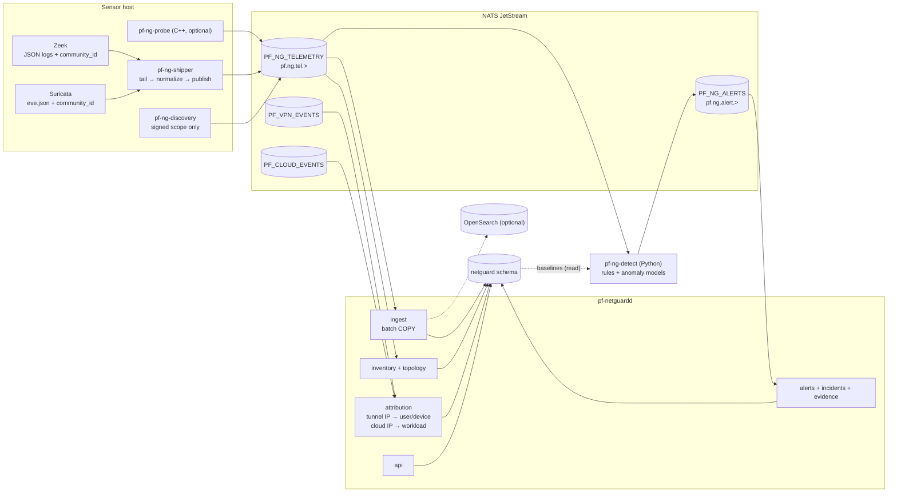
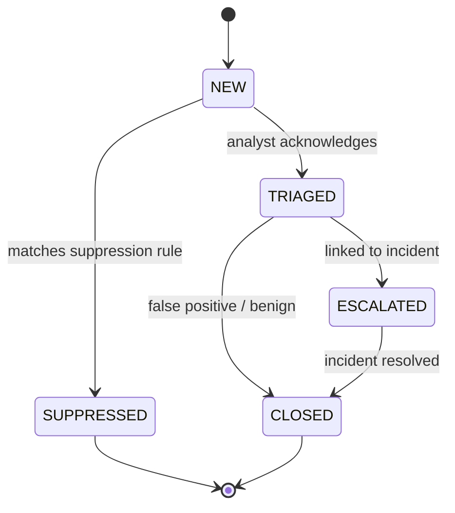
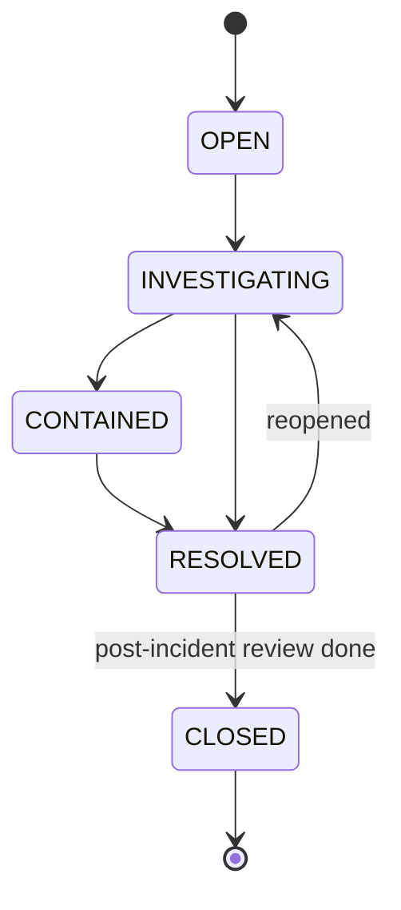

# ParallelF NetGuard — Network Monitoring & Defensive Security

## 1. Goals

- **Authorized** device discovery and inventory, enforced technically and not just by policy text.
- Telemetry collection (Zeek protocol logs, Suricata IDS alerts, VPN and Cloud context) through a normalized, backpressured pipeline.
- Network topology (L2/L3 and observed-flow graph) and traffic analytics.
- Detection with alert deduplication and correlation, incident management, and **evidence integrity** (hashes, provenance), which the AI later relies on.

## 2. Where the sensors look

On a home network a sensor only sees traffic that physically passes it. ParallelF solves this by monitoring the networks it **owns end to end**:

| Vantage point | Sees | Mechanism |
|---|---|---|
| Cloud bridges `pfbr-*` | All VM/container traffic, including the lab | Zeek/Suricata `AF_PACKET` on the bridge interface (host side) |
| VPN interface `wg-pf0` | All decrypted tunnel traffic | Zeek/Suricata on `wg-pf0` (L3 interface, no Ethernet headers) |
| Host uplink (optional) | The dev host's own traffic | `AF_PACKET` on the WSL/VM interface |
| Home LAN (optional) | Whole-LAN traffic | Only with a managed switch SPAN/mirror port or a router that supports mirroring. Otherwise passive ARP/DHCP/mDNS observation only |

This also makes the project demonstrable: everything NetGuard shows comes from infrastructure you created.

## 3. Components and data flow



### 3.1 `pf-ng-shipper` (Go)

- Tails Zeek logs (`conn`, `dns`, `http`, `ssl`, `dhcp`, `notice`, `weird`, `known_hosts`, `software`) and Suricata `eve.json` (`alert`, `flow`, `anomaly`), with inode-aware rotation handling and on-disk offsets so restarts neither lose nor duplicate lines.
- Normalizes records into the ParallelF telemetry schema (Protobuf `netguard.v1.TelemetryRecord`, see [06](../06-api-and-event-contracts.md)). Every record keeps `community_id` (the standard cross-tool flow hash), `sensor_id`, `source_tool`, `observed_at`, and a hash of the raw line for provenance.
- Hard limits on line size (64 KiB) and field lengths. Values are treated as **untrusted attacker-controlled strings** (hostnames, user agents, DNS queries).
- Publishes to `pf.ng.tel.<sensor_id>.<log_type>` and respects JetStream publish acks. When the stream rejects a message (limits hit), it buffers to disk up to a cap, then drops with a counter. It never blocks Zeek.
- The normalizer is fuzz-tested with Go native fuzzing.

### 3.2 `pf-ng-discovery` (Go) — scope-enforced active discovery

- **Signed scope.** It accepts work only as a `ScanScope` document `{scope_id, cidrs[], allowed_techniques[], rate_pps, valid_until}` signed with Ed25519 by `pf-netguardd`. The agent pins the public key at install time and refuses unsigned, expired or tampered scopes.
- **Hard-coded guards, independent of the scope:** only RFC 1918 / ULA / CGNAT ranges (no public IPs, ever); maximum /22 per scope; a rate cap; and no techniques beyond the allowlist: ARP who-has (L2 local only), ICMP echo, TCP connect to a small configurable port list, and passive listening (ARP/DHCP/mDNS/SSDP). There is no SYN-stealth scanning, OS fingerprinting beyond passive banners, or exploitation.
- Scopes are created only by `owner`/`admin`, require an `authorization_note` ("my home LAN, I own the router"), are audited, and show on the dashboard.
- Results become telemetry (`pf.ng.tel.<sensor>.discovery`), so they flow through the same pipeline as passive data.

### 3.3 `pf-netguardd` (Go)

| Module | Responsibility |
|---|---|
| `ingest` | Durable pull consumers on `PF_NG_TELEMETRY`. Batches (≤ 1,000 rows or 1 s) written with `COPY` into daily-partitioned `flows`, `dns_events`, `http_events`, `tls_events`. Optional dual-write to OpenSearch via the bulk API |
| `inventory` | Upserts `assets` from DHCP, ARP, `known_hosts`, discovery, Cloud events and VPN events. Merge key: MAC within a site, otherwise IP+time window. Vendor from an offline OUI table. `authorized_state`: `known` (registered/approved), `unknown` (new), `rogue` (explicitly flagged) |
| `topology` | Maintains `topology_links`: L2 adjacency (same bridge/segment), L3 gateway relations, and flow edges aggregated into hourly buckets (bytes, connection count). Serves graph JSON to the dashboard |
| `attribution` | Interval tables mapping tunnel IP → (user, device) and cloud IP → workload, used to enrich alerts and queries |
| `alerts` | Consumes `PF_NG_ALERTS`, deduplicates on `dedupe_key` while open, increments counts, updates `last_seen` |
| `incidents` | Workflow, timeline, evidence capture (hashing), assignment, AI report attachment (after human approval) |
| `retention` | Creates future partitions and drops expired ones (7 d dev default, configurable per table) |
| `scopes` | CRUD for authorized scopes; signs `ScanScope` documents |

### 3.4 `pf-ng-detect` (Python)

Consumes telemetry (a durable consumer with a separate cursor from ingest) and emits `AlertCandidate`s. Detectors are plugins with a uniform interface:

```python
class Detector(Protocol):
    id: str            # "ng.new_device"
    version: str
    def on_record(self, rec: TelemetryRecord, ctx: DetectorContext) -> Iterable[AlertCandidate]: ...
    def on_tick(self, now: datetime, ctx: DetectorContext) -> Iterable[AlertCandidate]: ...
```

Initial detectors (each with unit tests and a lab replay scenario):

| ID | Logic | Severity |
|---|---|---|
| `suricata.passthrough` | Normalizes Suricata alerts (trimmed ET Open ruleset sized to the RAM budget) | per rule |
| `ng.new_device` | MAC/IP never seen before in a site | low → medium if on the lab or VPN network |
| `ng.port_scan` | Distinct dst ports per src in a sliding 60 s window above a threshold, or many distinct hosts (horizontal) | medium |
| `ng.beaconing` | Per (src, dst, dport): low coefficient of variation of inter-arrival times over N ≥ 20 connections, with jitter tolerance | medium |
| `ng.dns_anomaly` | High Shannon entropy / long labels / high NXDOMAIN rate per source | low/medium |
| `ng.egress_volume` | Bytes out per asset vs an EWMA baseline (z-score > 4, minimum volume floor) | medium |
| `ng.lab_egress_attempt` | **Any** packet from a `lab` network toward a non-lab destination (should be impossible, so it signals an isolation failure) | **critical** |
| `ng.vpn_anomaly` | Device endpoint ASN/country change, or handshake from a revoked key (seen in gateway logs) | medium/high |
| `lab.game_integrity` | Game-server integrity/anomaly reports from the Security Lab (see [security-lab.md](security-lab.md)) | per report |

Baselines and state live in process memory with periodic snapshots to `netguard.detector_state` (JSONB) so restarts are warm. Alert candidates carry **evidence references** (telemetry record IDs, community IDs, time window), never free-form claims.

## 4. Alert → incident model





- **Correlation:** alerts sharing an asset (or community_id) within 30 min and severity ≥ medium auto-group into a proposed incident. An analyst confirms.
- **Evidence:** when attached, evidence is snapshotted into object storage (a query result as JSONL, a pcap slice if packet capture is enabled), its SHA-256 is recorded in `netguard.evidence`, and an audit entry is written. The AI cites evidence IDs, and the validator checks them against these rows.
- **Containment actions** (e.g. "quarantine workload", "revoke VPN device") are **suggested** links that open the owning subsystem's UI with a confirmation step. NetGuard never mutates Cloud or VPN directly. This keeps blast radius small and keeps the AI read-only.

## 5. Storage strategy

| Data | Default store | Volume (dev estimate) | Retention |
|---|---|---|---|
| Flows (`conn`) | Postgres, daily partitions, BRIN on `ts`, btree on `(src_ip, ts)` and `community_id` | 50k–500k rows/day | 7 d dev / 14 d lab-prod |
| DNS / HTTP / TLS metadata | Postgres partitions | similar | 7 d |
| Full raw logs | OpenSearch (optional) or compressed files in object storage | — | 3–14 d |
| Alerts, incidents, evidence, assets | Postgres (no partitions) | small | indefinite |
| Detector state | Postgres JSONB | tiny | latest |

See [ADR-0009](../../adr/0009-postgres-first-telemetry.md) for why Postgres is the default and OpenSearch is opt-in.

## 6. Key metrics

`pf_ng_events_ingested_total{type}`, `pf_ng_ingest_lag_seconds`, `pf_ng_consumer_pending{consumer}`, `pf_ng_shipper_dropped_total{reason}`, `pf_ng_alerts_total{detector,severity}`, `pf_ng_assets{state}`, `pf_ng_discovery_refusals_total{reason}`, `pf_ng_partition_bytes{table}`.
