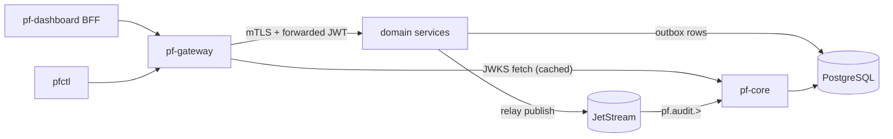

# Platform Core — Identity, RBAC, Gateway, Events, Audit

Platform Core is not one of the six product subsystems, but every subsystem depends on it. It is built first (milestones M0–M3).

## 1. Components

### 1.1 `pf-core` (Go)

> **Changed by [ADR-0011](../../adr/0011-keycloak-oidc-provider.md):** identity is provided by Keycloak. The `identity`, `mfa` and `tokens` modules and the token model below describe the earlier design and are not being built. Projects, RBAC and audit remain in `pf-core`.

Modules:

| Module | Responsibility |
|---|---|
| `identity` | Users, password hashing (argon2id via `golang.org/x/crypto/argon2`, parameters per OWASP guidance, re-tuned on hardware in M2), login, logout, session and refresh-token lifecycle |
| `mfa` | TOTP (RFC 6238, `pquerna/otp`), WebAuthn/passkeys (`go-webauthn/webauthn`), recovery codes (hashed) |
| `tokens` | Signs access JWTs with **Ed25519** (`EdDSA`) using `lestrrat-go/jwx`. Publishes JWKS at `/.well-known/jwks.json`. Rotates keys on a schedule; old keys stay in JWKS until every token they signed has expired |
| `projects` | Projects are the tenancy unit. Every resource belongs to a project |
| `rbac` | Role bindings `(project, principal, role)`, evaluated by a shared `pkg/authz` library |
| `serviceaccounts` | Non-human principals (`svc:labd`, `svc:aid`, …) using the OAuth 2.0 client-credentials grant |
| `apitokens` | Personal access tokens for `pfctl`, stored as SHA-256 hashes with a visible prefix (`pfat_…`) and an expiry |
| `audit` | Consumes `pf.audit.>`, writes the hash-chained `audit.audit_log`, exposes query and verify endpoints |
| `bootstrap` | First-run: creates the owner account from a one-time CLI token. There is **no open self-registration** |

Token model:

| Token | Format | TTL | Storage |
|---|---|---|---|
| Access token | JWT, `alg=EdDSA`, claims `sub`, `sid`, `proj_roles`, `amr` (pwd/otp/webauthn), `aud=parallelf-api`, `iss`, `exp`, `iat`, `jti` | 10 min | Never persisted. In the BFF it lives in server memory/session only |
| Refresh token | Opaque 256-bit random value; DB stores a SHA-256 hash | 12 h idle / 7 d absolute | `core.sessions`. Rotates on every use; **reuse of an old token revokes the whole family** |
| Service-account token | JWT, `sub=svc:<name>`, scoped roles | 10 min | Fetched via client-credentials grant using an mTLS-bound client cert |
| API token (PAT) | `pfat_<prefix>_<secret>` | ≤ 90 d | Hash only |
| Step-up / MFA freshness | `amr` + `auth_time` claims | — | Used by VPN JIT activation and destructive ops (require MFA within 15 min) |

### 1.2 `pf-gateway` (Go)

A small, purpose-built edge built on `net/http` + `httputil.ReverseProxy`. An off-the-shelf proxy was considered (see [ADR-0005](../../adr/0005-custom-go-gateway.md)).

Request pipeline:

1. TLS termination (internal CA cert in dev; in lab-prod it binds only on the VPN interface and loopback).
2. Request ID (`X-Request-ID`, UUIDv7) and W3C `traceparent` injection.
3. Size limits (1 MiB default, 10 GiB streaming for image uploads on a dedicated route).
4. Rate limiting: token bucket per principal and per IP. Login has a much tighter bucket.
5. JWT verification against the cached JWKS: `alg` pinned to `EdDSA`, `kid` required, `aud`/`iss`/`exp`/`nbf` checked, clock skew ≤ 30 s.
6. Coarse authorization from a route table (`route → required permission`), for example `POST /api/v1/cloud/workloads → cloud.workloads.create`.
7. Proxy to the upstream over **mTLS**. The original `Authorization` header is forwarded so the service can re-verify it and run fine-grained checks.
8. Emits the access log, metrics (`pf_gateway_requests_total{route,code}`, latency histogram) and an **audit event** for each mutating method.

The gateway also hosts:

- `GET /api/v1/events/stream`: an SSE endpoint. It subscribes to NATS on behalf of the user, filters by project + RBAC, and forwards a safe projection of each event.
- `GET /api/v1/cloud/workloads/{id}/console`: WebSocket upgrade. Requires a single-use console ticket (30 s TTL) minted by `pf-cloudd`.

### 1.3 Shared libraries

| Go (`pkg/`) | Python (`python/pf_common`) | Purpose |
|---|---|---|
| `pkg/authn` | `pf_common.auth` | JWKS cache, JWT verification, principal extraction |
| `pkg/authz` | `pf_common.authz` | Permission constants generated from one YAML file (`api/permissions.yaml`) |
| `pkg/events` | `pf_common.events` | CloudEvents envelope over NATS headers, outbox writer + relay, idempotent consumer helper |
| `pkg/obs` | `pf_common.obs` | slog/structlog setup, Prometheus registry, OTel tracer, NATS header propagation |
| `pkg/httpx` | `pf_common.http` | Problem+JSON errors, pagination, idempotency-key middleware, admin server (`/metrics`, `/healthz`, `/readyz`) |
| `pkg/pgx` | `pf_common.db` | Pool setup, tx helpers, advisory-lock leader election, `sqlc` (Go) / SQLAlchemy Core (Python) |
| `pkg/natsx` | `pf_common.nats` | Connection with NKey/TLS, stream/consumer provisioning from YAML |

## 2. Role model

| Role | Can |
|---|---|
| `owner` | Everything, including role management and key rotation |
| `admin` | Manage resources and members, except owner-only operations |
| `operator` | Create, operate and delete Cloud and VPN resources |
| `analyst` | Read telemetry, manage alerts and incidents, run AI investigations |
| `lab-researcher` | Create lab environments, experiments and findings. **Cannot** change lab isolation policy |
| `viewer` | Read-only on everything in the project |

Permissions follow `domain.resource.verb` (for example `netguard.incidents.update`). Roles map to permission sets in `api/permissions.yaml`, which generates Go and Python constants and a docs table.

## 3. Event backbone (shared)

- **Transactional outbox.** A service writes its domain change and an `outbox` row in **the same DB transaction**. An in-process relay (one per service, leader-elected through `pg_try_advisory_lock`) reads unpublished rows with `FOR UPDATE SKIP LOCKED`, publishes them to JetStream with `Nats-Msg-Id = event.id` (JetStream deduplicates within the stream's duplicate window), then sets `published_at`. Published rows are purged after 7 days.
- **Idempotent consumers.** Each consumer records `(consumer_name, event_id)` in a `processed_events` table inside the same transaction as its side effects.
- **Dead letters.** Consumers use `MaxDeliver` (default 5) with backoff. On the final failure the message is republished to `pf.dlq.<stream>` with error headers. A Grafana alert fires when the DLQ is non-empty.
- **Provisioning as code.** Streams, consumers and KV buckets are declared in `deploy/nats/jetstream.yaml` and applied by `pfctl nats apply` (idempotent).

## 4. Audit

- Producers: gateway (all mutating HTTP calls), services (domain-level actions such as "peer revoked by policy expiry"), agents (privileged host actions such as "nftables ruleset replaced").
- `pf-core` consumes `pf.audit.>` with a single ordered consumer and appends to `audit.audit_log`. Each row stores `hash = SHA-256(prev_hash || canonical_json(row))`.
- The DB role `pf_core` has `INSERT` + `SELECT` only on `audit_log`. A trigger rejects `UPDATE`/`DELETE` for every role. No role, including the migration role after bootstrap, has `TRUNCATE`.
- `pfctl audit verify [--from --to]` recomputes the chain. A nightly job exports the latest hash ("anchor") to a file in object storage, and in cloud-demo to an S3 bucket with Object Lock. This makes silent rewrites of history detectable.
