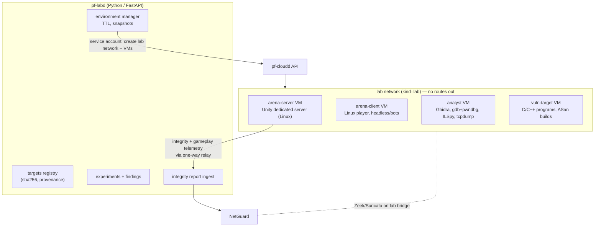
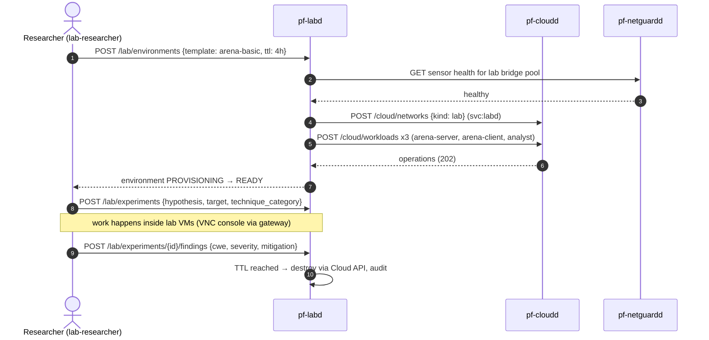

# ParallelF Security Lab — Isolated Defensive Game-Security Research

> Scope is binding. Read [docs/security/rules-of-engagement.md](../../security/rules-of-engagement.md) before any lab work. The lab studies **your own** game and **your own** deliberately vulnerable programs, to build and verify **defences**. It produces no tooling meant to work against third-party software or anti-cheat systems.

## 1. Goals

1. Provide **disposable, network-isolated** environments for reverse engineering and vulnerability analysis, built on ParallelF Cloud (VMs only) and monitored by NetGuard.
2. Study **client/server trust** in a small multiplayer Unity game you own. Show why a client cannot be trusted, and how server authority, validation, telemetry and anomaly detection hold up anyway.
3. Maintain a catalogue of **educational vulnerable programs** (C/C++, plus one toy network service), each with a fixed version and a regression test that proves the fix.
4. Record every experiment as hypothesis → method → observation → finding → mitigation → verification.

## 2. Components

`pf-labd` is Python because the analysis-adjacent tooling (LIEF, Capstone, pyelftools, structured report generation) is Python-native. It has **no privileges of its own**. Every infrastructure action goes through the Cloud API using the `svc:labd` service account, which may only create resources of network kind `lab` in the `lab` project.

## 3. Isolation design (defence in depth)

| Layer | Control |
|---|---|
| Network type | `lab` networks: bridge has no host IP; no NAT; no DHCP from the host; no DNS. Cloud admission **rejects** attaching a lab network and any non-lab network to the same workload |
| Host firewall | `parallelf_cloud` nftables: `iifname "pfbr-lab*" drop` in the forward and input chains, with counters. Any increment raises the critical `ng.lab_egress_attempt` |
| VPN | No policy may target a lab CIDR except the analyst VM's IP, and only for the `lab-researcher` role. This is enforced in `pf-vpnd` policy validation, not just the UI |
| Workload type | Lab code runs **only in VMs** (KVM boundary). Containers are disallowed on lab networks |
| QEMU hardening | sVirt/AppArmor confinement, `seccomp_sandbox`, no host device passthrough, no shared folders. Virtio-serial channel disabled except the lab relay channel (below) |
| Data ingress | Artifacts go in only as a **read-only ISO** attached at boot (built by `pf-labd` from targets whose SHA-256 is registered). No network transfer into the lab |
| Data egress | Only through the **lab relay**: a virtio-serial channel from the arena-server VM to the host-side lab relay (a module of `pf-node-agent`) that accepts **length-prefixed, schema-validated Protobuf** `IntegrityReport` / `GameplayTelemetry` messages (max 16 KiB) and publishes them to NATS. Anything else is dropped and counted. Findings text is entered by the researcher in the dashboard, not exported from the VM |
| Lifetime | Every environment has a TTL (default 4 h, max 24 h) and auto-destroys. Base images are immutable; per-environment disks are qcow2 overlays discarded on destroy. Named snapshots are allowed during a session |
| Monitoring | Zeek + Suricata always on lab bridges. The environment refuses to start if the lab sensor is unhealthy (a NetGuard sensor health check gates provisioning) |
| Host hygiene | Lab artifacts never live on Windows paths (`/mnt/c`). Windows Defender exclusions are **not** used. Vulnerable binaries are built inside lab VMs from source on the read-only ISO |

## 4. Target 1 — "ParallelF Arena" (your Unity game)

A deliberately small 2–8 player top-down arena game, designed to make trust boundaries explicit.

| Aspect | Design |
|---|---|
| Engine / netcode | Unity 6 LTS, Netcode for GameObjects, Unity Transport. **Dedicated server** build target (Linux), plus a Linux client with a headless bot mode for automated tests |
| Authority | Server-authoritative movement (client sends inputs, not positions), server-side hit validation with lag compensation (rewind buffer), server-owned inventory/currency, server-driven cooldowns |
| Transport security | Unity Transport encryption (DTLS) with a server certificate from the internal CA; session tokens issued by a small auth endpoint |
| Builds | Two scripting backends compared deliberately: **Mono** (assemblies decompile easily) and **IL2CPP** (native code). Both are built reproducibly and their hashes registered |
| Integrity telemetry | Client sends a build ID and assembly hashes at join time. The server logs mismatches. **Documented limitation:** client attestation is spoofable and is treated as a weak signal, never as an authorization decision |
| Server-side detection | Per-player rolling stats: speed vs max allowed, fire rate vs weapon cooldown, accuracy and headshot-ratio outliers, impossible line-of-sight hits, input-timing regularity (bot-like), economy anomalies. These emit `IntegrityReport`s through the lab relay → NetGuard alerts (`lab.game_integrity`) |
| Enforcement | Server-side only: reject/correct invalid actions, rubber-band movement, flag the session. No client-side "anti-cheat" driver or stealth component |

### 4.1 Research catalogue (each yields a finding + mitigation + test)

| # | Question (against your own build, in the lab) | Expected lesson / mitigation | Verification |
|---|---|---|---|
| A1 | How much game logic is recoverable from a Mono build vs IL2CPP? | Never ship secrets or authority in the client. IL2CPP raises cost but doesn't create trust | Report comparing decompilation output; secrets-in-build CI check |
| A2 | What happens if client memory values (health, ammo) are edited? | Server-owned state makes client edits cosmetic only | Bot test: modified client cannot change server-side health |
| A3 | Can a modified client move faster than allowed? | Server validates displacement per tick against max speed + tolerance | Automated: speed-modded bot is corrected, and an alert fires within 5 s |
| A4 | Can recorded packets be replayed or reordered? | Sequence numbers + session-bound tokens + DTLS | Replay harness in the lab gets rejected; counter increments |
| A5 | Can a client claim hits it couldn't make? | Server rewind-based hit validation + LOS check | Bot claiming impossible hits gets 0 damage applied + an alert |
| A6 | Can the client tamper with economy/inventory messages? | Server-side transactions, idempotency keys, rate limits | Fuzzed RPC inputs (lab-only fuzzer against own server) produce no invalid state |
| A7 | What do integrity checks actually buy you? | Detection signal, not prevention; layered with server-side anomaly scores | Write-up with measured false-positive rate on benign bots |

Out of scope by design: kernel-mode anti-cheat, driver-level memory protection, anti-debugging stealth, and any technique for defeating someone else's protection.

## 5. Target 2 — Educational vulnerable programs

Stored in `lab/targets/<id>/` with `README.md`, `vuln/`, `fixed/`, `exploit-check/` (a **proof-of-crash/condition** test, not a weaponized payload), and `CMakeLists.txt`.

| ID | Class | CWE | Shows |
|---|---|---|---|
| `vt-01-stack` | Stack buffer overflow in a parser | CWE-121 | Effect of canaries, NX, ASLR, `-D_FORTIFY_SOURCE=3`; ASan detection |
| `vt-02-fmt` | Format string | CWE-134 | `-Wformat-security`, why `printf(user)` is dangerous |
| `vt-03-intovf` | Integer overflow → undersized allocation | CWE-190/122 | Checked arithmetic, `__builtin_mul_overflow`, UBSan |
| `vt-04-uaf` | Use-after-free in a toy session manager | CWE-416 | Ownership with RAII/`unique_ptr`; ASan |
| `vt-05-proto` | Toy game-lobby TCP service: missing auth check + unbounded length field | CWE-306, CWE-770 | Server-side validation, length limits, fuzzing with libFuzzer |
| `vt-06-deser` | Unsafe deserialization of save files (C# in Unity editor-only test scene) | CWE-502 | Schema-validated formats, signed saves |

Each target builds in a **mitigation matrix** (`-O0` no mitigations / defaults / hardened + sanitizers) so you can document which mitigation stops which bug class. CI runs the `exploit-check` tests **only** in a lab-tagged job inside a container with no network (`--network none`), and only against the sanitizer builds.

## 6. Experiment workflow

## 7. Data produced

- `lab.findings` with CWE, CVSS v4 base vector (optional), status (`open` → `mitigated` → `verified`), and a link to the fixing commit and regression test.
- `lab.integrity_reports` (from the relay), which also become NetGuard telemetry so the AI can investigate "suspicious player" incidents the same way it investigates network incidents.
- Write-ups in `docs/lab-writeups/` that become portfolio pieces.
