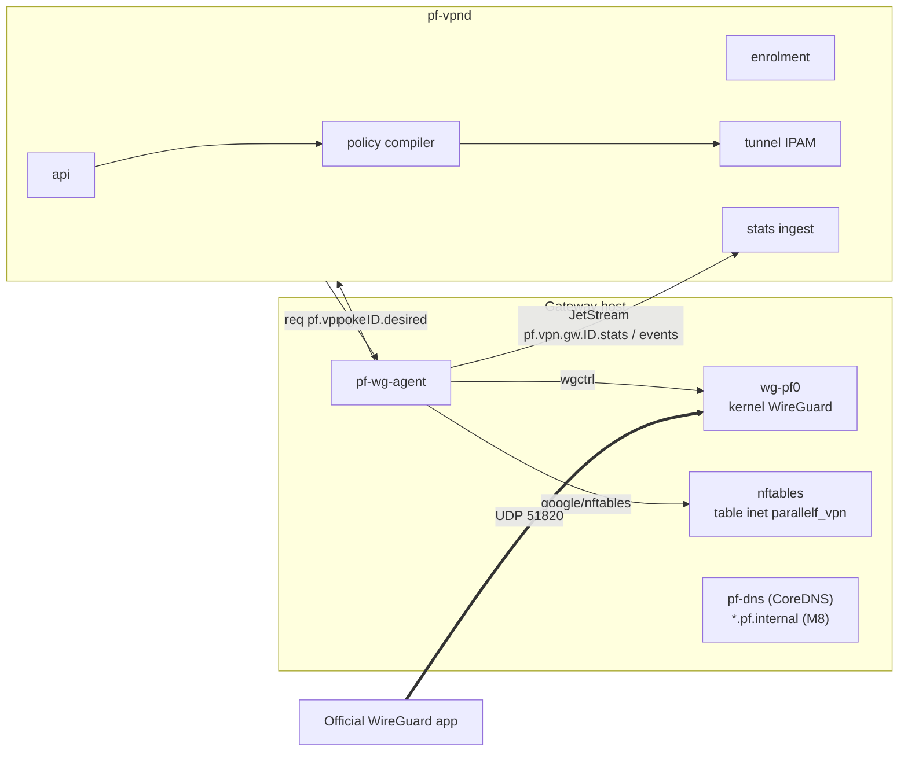
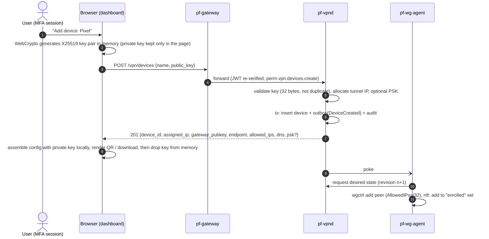
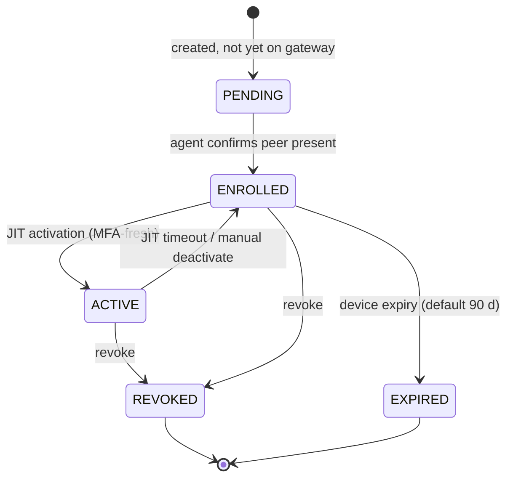

# ParallelF VPN — WireGuard with a Custom Control Plane

## 1. Goals

- Give owned devices private access to ParallelF services and Cloud networks over **WireGuard** (Noise IK handshake, Curve25519, ChaCha20-Poly1305, BLAKE2s). There is no custom crypto.
- Build a custom control plane covering enrolment, device lifecycle, groups, access policies, MFA-gated **just-in-time (JIT) access**, revocation and connection monitoring.
- **Fail closed.** Access expires even if the control plane is down.
- Feed identity into NetGuard so flows from the tunnel are attributed to *user + device*, not just an IP.

## 2. Components



- `pf-vpnd` (Go) owns the `vpn` schema and computes desired state for each gateway.
- `pf-wg-agent` (Go) runs on the gateway host. It uses `golang.zx2c4.com/wireguard/wgctrl` to configure the kernel interface and `github.com/google/nftables` to manage firewall state. The same reconciliation pattern as Cloud applies: poke, then a desired snapshot request, then an atomic apply.

## 3. Device enrolment — the private key never leaves the device



- The **browser path** uses WebCrypto X25519, which current Chromium, Firefox and Safari support (verify the compatibility table during M7). A fallback path lets the user paste a public key generated by the official WireGuard app (`wg genkey | wg pubkey` on desktop, or the app's own key generation).
- `pfctl vpn enroll` does the same thing on Linux using `wgtypes.GeneratePrivateKey()` locally.
- The optional **pre-shared key** (a symmetric post-quantum hedge) must exist on both sides. It is generated server-side, encrypted at rest (AES-256-GCM with a KEK from a file secret), and shown once.
- The server **stores only public keys**, plus PSKs encrypted. The gateway's own private key is generated on the gateway host, stored `0600 root`, and never leaves it.

## 4. Access model: enrolled ≠ allowed

WireGuard on its own authenticates *devices* (keys), not *users*, and has no notion of sessions. ParallelF adds two layers on the gateway's nftables:

1. **JIT activation set.** `set active_peers { type ipv4_addr; flags timeout; }`. Traffic from a tunnel IP is dropped unless that IP is in this set. A user activates a device from the dashboard, which requires an MFA-fresh session (`amr` contains `otp`/`webauthn`, `auth_time` ≤ 15 min). `pf-vpnd` records the activation, and the agent adds the element with `timeout 12h` (configurable per policy). **When the timeout passes, the kernel drops the element**, so access ends even if `pf-vpnd`, NATS and Postgres are all down. That is the fail-closed property.
2. **Policy chains.** Policies compile into nftables rules that match on source sets (device groups) and destination CIDR/port/protocol. The default is deny.

```text
table inet parallelf_vpn {
  set active_peers   { type ipv4_addr; flags timeout; }
  set grp_admins     { type ipv4_addr; }           # tunnel IPs of devices in group
  set dst_platform   { type ipv4_addr; flags interval; elements = { 10.255.0.10/32 } }   # gateway VIP
  set dst_net_a      { type ipv4_addr; flags interval; elements = { 10.20.1.0/24 } }

  chain forward {
    type filter hook forward priority 0; policy drop;
    ct state established,related accept
    iifname "wg-pf0" ip saddr != @active_peers counter drop
    iifname "wg-pf0" ip saddr @grp_admins ip daddr @dst_platform tcp dport 8443 accept   # policy 10
    iifname "wg-pf0" ip saddr @grp_admins ip daddr @dst_net_a tcp dport { 22, 80, 443 } accept   # policy 20
    iifname "wg-pf0" counter log prefix "pf-vpn-deny " drop
  }
  chain input {
    type filter hook input priority 0; policy accept;
    iifname "wg-pf0" ip saddr != @active_peers drop
    iifname "wg-pf0" ip daddr 10.255.0.1 tcp dport 8443 accept   # gateway on tunnel IP
    iifname "wg-pf0" udp dport 53 accept                         # internal DNS
    iifname "wg-pf0" drop
  }
}
```

The real ruleset is rendered from structured policy objects (never by string concatenation of user input) and applied as one nftables transaction. **Set elements** are updated incrementally for JIT activations so that existing connections are not disrupted by a full ruleset swap.

### 4.1 Policy object

```yaml
name: admins-to-net-a
priority: 20            # lower = evaluated first
action: allow           # allow | deny
sources:
  groups: [admins]      # or device_ids
destinations:
  - network_id: 0193...  # resolved to CIDR by pf-vpnd via pf-cloudd
  - cidr: 10.255.0.10/32
ports: ["22", "80", "443", "8000-8100"]
protocol: tcp           # tcp | udp | icmp | any
jit_ttl: 12h
```

## 5. Peer lifecycle



Connection status (`online` / `idle` / `offline`) is **derived**, not stored as lifecycle state. A peer is `online` if its last handshake is within 180 s (clients set `PersistentKeepalive = 25`), `idle` if within 15 min, otherwise `offline`.

**Revocation path (target < 10 s):** API → DB tx + outbox → poke → agent removes the peer via wgctrl, removes its IP from all sets, and **flushes conntrack entries** for the tunnel IP (`ti-mo/conntrack`) so established flows die immediately. The agent then reports, and the event `vpn.device.revoked` is emitted. The acceptance test measures the end-to-end time.

## 6. Monitoring

Every 10 s the agent samples `wgctrl.Device()` for each peer's `LastHandshakeTime`, `ReceiveBytes`, `TransmitBytes` and `Endpoint`, then publishes:

- `pf.vpn.gw.<id>.stats` (batched per sample) → `vpn.peer_stats` (daily partitions, 14-day retention).
- `pf.vpn.evt.peer.connected` / `.disconnected` when the derived status changes, with endpoint IP and geo/ASN left blank (no external lookups).
- `pf.vpn.evt.peer.endpoint_changed` (roaming). NetGuard can alert on a sudden change in country/ASN once enrichment is added (opt-in, offline MaxMind GeoLite DB).

NetGuard consumes the `vpn.device.*` and `vpn.peer.*` events to maintain a **tunnel IP → (user, device) attribution table** with validity intervals.

## 7. Private connectivity

| Destination | How |
|---|---|
| ParallelF API/dashboard | `pf-gateway` listens on the gateway's tunnel IP (`10.255.0.1:8443`) and loopback. In lab-prod it does **not** listen on the LAN |
| Cloud networks | Routes from the tunnel CIDR to `nat`/`isolated` networks, allowed only by explicit policy. `lab` networks are **never** routable from the VPN except to a designated analyst VM, through a policy that requires the `lab-researcher` role |
| Internal DNS (M8) | CoreDNS on the tunnel IP serving `*.pf.internal` from a zone file `pf-vpnd` renders out of the Cloud inventory, pushed in the client config as `DNS = 10.255.0.1` |
| Split tunnel | Default `AllowedIPs` on the client = tunnel CIDR + allowed destination CIDRs. Full-tunnel is an optional per-device setting |

## 8. Addressing

- Tunnel CIDR: `10.255.0.0/22` (gateway `10.255.0.1`, peers from `.10`).
- Cloud networks default to `10.20.0.0/16`, lab to `10.66.0.0/16`. Validation rejects overlaps with the host LAN (detected at node registration) and with the tunnel CIDR.

## 9. Key metrics

`pf_vpn_peers{state}`, `pf_vpn_peers_online`, `pf_vpn_handshake_age_seconds` (histogram), `pf_vpn_bytes_total{direction}`, `pf_vpn_policy_denies_total` (from the nft counter), `pf_vpn_reconcile_duration_seconds`, `pf_vpn_revocation_latency_seconds`.
