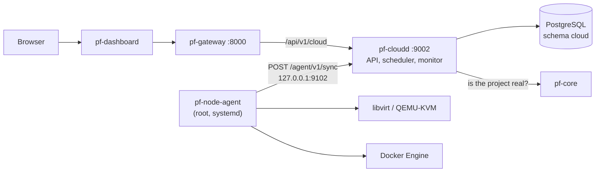

# ParallelF Cloud

ParallelF Cloud is a small infrastructure-as-a-service layer for compute you own: KVM virtual machines through libvirt and containers through Docker Engine, behind one authenticated workload API, with scheduling, quotas, virtual networks, metrics and an audit trail. It is built to run on one Linux workstation with 16 GB of RAM, and it manages only the hosts you register with it.

This guide covers running it, using it, how it recovers from failures, and how it is tested. The design it implements, and the places where Phase 2 deliberately differs from that design, are in [architecture/subsystems/cloud.md](architecture/subsystems/cloud.md) and [ADR-0013](adr/0013-cloud-phase-2-agent-protocol-and-runtimes.md).

## What runs



| Component | Where | What it does |
|---|---|---|
| `pf-cloudd` | Compose service `cloud` | Workload, network, quota and node API; admission and quota checks; the scheduler; marks silent nodes `NOT_READY`; prunes old metrics; writes the audit log and outbox events |
| `pf-node-agent` | The compute host, as root (`make agent-install`) | Registers the host, reports capacity and metrics, receives the complete desired state for the host every few seconds and converges libvirt and Docker to it |

The agent talks to `pf-cloudd` on `127.0.0.1:9102`. That port carries only the agent protocol, authenticated with a per-node credential; user requests go through the gateway like every other API.

## Requirements

- Linux with hardware virtualisation (`/dev/kvm`), systemd, and Docker Engine for the stack itself. WSL2 works when nested virtualisation is enabled and systemd is turned on (`[boot] systemd=true` in `/etc/wsl.conf`); without systemd, run the agent in the foreground with `make agent`.
- Debian or Ubuntu packages, installed by `make cloud-host-setup`: `libvirt-daemon-system`, `libvirt-clients`, `qemu-system-x86`, `qemu-utils`, `genisoimage`.
- Go 1.25 or later to build the agent (`make agent-build`).

### Memory on a 16 GB machine

| Consumer | Memory |
|---|---|
| The platform stack (PostgreSQL, Keycloak, gateway, core, cloud, AI, dashboard) | about 3 GB |
| Reserved for the host and the stack by the agent (`PF_AGENT_RESERVED_MEMORY_MIB`, default 4096) | 4 GB |
| Left for workloads | the rest, e.g. about 11 GB on a 16 GB host |

Memory is never overcommitted: the scheduler places a workload only where its full flavor memory fits. vCPUs are overcommitted four to one (`PF_CPU_OVERCOMMIT`). A CirrOS test VM needs 256 MiB, an Ubuntu VM 1 GiB and an Alpine container 256 MiB, so a laptop comfortably runs a handful of each. Each project also has a quota (default 8 vCPUs, 8 GiB, 100 GiB disk, 10 workloads).

## Quick start: one host, one VM

```sh
make up                 # the platform stack, including pf-cloudd
make cloud-host-setup   # once per host: KVM, libvirt, QEMU, genisoimage (sudo)
make agent-install      # build pf-node-agent and run it under systemd (sudo)
make verify-cloud       # create, run, ping, stop, start and delete a CirrOS VM
```

`make agent-check` shows which runtimes the agent can use on this host before you install it. `make agent` runs it in the foreground instead of under systemd. `make agent-uninstall` removes the service; workloads keep running and are re-adopted when an agent starts again.

`make verify-cloud` prints one line per check and fails on the first problem:

```
Compute node
  PASS  node my-host is READY (QEMU 8.2.2)
  PASS  allocatable: 28 vCPUs, 11871 MiB, 180 GiB
Network
  PASS  network check-net-04217 10.183.20.0/24 (gateway 10.183.20.1)
Virtual machine (cirros)
  PASS  admitted check-vm-04217 with address 10.183.20.2 and MAC 52:54:00:…
  PASS  RUNNING on my-host after 21s (generation 2)
  PASS  the host reaches the VM at 10.183.20.2 (DHCP reservation honoured)
  …
```

(The numbers above are illustrative: they depend on the host.)

Then open <http://localhost:3000/cloud>. The Cloud section shows each node's allocated capacity and CPU and memory charts, the workloads with their state, a form to create workloads and networks, each workload's history and utilisation, and the audit log with a live integrity check.

## Using the API

Every request needs an access token; `make token AS=owner` prints one. The contract is in [`api/openapi/parallelf.v1.yaml`](../api/openapi/parallelf.v1.yaml) under the `cloud` tag.

```sh
TOKEN=$(make -s token AS=owner)
API=http://localhost:8000/api/v1
auth=(-H "Authorization: Bearer $TOKEN" -H "Content-Type: application/json")

project=$(curl -s "${auth[@]}" -d '{"slug":"demo","name":"Demo"}' $API/core/projects | jq -r .id)
net=$(curl -s "${auth[@]}" -d "{\"project_id\":\"$project\",\"name\":\"demo-net\",\"kind\":\"nat\",\"cidr\":\"10.42.0.0/24\"}" \
  $API/cloud/networks | jq -r .id)
vm=$(curl -s "${auth[@]}" -d "{\"project_id\":\"$project\",\"name\":\"vm-1\",\"template\":\"cirros\",\"network_id\":\"$net\"}" \
  $API/cloud/workloads | jq -r .id)

curl -s "${auth[@]}" $API/cloud/workloads/$vm | jq '{state, ip, node, status_message}'
curl -s "${auth[@]}" -X POST $API/cloud/workloads/$vm/stop              # 202
curl -s "${auth[@]}" -X DELETE "$API/cloud/workloads/$vm"               # 428: say which one
curl -s "${auth[@]}" -X DELETE "$API/cloud/workloads/$vm?confirm=vm-1"  # 202
```

| Resource | Endpoints |
|---|---|
| Nodes | `GET /cloud/nodes`, `GET /cloud/nodes/{id}`, `GET …/metrics?window=15m\|1h\|6h\|24h`, `POST …/cordon`, `POST …/uncordon`, `DELETE …?confirm=<name>` |
| Catalogue | `GET /cloud/flavors`, `GET /cloud/templates` |
| Networks | `GET`, `POST /cloud/networks`, `GET /cloud/networks/{id}`, `DELETE …?confirm=<name>` |
| Workloads | `GET`, `POST /cloud/workloads`, `GET /cloud/workloads/{id}`, `POST …/start\|stop\|retry`, `DELETE …?confirm=<name>`, `GET …/events`, `GET …/metrics` |
| Quotas | `GET`, `PUT /cloud/quotas/{project_id}` |
| Audit | `GET /cloud/audit`, `GET /cloud/audit/verify` |

### Permissions

| Permission | Roles | Allows |
|---|---|---|
| `cloud.resources.read` | every role | reading nodes, catalogue, networks, workloads, quotas, metrics |
| `cloud.workloads.manage` | owner, admin, operator | creating, starting, stopping, retrying and deleting workloads |
| `cloud.networks.manage` | owner, admin, operator | creating and deleting networks |
| `cloud.nodes.manage` | owner, admin | cordoning, uncordoning and removing nodes |
| `cloud.quotas.manage` | owner, admin | changing project quotas |
| `cloud.audit.read` | owner, admin, analyst | reading and verifying the audit log |

## Concepts

### Workloads and their lifecycle

A workload is a VM or a container made from a template and a flavor, attached to one network. The API records what you want (`desired_state`: running, stopped or deleted) and a `generation` that increases with every request; the agent reports which generation it has applied (`observed_generation`). While the two differ the workload is converging, and the dashboard refreshes itself.

| State | Meaning |
|---|---|
| `PENDING` | Admitted; no node has room yet. `status_message` says why, e.g. `0/1 nodes available: 1 insufficient memory` |
| `SCHEDULED` | Bound to a node; its agent has not acted yet |
| `PROVISIONING` | The agent is downloading, creating or starting it |
| `RUNNING`, `STOPPED` | Converged |
| `STOPPING`, `DELETING` | The agent is shutting it down or removing it |
| `UNKNOWN` | Its node stopped reporting; the workload is probably still running |
| `ERROR` | Three attempts failed (the second 5 s after the first, the third 15 s later); the message is the last error. `retry` starts three more |
| `DELETED` | Gone from the host; its address and quota are released. The record and its history stay |

VMs are stopped with an ACPI shutdown and forced off after 90 seconds; containers get ten seconds.

### Templates: reproducible provisioning

A template is an immutable, versioned recipe: image, default flavor and provisioning settings. Changing a recipe means adding a version, and every workload records the version it was made from. The catalogue ships with:

| Template | Kind | Image | Notes |
|---|---|---|---|
| `cirros` | VM | CirrOS 0.6.2 (20 MB) | Boots in seconds in 256 MiB; DHCP |
| `ubuntu-24.04` | VM | Ubuntu 24.04 cloud image, release 20261017 | Static addressing through cloud-init, so it also works on lab networks |
| `alpine-sleeper` | container | `alpine:3.22` | Runs `sleep infinity`; a minimal container |
| `nginx` | container | `nginx:1.28-alpine` | Gets back only the capabilities nginx needs |

Every image is pinned: VM images by SHA-256, verified after download and before use (a mismatch is an error, never a warning), containers by registry digest. VMs are provisioned with a cloud-init NoCloud seed generated from the template, the workload's name, its SSH keys and, for static templates, its address. Two workloads made from the same template version on the same flavor are the same machine.

### Networks

| Kind | Host address | DHCP | Route out | For |
|---|---|---|---|---|
| `nat` | the gateway (first address) | yes | NAT through the host | general workloads |
| `isolated` | yes | yes | none | workloads that must not reach the internet |
| `lab` | **none** | none | none | VMs only, with static addressing; for the Security Lab |

Networks take CIDRs from 10.0.0.0/8 (except 10.255.0.0/16), between /16 and /27, and may not overlap one another. Addresses and MACs are assigned by the control plane when a workload is admitted; for VMs on DHCP networks the agent installs a DHCP reservation so the guest gets exactly that address. A network holds VMs or containers, not both (see ADR-0013).

### Scheduling and quotas

Admission checks the project's quota inside the same transaction that inserts the workload, so concurrent requests cannot exceed it. The scheduler filters nodes (ready, not cordoned, has KVM for VMs or Docker for containers, has room) and packs workloads onto the fullest node that fits, keeping other nodes free. Placement locks the node rows, so two placements can never overcommit memory. Cordoning a node keeps its workloads but places nothing new on it.

### Audit and confirmation

Every change made through the API (and node registration) is appended to `cloud.audit_log` with who, what, when and the request ID. Each entry stores the SHA-256 of the previous one; `GET /cloud/audit/verify` recomputes the chain, and the database refuses to update or delete entries. Deleting a workload, network or node requires repeating its name in `?confirm=`; without it the API answers `428 Precondition Required` and changes nothing.

### Events

State changes are written to `cloud.outbox` in the same transaction, as CloudEvents with Protobuf payloads (`parallelf.cloud.v1`, catalogue in [api/events](../api/events/README.md)). As for pf-core, the relay to NATS arrives with the event backbone; until then the outbox is the record.

## Failure and recovery

| What happens | What the platform does |
|---|---|
| The agent stops or the host loses contact | After `PF_NODE_TIMEOUT` (30 s) the node becomes `NOT_READY` and its running workloads `UNKNOWN`. Nothing is stopped: the agent's systemd unit uses `KillMode=process` and libvirt and Docker own the workloads |
| The agent starts again | It reads its credential, re-syncs, finds its VMs and containers by name and label, and reports them; the node becomes `READY` and the workloads `RUNNING` again. Applied generations are kept in `agent-state.json`, so nothing is re-created |
| `pf-cloudd` restarts | All state is in PostgreSQL. Agents retry until it is back and then continue; on start it immediately places pending workloads and checks node liveness |
| Provisioning fails (bad download, checksum mismatch, libvirt error) | The attempt's partial files are removed; two more attempts follow with backoff; then `ERROR` with the reason. `retry` starts again |
| A workload's resource exists on the host but not in the desired state | Removed after a two-minute grace period, but only when the agent holds fresh desired state, and only resources labelled as ParallelF-managed |
| A token or credential leaks | Change `PF_CLOUD_JOIN_TOKEN` and restart pf-cloudd; delete the node (`DELETE /cloud/nodes/{id}?confirm=…` once it is `NOT_READY`) and re-register the agent |

## Configuration

`pf-cloudd` (Compose service `cloud`):

| Variable | Default | Meaning |
|---|---|---|
| `PF_CLOUD_JOIN_TOKEN` | generated into `.env` | Shared secret agents present once to register (at least 24 characters) |
| `PF_NODE_TIMEOUT` | `30s` | Silence after which a node is `NOT_READY` |
| `PF_METRICS_RETENTION` | `24h` | How long node and workload samples are kept |
| `PF_CPU_OVERCOMMIT` | `4` | vCPUs per host CPU the scheduler hands out |
| `PF_DEFAULT_QUOTA_VCPUS`, `…_MEMORY_MIB`, `…_DISK_GIB`, `…_WORKLOADS` | 8, 8192, 100, 10 | Quota of projects without their own |

`pf-node-agent` (`/etc/parallelf/node-agent.env`):

| Variable | Default | Meaning |
|---|---|---|
| `PF_AGENT_CLOUD_URL` | required | e.g. `http://localhost:9102` |
| `PF_AGENT_JOIN_TOKEN` | | Needed for the first registration only |
| `PF_AGENT_NAME` | the host name | Node name |
| `PF_AGENT_DATA_DIR` | `/var/lib/parallelf/cloud` | Credential, state, image cache, VM disks and seeds |
| `PF_AGENT_ENABLE_VMS`, `PF_AGENT_ENABLE_CONTAINERS` | `true` | Runtimes to offer, if present |
| `PF_AGENT_RESERVED_CPUS`, `…_MEMORY_MIB`, `…_DISK_GIB` | 1, 4096, 20 | Capacity kept back for the host |

## Security notes

- The agent runs as root because managing libvirt, Docker and bridges requires it. It only changes resources it created: libvirt domains and networks named `pf-…`/`pfbr-…` and Docker objects labelled `io.parallelf.managed`.
- The node credential is 32 random bytes shown to the agent once; pf-cloudd stores only its SHA-256. The agent stores it in a 0600 file.
- The agent port is published on 127.0.0.1 only. A second host would need it exposed over the VPN (Phase 3), not to a LAN.
- Containers run with all capabilities dropped (templates add back named ones), `no-new-privileges`, CPU, memory and process limits, and no restart policy (the agent decides). Untrusted code belongs in VMs on lab networks, never in containers.
- VM images come only from https URLs with a pinned digest, at most 10 GiB, and must be plain qcow2 without a backing file.

## Running other ParallelF components as workloads

The later subsystems are planned to run on this layer rather than beside it:

- **Security Lab** environments are VMs on `lab` networks: no host address, no DHCP and no route, so a vulnerable target can only reach the analyst VM placed on the same network. Templates such as `ubuntu-24.04` already configure their own address for this.
- **VPN** and **NetGuard** sensors fit as templates: a VM template whose cloud-config installs WireGuard or the sensor, or a container template that adds back `NET_ADMIN` or `NET_RAW`. Templates are versioned, so a component upgrade is a new template version and a re-created workload.
- Placement, quotas, audit and events apply to them like to any other workload.

## Tests

| Suite | Command | Needs | Covers |
|---|---|---|---|
| Go unit tests | `make test-go` | nothing | scheduler, IPAM, cloud-init, audit chain, lifecycle rules, API handlers (fake store), agent reconciliation (fake runtime and clock), libvirt XML and command sequences, Docker requests, host sampling |
| Store tests | `make test-go-db` | the stack | quotas under concurrency, placement rules, scheduling without overcommit, the sync lifecycle, error and retry, unresponsive nodes, re-registration, audit tamper detection |
| Integration | `make test-integration` | the stack; for the runtime tier an agent | API contract and permissions, admission rules, quota, events, and with a node: VM lifecycle with ping, container confinement, lab isolation |
| Disruptive | `PF_CLOUD_DISRUPTIVE_TESTS=1 make test-integration` | sudo, the agent under systemd | agent outage and recovery, pf-cloudd restart, a failed download that reaches `ERROR`, is cleaned up and succeeds on retry |
| End to end | `make test-e2e` | the stack | creating a network and a container in the dashboard, watching it run, deleting both with typed confirmation; the viewer's read-only view |
| One host, one VM | `make verify-cloud` | the stack and an agent | the acceptance walk-through below |

CI runs all of them. GitHub's Linux runners expose `/dev/kvm`, so the stack job installs libvirt, runs the agent under systemd and boots real VMs.

## Acceptance criteria

| # | Criterion | Verified by |
|---|---|---|
| 1 | A host registers with the join token, appears `READY` with its capacity and is marked `NOT_READY` within 30 s of going silent | `test_compute_node_reports_capacity_and_metrics`, `test_agent_outage_marks_node_and_recovers`, store tests |
| 2 | A VM can be created, reaches `RUNNING`, answers ping at its assigned address, stops, starts and is deleted, leaving no domain or disk behind | `make verify-cloud`, `test_vm_lifecycle` |
| 3 | A container runs from a digest-pinned image with all capabilities dropped, `no-new-privileges` and flavor limits | `test_container_workload_is_confined` |
| 4 | Allocated vCPUs, memory and disk are reported per node and never exceed allocatable memory, even under concurrent placement | `TestConcurrentSchedulingNeverOvercommits`, node API |
| 5 | A workload that would exceed its project's quota is refused with 422 and the exceeded fields | `test_quota_admission`, `TestAdmissionEnforcesQuotaAndReusesAddresses` |
| 6 | Networks cannot overlap; a lab network has no host address, DHCP or route, and a VM on it configures its own address | `test_network_rules_and_confirmed_deletion`, `test_lab_network_is_isolated` |
| 7 | Every image is pinned and verified; a digest mismatch fails provisioning | catalogue test, `test_failed_provisioning_is_reported_cleaned_up_and_retried` |
| 8 | Desired state survives restarts of the agent and of pf-cloudd without re-creating workloads | `test_agent_outage_marks_node_and_recovers`, `test_control_plane_restart_keeps_state` |
| 9 | Unauthenticated requests get 401, viewers cannot change anything, analysts can read the audit log | `test_cloud_api_requires_authentication`, `test_viewer_may_read_but_not_change`, e2e |
| 10 | Node and workload CPU and memory are charted in the dashboard for 15 min to 24 h | dashboard Cloud pages, `test_vm_lifecycle` metrics check |
| 11 | Every change is audited in a verifiable chain; a destructive request without the resource's name changes nothing (428) | `test_changes_are_audited_and_emitted_as_events`, `TestAuditTrailIsAppendOnlyAndVerifiable`, e2e typed confirmation |
| 12 | A failed provisioning ends in `ERROR` with the reason, leaves nothing on the host and can be retried | `test_failed_provisioning_is_reported_cleaned_up_and_retried` |
| 13 | State changes are written as versioned events in the outbox | `test_changes_are_audited_and_emitted_as_events` |
| 14 | All of the above run in CI | `.github/workflows/ci.yml` |

## Not in this phase

- More than one compute host has not been tested. The model supports several (placement, per-node desired state), but networks are local to one host until the VXLAN overlay.
- VMs and containers cannot share a network; one runtime owns each bridge.
- No volumes, snapshots, live migration, consoles in the dashboard or image import API; images come from the catalogue migration.
- Outbox events are not yet published to NATS; agents use HTTP polling instead of NATS (ADR-0013).
- Metrics are stored in PostgreSQL for 24 hours; there is no Prometheus endpoint yet.
