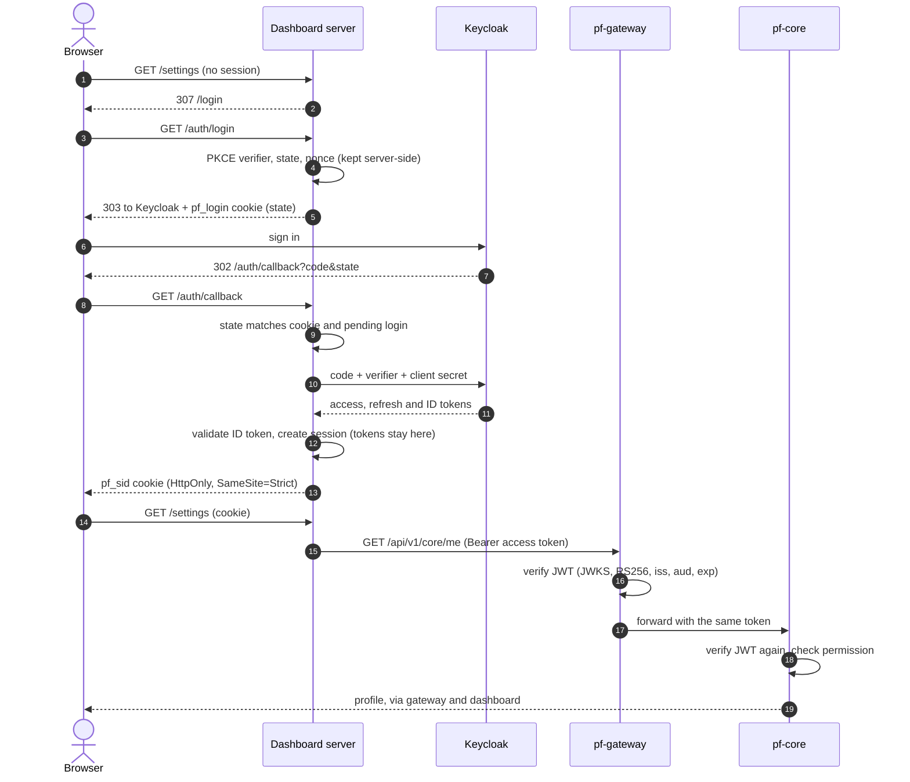

# Developer guide

This guide covers running ParallelF locally, the toolchain for working on each part, how authentication works end to end, and the conventions new code follows. For the target design, see [architecture](architecture/README.md).

## 1. Prerequisites

| Tool | Version | Needed for |
|---|---|---|
| Docker Engine + Compose plugin | Compose v2.24+ | Running the stack (`make up`) |
| GNU Make, curl | any | Tasks and the smoke test |
| Go | 1.27 (as in CI) | Go services and `pkg/` |
| golangci-lint | v2 | `make lint-go` |
| Python + [uv](https://docs.astral.sh/uv/) | Python 3.12+, uv 0.13.8 | `pf_common`, `pf-aid`, integration tests |
| Node.js + pnpm | Node 22, pnpm 10 (via `corepack enable`) | Dashboard |
| buf | v1 | Only when changing Protobuf contracts |

Running the stack needs only Docker, Make and curl. The other tools are needed to work on the code.

### Windows 11 (WSL2)

1. Install WSL2 with Ubuntu 24.04 and enable systemd (`/etc/wsl.conf`: `[boot]` / `systemd=true`).
2. Install Docker Engine **inside** the distro (not Docker Desktop). Docker Desktop also works but uses more memory.
3. Clone the repository into the Linux filesystem (`~/src/ParallelF`), not under `/mnt/c`. File access across the boundary is slow and breaks file watching.
4. Open it with VS Code's WSL extension (`code .` from the distro).
5. Limit WSL's memory in `%UserProfile%\.wslconfig` (`memory=10GB` on a 16 GB machine; see [08-infrastructure](architecture/08-infrastructure.md)).

## 2. Running the stack

```sh
make up       # create .env if missing, build images, start, wait until ready
make verify   # 23 end-to-end checks with curl
make ps       # container state
make logs     # follow every service's logs
make down     # stop, keep data
make clean    # stop and delete the database volume
```

`make up` runs these containers:

| Container | Port (127.0.0.1) | Role |
|---|---|---|
| `postgres` | 5432 | PostgreSQL 17; roles and schemas created by `deploy/postgres/init/` |
| `migrate-core` | — | Runs pf-core's migrations as the schema owner, then exits |
| `keycloak` | 8080 | OIDC provider; imports `deploy/keycloak/realm/parallelf-realm.json` |
| `core` | — | `pf-core` (Go), internal port 9001 |
| `ai` | — | `pf-aid` (Python), internal port 9006 |
| `gateway` | 8000 | `pf-gateway` (Go), the only API entry point |
| `dashboard` | 3000 | Next.js dashboard |

Start-up order is enforced with health checks: the database must be healthy before migrations run, migrations must succeed before `core` starts, and so on. The first build takes several minutes. Later builds use Docker's layer and module caches.

Memory: the whole stack uses roughly 1.5–2.5 GB; Keycloak is the largest part (heap capped at 512 MB). Measure on your machine with `docker stats --no-stream`.

### Development users

| User | Realm role | Can |
|---|---|---|
| `owner` | `owner` | Everything, including creating and deleting projects |
| `viewer` | `viewer` | Read status, profile and projects |

Passwords are generated into `.env` as `PF_DEV_OWNER_PASSWORD` and `PF_DEV_VIEWER_PASSWORD`. To change users or roles, edit the realm file and recreate the container (`make clean && make up`): Keycloak imports the realm only into an empty database.

### Calling the API directly

```sh
TOKEN=$(make -s token)            # owner; use `make -s token AS=viewer` for the viewer
curl -s localhost:8000/api/v1/core/me -H "Authorization: Bearer $TOKEN"
curl -s localhost:8000/api/v1/system/status -H "Authorization: Bearer $TOKEN"
curl -s -X POST localhost:8000/api/v1/core/projects \
  -H "Authorization: Bearer $TOKEN" -H "Content-Type: application/json" \
  -d '{"slug":"demo-lab","name":"Demo lab"}'
```

Tokens live for five minutes. The token script uses the realm's `parallelf-dev-cli` client, which exists only in the development realm.

## 3. Configuration reference

All services read `PF_*` environment variables. Each also accepts `NAME_FILE` pointing at a file that holds the value (the Docker and Kubernetes secrets convention). A service reports every invalid setting at once and refuses to start.

**Shared by pf-core, pf-gateway and pf-aid**

| Variable | Default | Meaning |
|---|---|---|
| `PF_OIDC_ISSUER` | required | Exact `iss` claim expected in tokens (the browser-facing provider URL) |
| `PF_OIDC_JWKS_URL` | required | Where the service downloads signing keys (may use an internal hostname) |
| `PF_OIDC_AUDIENCE` | `parallelf-api` | Required `aud` claim |
| `PF_LOG_LEVEL` | `info` | `debug`, `info`, `warn` or `error` |

**pf-core:** `PF_HTTP_ADDR` (`:9001`), `PF_DATABASE_URL` (required, secret), `PF_SHUTDOWN_TIMEOUT` (`10s`).
**pf-gateway:** `PF_HTTP_ADDR` (`:8000`), `PF_UPSTREAM_CORE_URL`, `PF_UPSTREAM_AI_URL` (required), `PF_SHUTDOWN_TIMEOUT`.
**pf-aid:** `PF_HTTP_HOST` (`0.0.0.0`), `PF_HTTP_PORT` (`9006`), `PF_VERSION`.

**Dashboard**

| Variable | Meaning |
|---|---|
| `PF_PUBLIC_URL` | Browser-facing origin, e.g. `http://localhost:3000`; used for the OIDC redirect URI and the CSRF origin check |
| `PF_GATEWAY_URL` | Gateway URL as reachable from the dashboard server |
| `PF_OIDC_ISSUER` | Expected issuer; must equal the `issuer` in the discovery document |
| `PF_OIDC_DISCOVERY_URL` | Discovery document URL as reachable from the dashboard server |
| `PF_OIDC_CLIENT_ID`, `PF_OIDC_CLIENT_SECRET` | Confidential client credentials |
| `PF_COOKIE_SECURE` | `true` (default) adds `Secure` and the `__Host-` prefix; the local stack sets `false` because it serves plain HTTP |
| `PF_SESSION_TTL_HOURS` | Absolute session lifetime, default 12 |

## 4. How authentication works



Points worth knowing:

- **Tokens never reach the browser.** The browser has an opaque, random session ID. The dashboard refreshes access tokens shortly before they expire. Sessions are kept in the dashboard process's memory, so restarting the dashboard signs everyone out.
- **Defence against CSRF:** the session cookie is `SameSite=Strict`, and every state-changing request (`POST`/`DELETE` to `/bff/*`, sign-out) must carry an `Origin` header equal to `PF_PUBLIC_URL`.
- **Every service verifies the token.** The gateway checks it to refuse bad requests early; pf-core and pf-aid check it again and never trust the gateway as a hop.
- **ID tokens are refused by the API.** Keycloak marks access tokens `typ: Bearer`; the verifiers reject anything else.
- **Roles → permissions.** Realm roles arrive in `realm_access.roles`. `pkg/authz/permissions.json` maps them to permissions such as `core.projects.create`. Unknown roles grant nothing.

## 5. Working on each part

### Go (`pkg/`, `services/core`, `services/gateway`)

```sh
go test ./...                 # unit tests; store tests skip without a database
make test-go-db               # also runs the PostgreSQL store tests against the running stack
make lint-go
go run ./services/gateway/cmd/pf-gateway   # with the PF_* variables exported
```

Conventions: errors are RFC 9457 problems written with `httpx.WriteProblem`; logs go through `slog` with the context (`logger.InfoContext(r.Context(), ...)`) so the request ID is attached; configuration is read only in `internal/config` through `pkg/config`.

### Python (`python/pf_common`, `services/ai`)

```sh
uv sync --all-packages        # once
uv run pytest                 # unit tests
uv run ruff check . && uv run ruff format --check . && uv run mypy
```

New FastAPI services start from `pf_common.web.create_app`, which already provides health endpoints, request IDs, JSON access logs, problem responses and `require_principal` for authentication.

### Dashboard (`web/dashboard`)

```sh
cd web/dashboard
pnpm install
pnpm test                     # Vitest unit tests (lib/)
pnpm lint && pnpm typecheck && pnpm format:check
pnpm exec playwright test     # against the running stack; needs PF_DEV_*_PASSWORD (make test-e2e exports them)
```

For hot reload, start the stack, stop its dashboard container (`docker compose --env-file .env -f deploy/compose/compose.yaml stop dashboard`), then run `pnpm dev` with the dashboard's variables from `compose.yaml`, replacing `gateway:8000` and `keycloak:8080` with `localhost`.

Pages are server components that call the gateway with `gatewayGet`. Client components reach the API only through `/bff/api/<domain>/...`, which attaches the token server-side and allows only the `core`, `ai` and `system` domains.

## 6. Changing contracts and the database

**Adding an HTTP endpoint**

1. Describe it in `api/openapi/parallelf.v1.yaml` first (operationId, schemas, error responses).
2. Run `make gen-api` so the dashboard's types follow.
3. Implement it; add the permission to `pkg/authz` and `permissions.json` if it needs one.
4. Add an integration test that validates the live response against the schema with the `contract` fixture.

**Adding or changing an event**

1. Edit `api/proto/parallelf/<domain>/v1/*.proto`. Never reuse a field number; removed fields become `reserved`.
2. `make gen-proto` (needs `buf`). CI runs `buf breaking` against `main` and fails on incompatible changes.
3. Write the event to the outbox in the same transaction as the change it describes (see `services/core/internal/store`).

**Adding a migration**

1. Add `services/core/migrations/NNNN_description.up.sql` and `.down.sql`. Never edit an applied migration.
2. Grant the runtime role `pf_core` only the privileges it needs, inside the migration.
3. `make migrate` applies it to the running stack; CI applies all migrations to a fresh database.

## 7. Logging and tracing a request

Every service writes one JSON object per line with `ts`, `level`, `msg`, `service` and `version`. Request logs add `request_id`, `method`, `path`, `status` and `duration_ms`, and `subject` once authenticated.

The gateway assigns `X-Request-ID` (or keeps a valid inbound one), forwards it to upstreams and returns it to the client. Every error body carries the same value as `request_id`. To follow one request across services:

```sh
make logs | grep 019a....        # the request_id from the response
```

## 8. Tests

| Suite | Command | Needs | What it proves |
|---|---|---|---|
| Go unit + store | `make test-go` / `make test-go-db` | — / running stack | Handlers, middleware, auth, config, SQL against real PostgreSQL |
| Python unit | `make test-python` | — | Settings, auth, logging, middleware, app factory, pf-aid |
| Dashboard unit | `make test-web` | — | Config, session store, token refresh, redirects, BFF path rules |
| Smoke | `make verify` | running stack | The full request path with real tokens, in 23 curl checks |
| Integration | `make test-integration` | running stack | API behaviour and responses against the OpenAPI schemas, outbox rows in PostgreSQL, dashboard HTTP behaviour |
| End-to-end | `make test-e2e` | running stack, `pnpm exec playwright install chromium` | Real browser sign-in, navigation, projects, roles, sign-out, no token in the browser |

CI (`.github/workflows/ci.yml`) runs all of them on every pull request: contracts, Go, Python and dashboard jobs, then a stack job that builds the images, starts Compose and runs smoke, integration and end-to-end tests.

## 9. Troubleshooting

| Symptom | Cause and fix |
|---|---|
| `make up` waits on the identity provider for minutes | Keycloak's first start imports the realm and can take 30–90 s on a slow disk. `make logs` shows progress. |
| Sign-in shows "The identity provider could not be reached" | Keycloak is not ready, or `PF_OIDC_DISCOVERY_URL` is wrong. Check `curl localhost:8080/realms/parallelf/.well-known/openid-configuration`. |
| Every API call returns 401 after editing the realm | Tokens from the old realm container no longer verify. Sign out and in again. |
| Changed a password or user in the realm file, nothing happened | The realm is imported only into an empty Keycloak. `make clean && make up`. |
| `port is already allocated` | Another process uses 3000, 8000, 8080 or 5432. Stop it, or change `PF_POSTGRES_HOST_PORT` in `.env` for the database. |
| Changed a password in `.env`, PostgreSQL rejects it | Roles are created only when the volume is first initialised. `make clean && make up`. |
| Signed out after restarting the dashboard | Expected: sessions are held in the dashboard's memory. |
