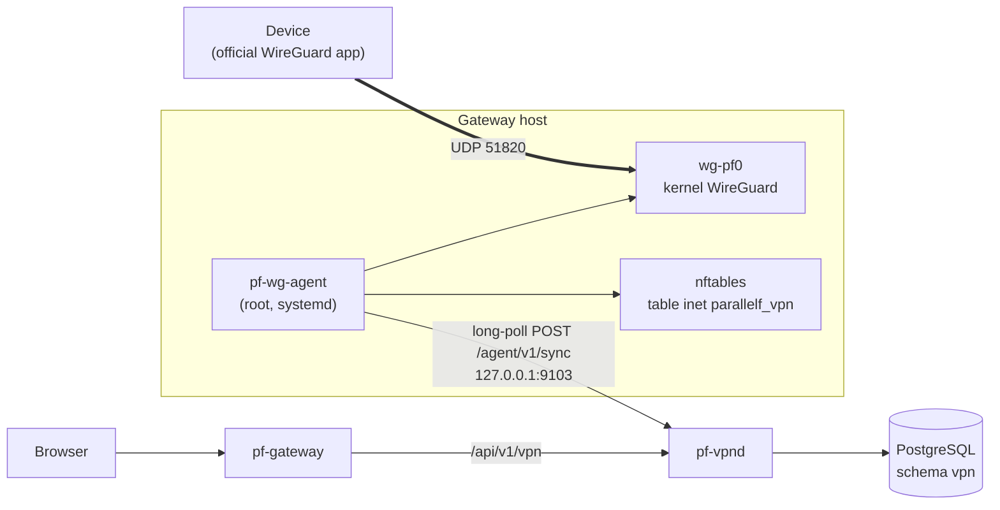

# ParallelF VPN

ParallelF VPN gives your own devices private access to the platform over **WireGuard**, with a control plane that decides who may send what, and when. It uses the kernel's WireGuard implementation and the standard tools only; there is no custom cryptography.

The model in one paragraph: a user **enrols** a device by sending only its public key (the key pair is generated on the device, or in the browser). Enrolled is not allowed: the gateway drops everything from a device until its owner **activates** it, which requires a recent sign-in. An activation lasts a chosen time (1 to 12 hours) and its expiry is a **kernel timeout** on the gateway, so access ends on time even if the control plane, its database and the network to it are all down. While active, **policies** decide which destinations, protocols and ports a device's groups may reach; everything else is denied. **Revoking** a device removes the peer and its connections within about a second.

The design is in [architecture/subsystems/vpn.md](architecture/subsystems/vpn.md); where this phase differs, see [ADR-0014](adr/0014-vpn-phase-3-long-poll-and-cli-firewall.md).

## What runs



| Component | Where | What it does |
|---|---|---|
| `pf-vpnd` | Compose service `vpn` | Devices, activations, policies, gateways, audit, outbox events; computes each gateway's complete desired state; holds agents' sync requests open until that state changes |
| `pf-wg-agent` | The gateway host, as root (`make wg-agent-install`) | Keeps its private key on the host, registers with its public key, and converges the kernel interface, its peers and the nftables table to the desired state |

The gateway's tunnel address is `10.255.0.1` in `10.255.0.0/22`; devices get addresses from `10.255.0.10`.

## Quick start: one gateway, one device

```sh
make up                  # the stack, including pf-vpnd
make vpn-gateway-setup   # once: wireguard-tools, nftables, conntrack (sudo)
make wg-agent-install    # the gateway agent under systemd (sudo)
make verify-vpn          # enrol, connect, deny, activate, policy, deactivate, revoke
```

`make verify-vpn` plays the device in a network namespace with its own key pair and checks each step. On a GitHub runner it prints (numbers vary):

```
Gateway
  PASS  gateway runner is READY at 10.1.0.12:51820 (10.255.0.1/22)
Enrolment
  PASS  enrolled verify-04217 at 10.255.0.10 with a pre-shared key (only the public key was sent)
  PASS  the gateway configured the peer; device ENROLLED
  PASS  WireGuard handshake completed
  PASS  not active yet: traffic is dropped (enrolled is not allowed)
Activation
  PASS  activated: the platform answers ping after 0.3s
  ...
Revocation
  PASS  revoked: peer removed from the gateway 0.41s after the request (target < 10s)
```

Then open <http://localhost:3000/vpn>, enrol a device (the dashboard generates the key pair with WebCrypto and gives you a `.conf` to import into the WireGuard app), and activate it.

## Using it

| Resource | Endpoints (under `/api/v1/vpn`) |
|---|---|
| Gateways | `GET /gateways`, `DELETE /gateways/{id}?confirm=<name>` (only when NOT_READY) |
| Devices | `GET /devices` (yours; `?scope=all` for managers, `?include=ended`), `POST /devices`, `GET /devices/{id}`, `GET …/config`, `GET …/metrics`, `POST …/activate`, `POST …/deactivate`, `PUT …/groups`, `DELETE …?confirm=<name>` (revoke) |
| Policies | `GET /policies`, `POST /policies`, `DELETE /policies/{id}?confirm=<name>` |
| Audit | `GET /audit`, `GET /audit/verify` |

Enrolling from a shell, with keys generated locally:

```sh
TOKEN=$(make -s token AS=owner)
priv=$(wg genkey); pub=$(echo "$priv" | wg pubkey)
curl -s -H "Authorization: Bearer $TOKEN" -H 'Content-Type: application/json' \
  -d "{\"name\":\"laptop\",\"public_key\":\"$pub\",\"preshared_key\":true}" \
  http://localhost:8000/api/v1/vpn/devices | jq .config
```

The response's `config` has everything except the private key: address, gateway public key, endpoint, the routes to send through the tunnel, keepalive and, this once, the pre-shared key.

### Permissions

| Permission | Roles | Allows |
|---|---|---|
| `vpn.resources.read` | every role | gateways, policies, one's own devices |
| `vpn.devices.use` | owner, admin, operator, analyst, lab-researcher | enrol, activate, deactivate and revoke one's own devices |
| `vpn.devices.manage` | owner, admin | every user's devices: list, regroup, revoke |
| `vpn.policies.manage` | owner, admin | create and delete policies |
| `vpn.gateways.manage` | owner, admin | remove a gateway that stopped reporting |
| `vpn.audit.read` | owner, admin, analyst | read and verify the VPN audit trail |

Only a device's owner can activate it, even an admin cannot activate someone else's device: access is personal and follows the owner's own sign-in.

## Concepts

### Devices

| State | Meaning |
|---|---|
| `PENDING` | Enrolled; the gateway has not confirmed the peer yet |
| `ENROLLED` | The gateway has the peer (it may handshake but sends nothing until active) |
| `REVOKED` | Ended by its owner or a manager; key and address are free again |
| `EXPIRED` | Ended at its expiry (`PF_VPN_DEVICE_TTL`, 90 days) |

`active` and `connection` are derived: active while `active_until` is in the future; `online` with a handshake in the last 180 s, `idle` within 15 minutes, otherwise `offline`.

A device starts in groups named after its owner's platform roles (an owner's devices are in group `owner`); managers can change them.

### Activation and step-up sign-in

Activating needs a sign-in within `PF_VPN_MAX_AUTH_AGE` (15 minutes); otherwise the API answers 403 `reauthentication-required` and the dashboard offers "Sign in again", which asks the identity provider for the password again (`max_age=0`). `PF_VPN_REQUIRE_MFA=true` additionally demands a second factor in the token's `amr` claim; the development realm has no second factor configured, so it is off by default.

Tokens from the password grant carry no `auth_time` in Keycloak, so they can never prove a recent sign-in. The local stack therefore exempts the development CLI client (`PF_VPN_STEP_UP_EXEMPT_CLIENTS=parallelf-dev-cli`), which scripts and tests use and which exists only in the development realm; the dashboard's tokens are always checked. Leave the setting empty anywhere else.

### Policies

A policy says: devices in these **groups** may (allow) or may not (deny) reach these **destinations** over this **protocol** and these **ports**. Destinations are `platform` (the gateway's tunnel address, where the dashboard and API can be published) or IPv4 CIDRs outside the tunnel. Lower priorities run first; the first match decides; anything unmatched is dropped. Two policies ship with the platform:

| Priority | Name | Allows |
|---|---|---|
| 100 | `admins-to-platform` | owner, admin → platform TCP 3000 and 8000 |
| 110 | `ping-platform` | owner, admin, operator, analyst → platform ICMP |

### How the gateway enforces it

The agent renders one nftables table from structured values (never from text input) and applies it in one transaction:

```text
table inet parallelf_vpn {
  set active_peers { type ipv4_addr; flags timeout; }        # elements carry their expiry
  set s0 { type ipv4_addr; elements = { 10.255.0.10 }; }     # policy 0's devices
  set d0 { type ipv4_addr; flags interval; auto-merge; elements = { 10.255.0.1/32 }; }
  chain input {
    type filter hook input priority 0; policy accept;
    iifname "wg-pf0" ip saddr != @active_peers counter drop  # before everything, established included
    iifname "wg-pf0" ct state established,related accept
    iifname "wg-pf0" ip saddr @s0 ip daddr @d0 tcp dport { 3000, 8000 } counter accept comment "policy 0"
    iifname "wg-pf0" counter drop comment "default deny"
  }
  chain forward { ... same rules, plus return traffic towards the tunnel ... }
}
```

Activations change only `active_peers`, element by element, so connections are not disturbed; a policy change replaces the table atomically. Because the activation check comes before accepting established traffic, deactivating a device cuts its open connections too. A revoked peer is removed with `wg set … remove` and its connection-tracking entries are flushed.

### Revocation in about a second

The agent's sync is a long-poll: pf-vpnd holds it open until the desired-state revision changes (at most 25 s). Every change that matters to a gateway bumps the revision in the same transaction and wakes the waiting request, so the gateway applies it immediately. The integration test measures revocation end to end and fails above 10 s.

## Failure behaviour

| What happens | Effect |
|---|---|
| pf-vpnd, PostgreSQL or the agent's link to them is down | Nothing changes on the gateway: enrolled devices keep their tunnels, and every activation still ends at its expiry because the kernel removes the set element. Tested with pf-vpnd stopped. |
| The agent stops | Same; systemd restarts it, it re-reads the desired state and re-applies activations with their remaining time |
| The gateway stops reporting | After `PF_VPN_GATEWAY_TIMEOUT` (45 s) it is `NOT_READY` |
| A rule cannot be applied | The agent reports the error (shown on the gateway in the dashboard) and keeps the previous table; peers are not changed after a failed firewall update |

## Security notes

- The server stores public keys only. Pre-shared keys are generated server-side, stored encrypted with AES-256-GCM under `PF_VPN_PSK_KEY` (bound to the device ID), shown once, and passed to `wg` on stdin, never as arguments.
- The gateway's private key is generated on the gateway (`wg genkey`), stored 0600 in `/var/lib/parallelf/vpn`, and never leaves it. The gateway credential is 32 random bytes; pf-vpnd keeps its SHA-256.
- The agent touches only its interface and its nftables table. Its systemd unit keeps only `CAP_NET_ADMIN` and `CAP_NET_RAW`.
- Another user's device is answered with 404, not 403, so its existence is not disclosed.

## Configuration

| Variable (pf-vpnd) | Default | Meaning |
|---|---|---|
| `PF_VPN_JOIN_TOKEN` | generated | Secret gateway agents present once to register |
| `PF_VPN_PSK_KEY` | generated (32 bytes, base64) | Key-encryption key for pre-shared keys; unset disables them |
| `PF_VPN_TUNNEL_CIDR` | `10.255.0.0/22` | Tunnel network (gateway at the first address) |
| `PF_VPN_ACTIVATION_TTL` / `_MIN` / `_MAX` | 8h / 30s / 12h | Activation length |
| `PF_VPN_MAX_AUTH_AGE` | 15m | Sign-in freshness needed to activate (0 disables) |
| `PF_VPN_REQUIRE_MFA` | false | Also require a second factor (`amr`) |
| `PF_VPN_STEP_UP_EXEMPT_CLIENTS` | empty (local stack: `parallelf-dev-cli`) | OAuth clients whose tokens skip the step-up check; development only |
| `PF_VPN_DEVICE_TTL` | 2160h (90 days) | Device lifetime |
| `PF_VPN_GATEWAY_TIMEOUT` | 45s | Silence after which a gateway is NOT_READY |

| Variable (pf-wg-agent) | Default | Meaning |
|---|---|---|
| `PF_WGA_VPN_URL` | required | e.g. `http://localhost:9103` |
| `PF_WGA_JOIN_TOKEN` | | Needed only for the first registration |
| `PF_WGA_INTERFACE` | `wg-pf0` | Interface name |
| `PF_WGA_LISTEN_PORT` | 51820 | UDP port |
| `PF_WGA_ENDPOINT` | first non-loopback IPv4 + port | What devices dial; set it to your public name behind NAT |

## Tests

| Suite | Command | Covers |
|---|---|---|
| Go unit | `make test-go` | ruleset rendering (including injection attempts), incremental set updates, `wg` dump parsing, peer sync order and stdin-only keys, apply order, policy validation and compilation, tunnel addressing, PSK encryption and binding, API permissions, ownership, step-up, confirmation, long-poll |
| Store | `make test-go-db` | lifecycle and revision bumps, address and key reuse, desired state with PSKs and policies, enrolment confirmation, expiry, gateway liveness, audit chain |
| Walk-through | `make verify-vpn` | the quick start above |
| Integration | `make test-integration` | contract and permissions; with a gateway: a real device through lifecycle, policy changes, statistics, revocation latency, invisibility of others' devices, outbox events; with `PF_CLOUD_DISRUPTIVE_TESTS=1`, expiry with pf-vpnd stopped |
| End to end | `make test-e2e` | enrolment with a browser-generated key, configuration download, activation and revocation in the dashboard; the viewer's read-only view |

## Acceptance criteria

| # | Criterion | Verified by |
|---|---|---|
| 1 | A device is enrolled with its public key only; the private key never reaches the server | `verify-vpn`, `test_device_lifecycle_on_a_real_gateway`, e2e |
| 2 | An enrolled but inactive device cannot send anything through the gateway | `verify-vpn`, integration |
| 3 | Activation needs the owner and a recent sign-in, and expires on time even with the control plane down | API tests, `test_activation_expires_even_without_the_control_plane` |
| 4 | Policies are default-deny, ordered, and take effect without disturbing activations | integration (allow 9999, delete, deny again) |
| 5 | Revocation removes the peer and its connections in under 10 s (measured) | `verify-vpn`, integration |
| 6 | Users see only their own devices; managers see all | API tests, `test_another_users_device_is_invisible` |
| 7 | Every change is audited in a verifiable chain and emitted as a versioned event (including address → owner for NetGuard) | integration, store tests |
| 8 | All of it runs in CI on a real kernel | `.github/workflows/ci.yml` |

## Not in this phase

- One gateway. The model allows several, but devices are not yet assigned to gateways and they would share one tunnel network.
- Policies reach the gateway itself and routed CIDRs; Cloud `nat` networks are protected by libvirt's own firewall, which does not yet admit tunnel traffic. A route into Cloud networks arrives with the Cloud network provider work.
- No internal DNS (`*.pf.internal`) and no QR codes in the dashboard.
- Events are in the outbox, not yet on NATS (as for the other services).
